# CronosDB Architecture

> A distributed, timestamp-triggered event database with built-in scheduling, pub/sub messaging, and WAL-based persistence.

> **Production readiness note:** CronosDB has a development and a production run mode. The `--dev` flag disables the production requirements for local testing. Without `--dev` the server refuses to start unless it has TLS, authentication with a policy file, encryption at rest, mutual TLS between nodes, `--replication-factor>=3`, `--min-insync-replicas>=2`, `--fsync-mode` `batch` or `every_event`, and, in cluster mode, `--cluster-seeds`. It also refuses `--exactly-once-commits`, `--experimental-features` and a `--pprof-addr` that is not a loopback address (`config.ValidateConfig`). See [Security](#security) and [Configuration Reference](#configuration-reference) for details.

Quick navigation:

- Feature-by-feature architecture docs: [docs/architecture/README.md](docs/architecture/README.md)
- Inline-rendered diagrams live in the feature docs (see the [Diagram Index](docs/architecture/README.md#diagram-index))
- Comprehensive developer walkthrough: [docs/DEVELOPER_ARCHITECTURE_GUIDE.md](docs/DEVELOPER_ARCHITECTURE_GUIDE.md)
- **Known limitations (intentionally deferred):** [Known Limitations](#known-limitations)

---

## Table of Contents

- [System Overview](#system-overview)
- [High-Level Architecture](#high-level-architecture)
- [Request Lifecycle](#request-lifecycle)
- [Storage Engine](#storage-engine-wal)
- [Scheduler and Timing Wheel](#scheduler-and-timing-wheel)
- [Deduplication Engine](#deduplication-engine)
- [Delivery Pipeline](#delivery-pipeline)
- [Consumer Groups](#consumer-groups)
- [Change Data Capture](#change-data-capture)
- [Cluster Architecture](#cluster-architecture)
- [Replication Protocol](#replication-protocol)
- [Replay Engine](#replay-engine)
- [Observability](#observability)
- [Data Flow Diagrams](#data-flow-diagrams)
- [Performance Characteristics](#performance-characteristics)
- [Configuration Reference](#configuration-reference)
- [Technology Stack](#technology-stack)
- [Consistency and Guarantees](#consistency-and-guarantees)
- [Security](#security)
- [Operations](#operations)
- [Known Limitations](#known-limitations)

---

## System Overview

CronosDB is a **time-aware event store**. Events are published with a future `schedule_ts` and the system triggers delivery precisely at that timestamp. It combines:

- **Append-only WAL** for durable, ordered storage
- **Hierarchical Timing Wheel** for O(1) timer scheduling
- **Bloom Filter + PebbleDB** for deduplication
- **Raft consensus** for cluster metadata, including which node leads each partition
- **Consistent hashing** to propose where partition replicas live
- **Synchronous partition replication**: a publish is acknowledged once it is on `--min-insync-replicas` replicas
- **gRPC streaming** for pub/sub

Publishing to a partition and delivering its events happen on the partition's leader only. Other nodes answer `Unavailable` for that partition.

### Core Subsystems

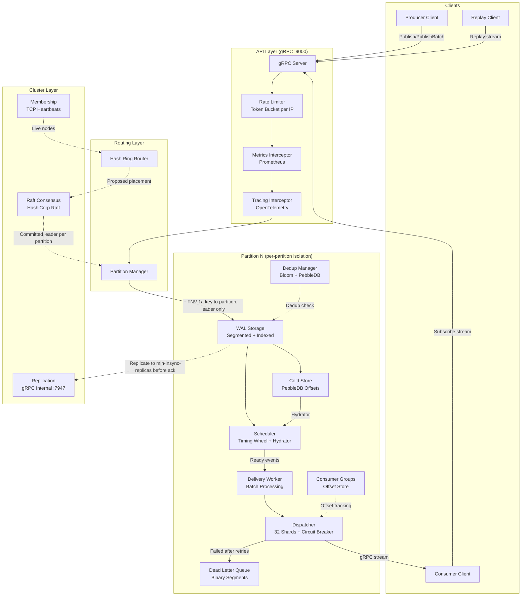

---

## High-Level Architecture

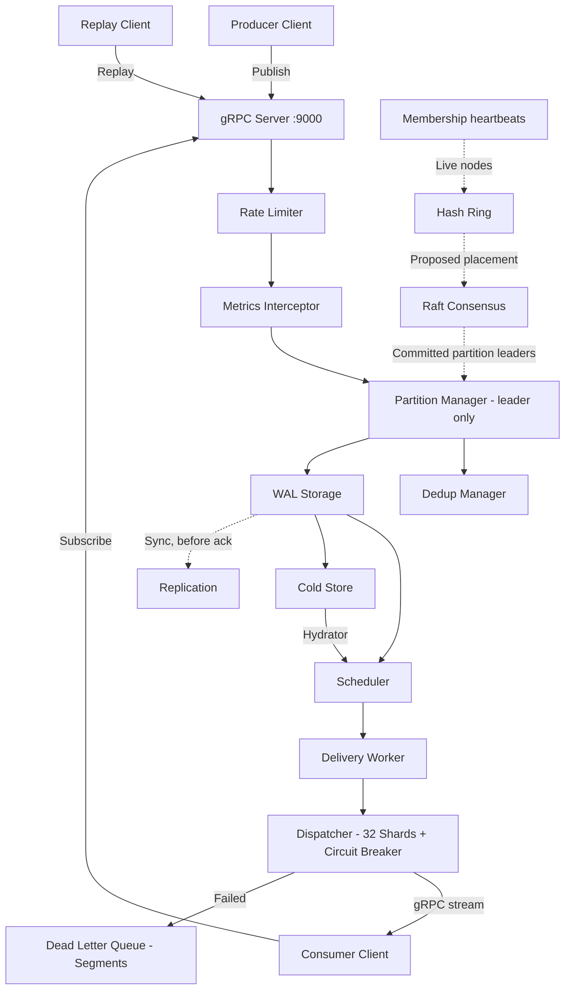

---

### Module Dependency Graph

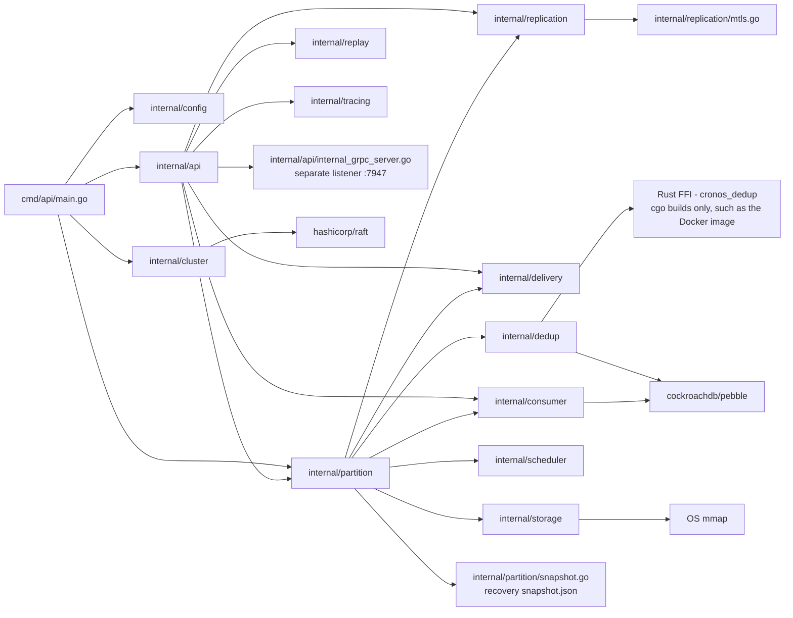

---

## Request Lifecycle

Publishing to a partition and delivering its events happen on the
partition's leader only. Every other node answers `Unavailable` for that
partition (`ensureClusterPartitionWritable` and `ensureClusterPartitionLed` in
`internal/api/handlers.go`).

### Publish - Single Event

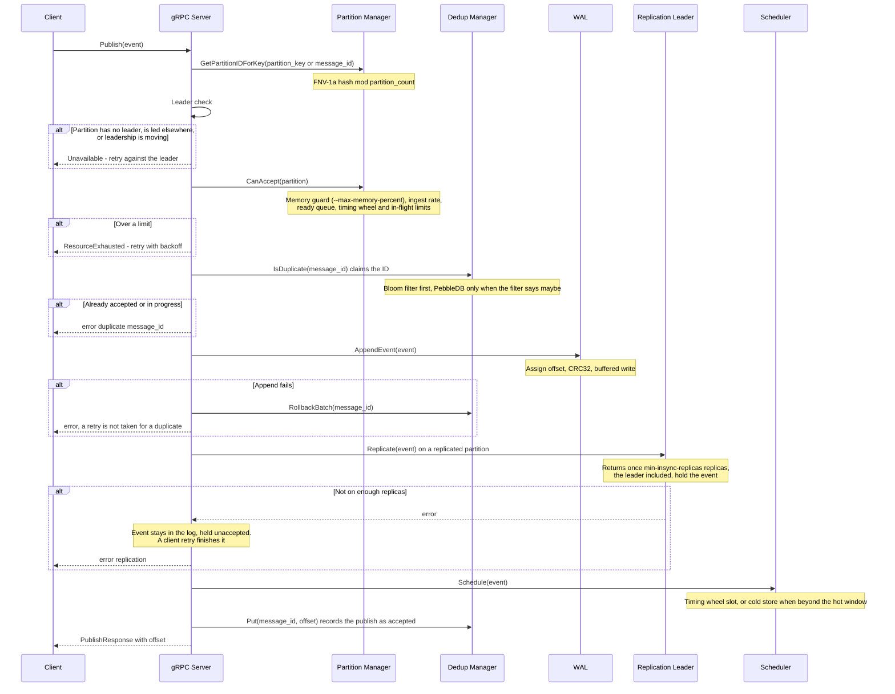

### Publish Batch - High Throughput

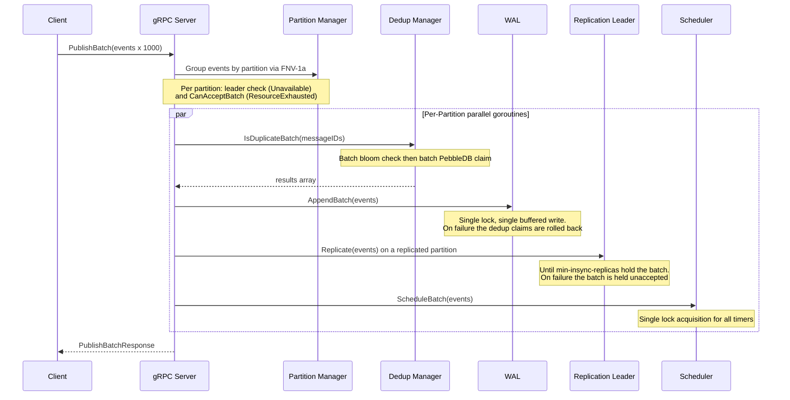

---

### Subscribe and Delivery Flow

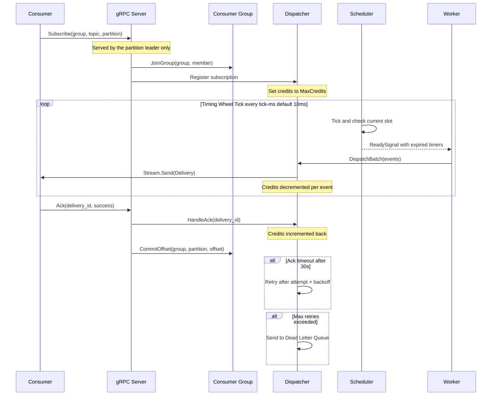

---

## Storage Engine (WAL)

The Write-Ahead Log is the durability backbone. Every event is persisted before acknowledgment.

### Segment File Structure

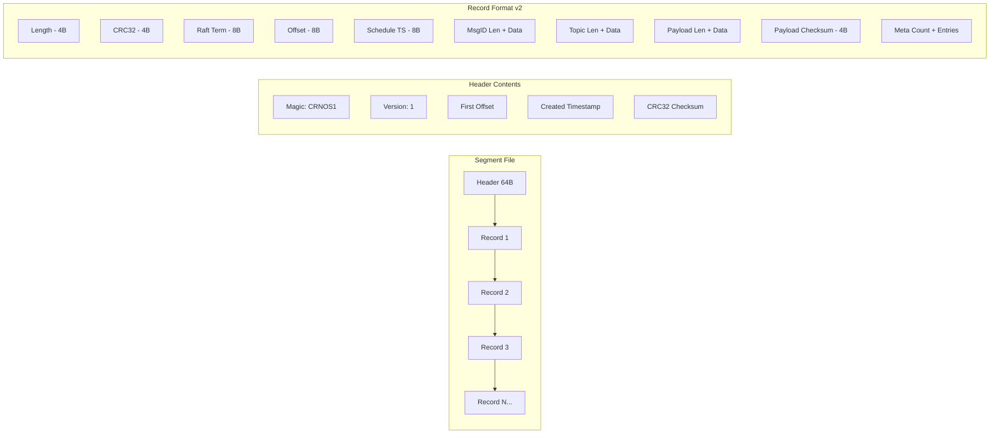

### Record Binary Format

WAL records use **format v2**. Each record carries an 8-byte Raft term and a 4-byte payload checksum (written immediately after the payload, before the metadata entries) in addition to the existing fields. Upgrading from older builds requires a clean `--data-dir`.

| Field | Size | Description |
|-------|------|-------------|
| Length | 4 bytes | Total record size including this field |
| CRC32 | 4 bytes | IEEE CRC32 of all bytes after the Length field |
| Raft Term | 8 bytes | Raft term of the leader that authored the record |
| Offset | 8 bytes | Monotonically increasing event offset |
| Schedule TS | 8 bytes | Unix millisecond timestamp for trigger |
| MsgID Len | 2 bytes | Length of message_id string |
| MsgID | N bytes | Unique message identifier |
| Topic Len | 2 bytes | Length of topic string |
| Topic | N bytes | Topic/channel name |
| Payload Len | 4 bytes | Length of payload |
| Payload | N bytes | Arbitrary event data |
| Payload Checksum | 4 bytes | IEEE CRC32 covering the payload only |
| Meta Count | 2 bytes | Number of metadata key-value pairs |
| Meta Entries | Variable | key_len(2) + key + val_len(2) + val per entry |

**Upgrade note:** WAL v2 is not backward-compatible with older segment files. Remove or move the old `--data-dir` before starting a newer binary.

### WAL Architecture

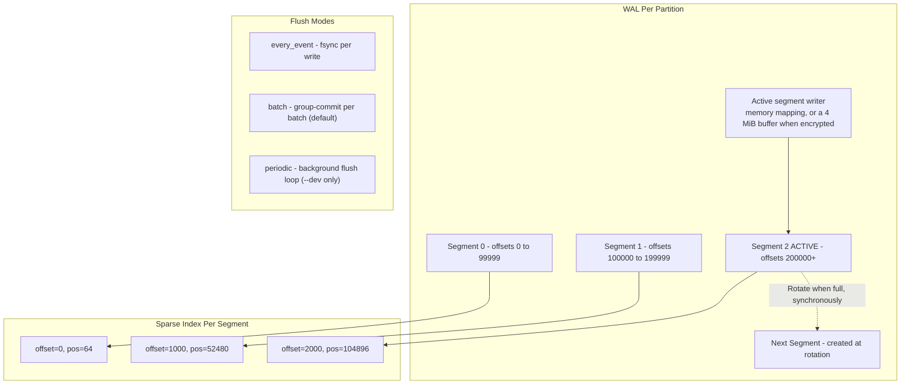

### Key Design Decisions

| Decision | Rationale |
|----------|-----------|
| **Mapped or buffered appends** | A plaintext active segment is appended to through its memory mapping. An encrypted segment, or one whose file cannot be mapped, is written through a 4 MiB `bufio.Writer`, made when the segment is first written to (`internal/storage/segment.go`) |
| **Rotation creates the next segment synchronously** | Under the WAL lock, starting after the last record actually appended (`rotateSegment`); nothing is created ahead of time |
| **fsync `batch` or `every_event` in production** | The leader and every follower sync before they acknowledge, so an acknowledged publish is on disk on `min-insync-replicas` replicas. `periodic` is refused without `--dev` |
| **Sparse index every 1000 events** | Binary search for O(log N) seeks without full index overhead |
| **Memory-mapped reads** | Zero-copy reads on supported platforms |
| **CRC32 per record + trailing checksum + Raft term** | Detects corruption; enables term-aware replication; tail truncation on recovery |
| **Prepared records outside lock** | Serialization happens lock-free; only offset assignment needs mutex |
| **sync.Pool for record buffers** | Reduces GC pressure under high throughput |
| **Atomic file writes via `utils.AtomicWriteFile`** | Temp file + fsync + rename + parent-dir fsync for tx logs, encryption key files, etc. |

### Retention Enforcement

The retention enforcer runs every hour (`--retention-max-age-hours`,
`--retention-max-size-gb`). It picks segments by age and size, and asks the
partition to remove each one through `Partition.PruneWAL`, the same boundary
compaction uses (`internal/partition/retention.go`).

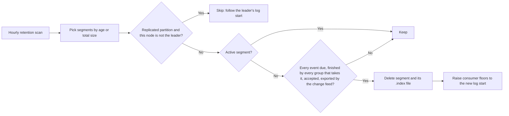

**Rules:**
- Removal goes through `PruneWAL`, which removes a segment only when every
  event in it is due, is finished by every consumer group that takes it, is
  accepted (on a replicated partition, on `min-insync-replicas` replicas) and
  has been exported by the change feed.
- The active segment is never removed.
- On a replicated partition only the leader prunes, and only from the start of
  the log, so the log stays one unbroken range of offsets. Followers skip the
  scan; every append names the leader's log start, and a follower removes what
  lies below it (`FollowLogStart`).
- Unloaded partitions and files outside a partition's `segments/` directory are
  not touched.

### Compaction Flow

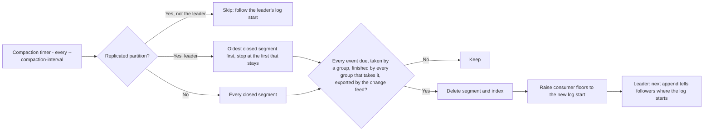

---

## Scheduler and Timing Wheel

The scheduler uses a **hierarchical timing wheel** for O(1) timer management of millions of events.

### Timing Wheel Structure

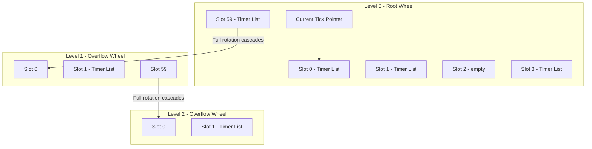

**Wheel Parameters:**
- Level 0 (default): 10ms tick, 600 slots = 6 second window
- Level 1: 6s tick, 600 slots = 3600 second (60 min) window
- Level 2: 3600s tick, 600 slots = 25 day window
- Max levels: 10 (hardcoded; only `--tick-ms` and `--wheel-size` are configurable)

### Timer Lifecycle

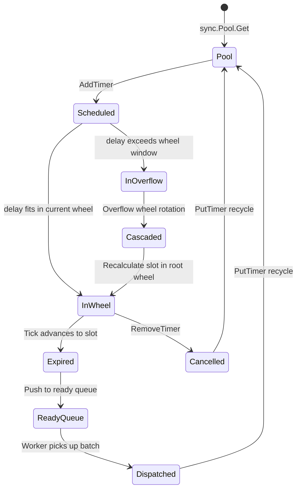

### Absolute Time Tracking

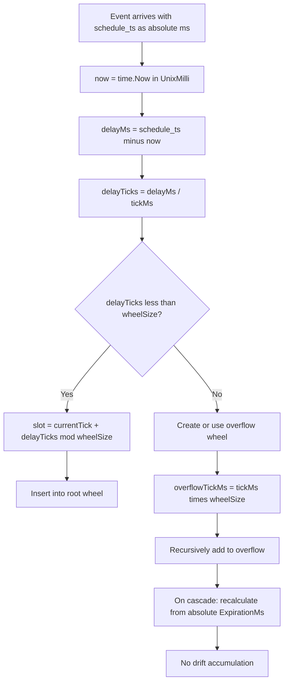

### Cascade Operation

When the root wheel completes a full rotation, timers cascade from the overflow wheel:

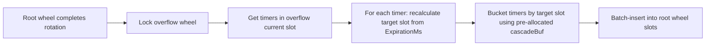

### Scheduler Recovery on Crash

On restart the scheduler:

1. Restores wheel origin from `timer_state.json` when present.
2. **Rebases `currentTick` from wall clock** so absolute fire times stay aligned after downtime (no compounding future skew).
3. Walks the whole log from its first offset (`Wal.GetFirstOffset()`), in
   reads of at most 10,000 events and 16 MiB (`replayWALTimers` in
   `internal/partition/manager.go`).
4. Events with `schedule_ts > now` re-enter the hot timing wheel (or cold store).
5. Events that are **already due** are not queued. They stay in the log, and a
   subscription reads what its group has not finished from the log when it
   starts, at the pace its consumers take it (`redriveRetained` in
   `internal/api/handlers.go`). Nothing is delivered without a subscription,
   and a backlog larger than memory does not have to fit in memory.

`timer_replay_checkpoint.json` is still written after the walk, but nothing
reads it at start (`readTimerCheckpoint` and `replayWALTimersFromOffset` have
no callers).

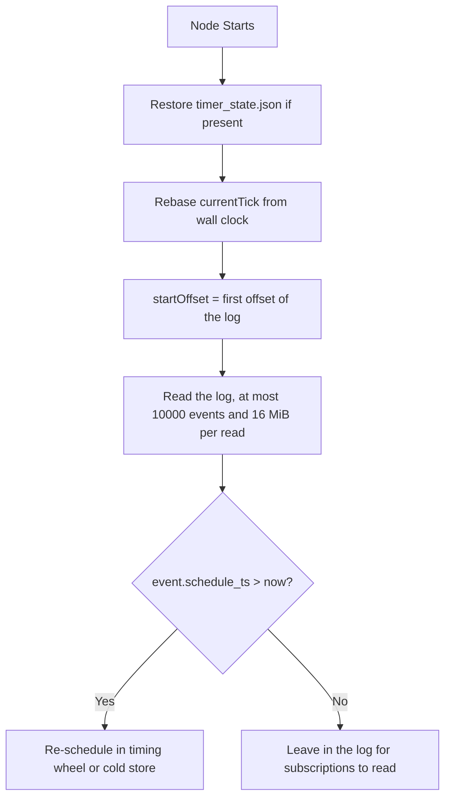

---

### Two-Tier Cold/Hot Scheduler

To keep memory bounded while supporting millions of scheduled events, the scheduler uses a **two-tier architecture**:

- **Hot Tier**: Hierarchical timing wheel (in-memory) for events within the hot window (default 60 minutes).
- **Cold Tier**: PebbleDB-backed `ColdStore` for far-future events (> hot window). Stores **only offsets** (~16 bytes per event) — full event data remains in the WAL.

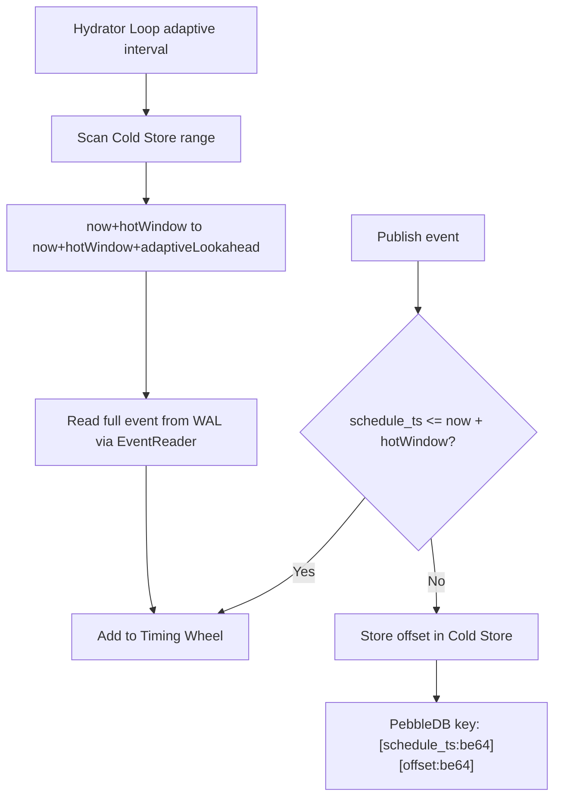

**Key Design Decisions:**

| Decision | Rationale |
|----------|-----------|
| **Offsets only in cold store** | WAL is single source of truth; avoids double-writing event data |
| **Big-endian composite key `[ts][offset]`** | Enables efficient range scans by timestamp |
| **Adaptive hydrator interval (5s–5min)** | Scans more frequently under load, backs off when idle; saves I/O |
| **Adaptive lookahead window** | Lookahead equals current hydrator interval; naturally scans further ahead when running less frequently |
| **EventReader interface decouples scheduler from WAL** | Clean dependency boundary; allows alternative storage backends |
| **HotWindowMinutes = 0 disables cold store** | Full backward compatibility with legacy behavior |

---

## Deduplication Engine

A two-tier deduplication system ensures idempotent publishes with minimal latency.

### Two-Tier Architecture

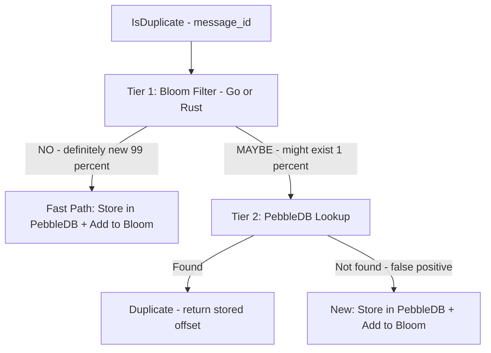

**Tier 1 - Bloom Filter (In-Memory):**
- Two implementations behind one interface (`internal/dedup/bloom_store.go`).
  `NewBloomFilter` uses the Rust filter when the binary is built with cgo and
  the library is linked, and `GoBloomFilter` otherwise.
- Release binaries are built without cgo (`CGO_ENABLED=0`), where the Rust
  filter is a stub that returns nil (`internal/dedup/rust_bloom_nocgo.go`), so
  they use `GoBloomFilter`. The Docker image is built with cgo and links the
  Rust library.
- `GoBloomFilter`: FNV-1a double hashing over `uint64` words set with atomic
  compare-and-swap.
- Rust filter: XxHash64 double hashing, AtomicU64 bit arrays, Rayon parallel
  batch check for 100+ keys.
- About 10 bits per ID at a 1% false positive rate: ~120 MB for the default capacity of 100M IDs, allocated on first use

**Tier 2 - PebbleDB (Persistent):**
- 64MB memtable (vs 4MB default)
- Internal WAL disabled (our WAL provides durability)
- NoSync writes for performance
- 7-day TTL automatic expiration

### Bloom Filter Implementation - Rust FFI (cgo builds only)

This path is used only by builds with cgo, such as the Docker image. No
benchmark of it is kept in the repository, so no per-call latency is stated
here.

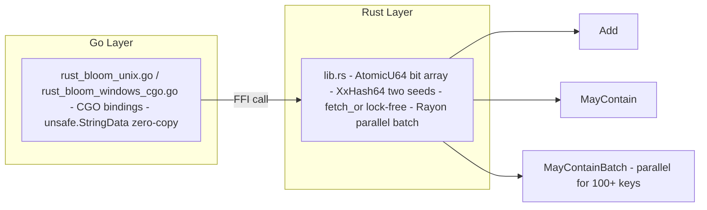

### Batch Dedup Flow

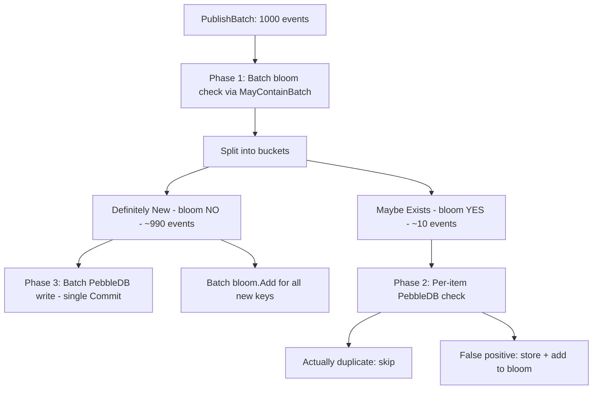

### Bloom Filter Health and Reset

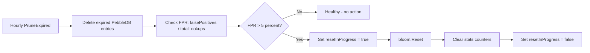

---

## Delivery Pipeline

The delivery pipeline moves events from the scheduler to consumers with backpressure control.

### Pipeline Architecture

```mermaid
graph LR
    TW[Timing Wheel] -->|ReadySignal| RQ[Ready Queue]
    RQ -->|GetReadyEvents| W[Delivery Worker]
    W -->|DispatchBatch| DSP[Dispatcher]

    DSP --> SH0[Shard 0]
    DSP --> SH1[Shard 1]
    DSP --> SHN[Shard 31]

    SH0 --> SUB1[Consumer A]
    SH1 --> SUB2[Consumer B]

    DSP -->|Timeout or Nack| RH[Retry Heap]
    RH -->|Due| RT[Retry with Backoff]
    RT -->|Max retries| DLQ[Dead Letter Queue - Segments]
```

### Credit-Based Flow Control

```mermaid
sequenceDiagram
    participant S as Server Dispatcher
    participant C as Consumer Client

    Note over S,C: Initial Credits = MaxCredits 1000

    S->>C: Delivery event_1 - Credits now 999
    S->>C: Delivery event_2 - Credits now 998
    S->>C: Delivery event_3 - Credits now 997

    C->>S: Ack event_1 success - Credits now 998
    C->>S: Ack event_2 success - Credits now 999

    Note over S: Credits > 0 so continue sending
    S->>C: Delivery event_4 - Credits now 998

    Note over S,C: If Credits = 0 then STOP sending and wait for Acks
```

### Non-Blocking Retry Heap

The `timeoutLoop` no longer blocks on inline `time.Sleep` during retries. Instead, expired deliveries are pushed to a **min-heap ordered by `retryAt`**:

```mermaid
flowchart TD
    A[scanExpiredDeliveries] --> B{Delivery timed out?}
    B -->|Yes| C[Push to RetryHeap with retryAt = now + backoff]
    B -->|No| D[Continue]

    E[processRetries on retry loop] --> F{Peek retryAt <= now?}
    F -->|Yes| G[Pop and redispatch]
    F -->|No| H[No-op]
    G --> E
```

**Benefits:**
- `timeoutLoop` stays responsive even under retry storms
- No goroutine proliferation per retry
- Backoff is deterministic and memory-efficient

### Circuit Breaker

Each subscription has an independent **circuit breaker** with atomic state machine:

```mermaid
stateDiagram-v2
    [*] --> Closed
    Closed --> Open : FailureRate > Threshold && Attempts >= MinAttempts
    Open --> HalfOpen : OpenDuration elapsed
    HalfOpen --> Closed : Trial success
    HalfOpen --> Open : Trial failure
```

- **Closed**: Normal operation; failures counted
- **Open**: Skips dispatch to dead subscriber; fast-fail
- **HalfOpen**: Allows one trial after cooldown; re-closes on success

**Configuration:**
- `CircuitBreakerFailureThreshold` (default 0.5): failure rate to trip
- `CircuitBreakerMinAttempts` (default 10): minimum attempts before evaluation
- `CircuitBreakerOpenDurationMs` (default 30000): cooldown before half-open

### Delivery Retry and DLQ Flow

```mermaid
flowchart TD
    A[Event dispatched to consumer] --> CB{Circuit Breaker Open?}
    CB -->|Yes| Z[Skip dispatch]
    CB -->|No| B{Ack received within 30s?}
    B -->|Yes success| C[Commit offset, release credits, CB.RecordSuccess]
    B -->|Yes failure| D{Attempt < MaxRetries?}
    B -->|Timeout| D

    D -->|Yes| E[Push to RetryHeap: retryAt = now + backoff]
    E --> F[processRetries pops due entry and redispatches]
    F --> B

    D -->|No| G[Send to Dead Letter Queue]
    G --> H[DLQ Segment: binary record + CRC32]
    H --> I[Available for manual replay or inspection]
```

### Dispatcher Sharding

The dispatcher uses **32 shards** to reduce lock contention under high concurrency:

```mermaid
graph TB
    subgraph Dispatcher
        HASH[hash of subscription_id mod 32]
        subgraph Shard 0
            S0S[Subscriptions map]
            S0D[Active Deliveries map]
        end
        subgraph Shard 1
            S1S[Subscriptions map]
            S1D[Active Deliveries map]
        end
        subgraph Shard 31
            SNS[Subscriptions map]
            SND[Active Deliveries map]
        end
    end

    subgraph Global Lock-Free
        PI[partitionSubs map - partition to subscribers]
        IFC[inFlightCount - atomic Int64 cap 100K]
    end

    HASH --> S0S
    HASH --> S1S
    HASH --> SNS
```

---

### DLQ Segment Storage

The Dead Letter Queue uses **append-only binary segments** instead of JSON files:

| Feature | Implementation |
|---------|---------------|
| **Header** | 64-byte header with `"CRNDLQ1"` magic |
| **Records** | Binary format identical to WAL (length + CRC32 + payload) |
| **Writes** | Each entry is written to the file and synced when it is recorded; there is no write buffer |
| **Rotation** | 64MB per segment file |
| **Recovery** | On startup, scan `dlq/` directory and replay all `.dlq` segments |

**Benefits over JSON:**
- Smaller on disk: no base64 or JSON overhead (not measured here)
- Faster append (no marshal/unmarshal)
- CRC32 integrity per record
- Easy to segment and archive

---

## Consumer Groups

Kafka-style consumer groups with persistent offset tracking, per-event
completion records and group metadata. Delivery is at least once. The leader
of a partition sends its groups' progress to its followers
(`ReplicationService.SyncConsumerProgress`), so a follower that takes over
does not deliver finished work again, apart from what finished since the last
maintenance tick.

### Consumer Group Model

```mermaid
graph TB
    subgraph Consumer Group: order-processors
        M1[Member A - Partition 0 and 1]
        M2[Member B - Partition 2 and 3]
        M3[Member C - Partition 4 and 5]
    end

    subgraph Offset Store via PebbleDB
        O1[order-processors:P0 = offset 45230]
        O2[order-processors:P1 = offset 12891]
        O3[order-processors:P2 = offset 78432]
        O4[order-processors:meta = group metadata + assignments]
        O5[order-processors:txn:ID = commit ID, not written by the Ack path]
    end

    subgraph Offset Commit Pipeline
        PEN[Pending Map - in-memory buffer]
        FL[Flush Loop - every 200ms]
        DB[PebbleDB Batch Write]
    end

    M1 -->|CommitOffset| PEN
    M2 -->|CommitOffset| PEN
    M3 -->|CommitOffset| PEN
    PEN -->|dirty flag| FL
    FL -->|batch.Commit NoSync| DB
```

**Persisted state in `OffsetStore`:**
- **Offsets:** per-group, per-partition committed offsets.
- **Group metadata and assignments:** rebalanced partition assignments and member metadata survive restarts.
- **Commit IDs:** `OffsetStore.CommitOffsetExactlyOnce` can record a commit ID
  with an offset, but the Ack path does not call it, with or without
  `--exactly-once-commits`. Delivery is at least once. Production mode refuses
  that flag; it needs `--dev`.

### Rebalancing

```mermaid
sequenceDiagram
    participant M1 as Member A
    participant M2 as Member B - new
    participant GM as Group Manager

    M2->>GM: JoinGroup processors member-B
    GM->>GM: Add member to group
    GM->>GM: rebalanceGroup
    Note over GM: Round-robin partitions across active members
    GM-->>M1: Assigned Partition 0, 2, 4
    GM-->>M2: Assigned Partition 1, 3, 5
    Note over M1,M2: Each member subscribes to assigned partitions
```

---

## Change Data Capture

CDC hands every accepted event to external sinks. It reads a per-partition
**change feed** from the log; nothing runs on the append path.

```mermaid
graph LR
    WAL[Partition log] -->|behind the accepted watermark| Feed[Change feed<br/>one per partition, leader only]
    Feed -->|batches in log order| CDC[cdc.Manager.Deliver]
    CDC --> S1[Kafka sink]
    CDC --> S2[Webhook sink]
    Feed -->|same events| XR[Cross-region replicator<br/>only with --dev --experimental-features]
    Feed -.->|position, at most once a second| Pos[changefeed.json<br/>+ sent to followers]
```

**Behavior:**
- An event is handed over only once its publish is accepted: not while the
  publish is in flight, not while it is held after failing past the append,
  and, on a replicated partition, not before it is on `min-insync-replicas`
  replicas.
- Events leave in log order, from the partition's leader only.
- A sink that fails is offered the same events again (100 ms to 5 s apart).
  Nothing is dropped and nothing queues in memory; the feed lags instead, and
  publishing never waits for it.
- The feed's position survives restarts and is handed to followers, so a new
  leader continues it. Delivery to sinks is at least once.
- Cross-region replication (`CRONOS_REGIONS`) is experimental. The server
  refuses to start with it unless it runs with `--dev --experimental-features`.

Details and limits: [docs/architecture/features/cdc.md](docs/architecture/features/cdc.md).

---

## Cluster Architecture

### Multi-Node Topology

```mermaid
graph TB
    subgraph Node 1
        N1G[gRPC :9000]
        N1H[HTTP :8080]
        N1S[Gossip :7946]
        N1R[Raft :7948]
        N1P[Leads partitions 0 3 6<br/>Follows 1 2 4 5]
    end

    subgraph Node 2
        N2G[gRPC :9001]
        N2H[HTTP :8081]
        N2S[Gossip :7956]
        N2R[Raft :7958]
        N2P[Leads partitions 1 4 7<br/>Follows 0 2 3 5]
    end

    subgraph Node 3
        N3G[gRPC :9002]
        N3H[HTTP :8082]
        N3S[Gossip :7966]
        N3R[Raft :7968]
        N3P[Leads partitions 2 5 8<br/>Follows 0 1 3 4]
    end

    N1S <-->|Heartbeats 1s| N2S
    N1S <-->|Heartbeats 1s| N3S
    N2S <-->|Heartbeats 1s| N3S

    N1R <-->|Raft consensus| N2R
    N1R <-->|Raft consensus| N3R
```

Leadership is per partition: every node leads some partitions and follows
others. The Raft leader of the metadata cluster is a separate role; it commits
partition assignments but does not serve a partition's traffic unless it also
leads that partition. The partition numbers above are an example.

### Membership

Every node sends a heartbeat to every other node it knows over TCP
(`internal/cluster/membership.go`). A node that is not heard from is suspected
and then counted as dead; it keeps being sent heartbeats, less often, and is
taken back as soon as it answers or announces itself. Membership decides who
is alive. It does not decide who leads: that is committed through Raft.

A dead node stays a member, and a Raft voter, until an operator removes it
with `cronos-admin cluster remove-node <node-id>`. Remove a node only when it
will not come back and is not running.

**Traffic between nodes.** Nodes talk to each other on three ports:
replication (gRPC), membership and Raft. With `--replication-tls-enabled` all
three speak mutual TLS with one set of certificates
(`internal/cluster/transport.go`, `internal/replication/mtls.go`). A caller
must present a certificate signed by the CA in `--replication-tls-ca-file`
before anything it sends is read, and a node checks that the certificate of
the node it calls is valid for the address it called. Production mode
requires this. Without it the membership and Raft ports are plain TCP, and
whoever can reach them can join the cluster as a node and vote.

`internal/cluster/memberlist_adapter.go` implements the same interface on
HashiCorp Memberlist (SWIM over UDP). The server does not use it, and refuses
to start with `--use-memberlist`.

### Consistent Hashing Ring

```mermaid
graph TB
    subgraph Hash Ring - SHA-256 with 2048 vnodes per node
        RING[Ring space: 0 to 2 pow 64]
        VN1[Node1 - 2048 virtual positions]
        VN2[Node2 - 2048 virtual positions]
        VN3[Node3 - 2048 virtual positions]
    end

    subgraph Proposed placement - committed through Raft
        PA[partition-0 maps to Node1]
        PB[partition-1 maps to Node3]
        PC[partition-2 maps to Node2]
        PD[partition-7 maps to Node1]
    end

    subgraph Topic Routing
        TR[topic orders via FNV-1a maps to partition 5]
        TR2[topic payments via FNV-1a maps to partition 11]
    end

    RING --> PA
    RING --> PB
    RING --> PC
```

The ring only proposes where replicas live and which replica would ideally
lead. Leadership comes from the assignment committed through Raft
(`internal/cluster/leadership.go`). `syncClusterState`, on the Raft leader,
commits the ring's replica placement, and moves leadership in one of two ways:
a fenced election when the committed leader is dead, or a staged handoff when
the ring prefers another live replica.

### Node Join Flow

```mermaid
sequenceDiagram
    participant N4 as New Node node4
    participant N1 as Seed node1
    participant GOSSIP as Gossip Layer
    participant RAFT as Raft Leader
    participant ROUTER as Router
    participant PL as Partition Leader

    N4->>GOSSIP: TCP connect to seed node1:7946
    N4->>GOSSIP: Send JoinRequest with node_id and addresses
    GOSSIP->>N1: handleJoinRequest
    N1->>GOSSIP: broadcastNodeJoined node4
    GOSSIP-->>N4: Response with success and existing_nodes
    GOSSIP->>RAFT: OnJoin node4
    RAFT->>RAFT: AddVoter node4 at raft_addr

    Note over ROUTER: Hash ring updated
    ROUTER->>ROUTER: AddNode node4 then Rebalance
    ROUTER->>RAFT: Proposed placement
    RAFT->>RAFT: syncClusterState commits replica placement

    par State Transfer
        N4->>PL: SyncPartitionFromLeader partition=3
        Note over N4,PL: ReplicationService.Snapshot over internal gRPC<br/>per-file IEEE CRC32 + atomic dir swap
        N4->>N4: WAL.InstallCheckpoint
        N4->>N4: replayWALTimers
    end

    Note over RAFT,PL: If the ring prefers node4 as leader: staged handoff.<br/>The leader stops accepting publishes, and node4 takes<br/>over once its log equals the leader's
```

### Failure Detection and Recovery

```mermaid
stateDiagram-v2
    [*] --> Alive : Node joins
    Alive --> Alive : Heartbeat received
    Alive --> Suspect : No heartbeat for 5 heartbeat intervals (5s)
    Suspect --> Alive : Heartbeat received
    Suspect --> Dead : No heartbeat for 10 heartbeat intervals (10s)
    Dead --> Alive : Answers a probe or announces itself
    Dead --> [*] : cronos-admin cluster remove-node
```

The timeouts are multiples of `--heartbeat-interval` (default 1s). A dead node
is still probed every fifth heartbeat round. It is removed from Raft and from
every node's member list only by `cronos-admin cluster remove-node`.

**Raft leader actions when a partition's leader is dead** (`checkPartitionHealth`
and `electNewLeader` in `internal/cluster/leadership.go`):

```mermaid
flowchart LR
    A[checkPartitionHealth: committed leader not alive] --> B[Commit: partition has no leader, epoch + 1]
    B --> C[fencedPositions: each reachable replica stops accepting older epochs and reports its log end]
    C --> D{Enough replicas answered to rule out losing acknowledged writes?}
    D -->|No| E[Wait for the next round]
    D -->|Yes| F[Commit the most complete reachable replica as leader, higher epoch]
    F --> G[Nodes follow the committed assignment: promote or step down]
```

### Clock Skew Detection

Cross-node heartbeats include timestamps for clock skew monitoring:

```mermaid
flowchart TD
    A[Local heartbeat tick] --> B[Send heartbeat with local timestamp]
    B --> C[Remote node receives]
    C --> D[Compute skew as remote_ts minus local_ts]
    D --> E{Absolute skew over 5 seconds}
    E -->|Yes| F[Log a warning]
    E -->|No| G[Nothing]
```

- Compares the remote node's timestamp against local time on every heartbeat
  (`internal/cluster/membership.go`).
- Logs a warning if the absolute skew exceeds 5 seconds. The threshold is
  fixed in code: the `--clock-skew-threshold-ms` flag is parsed but nothing
  reads it.
- The gauge `cronos_clock_skew_ms` (no labels) is registered, but nothing sets
  it, so it stays at 0. Use the log warning, or monitor NTP directly.

---

## Replication Protocol

CronosDB uses a **hybrid replication model**: HashiCorp Raft for cluster
metadata (partition ownership, leader election, peer set), and a
dedicated internal gRPC channel for partition data. Public client
traffic never reaches the replication listener.

### Replication channel layout

```mermaid
graph LR
    subgraph "Public API listener"
      PUB[gRPC :9000<br/>EventService, PartitionService,<br/>ConsumerGroupService, AdminService<br/>TransactionService: experimental only]
    end
    subgraph "Internal cluster listener"
      INT[InternalGRPCServer :7947<br/>ReplicationService, RaftService<br/>CrossRegionService: experimental only]
    end
    subgraph "HTTP operator plane"
      HTTP[HTTP :8080<br/>health metrics /ui /api/admin]
    end
    subgraph "Public client traffic"
      C[Client SDK] --> PUB
      O[Ops UI / CLI] --> HTTP
      O --> PUB
    end
    subgraph "Intra-cluster traffic"
      L[Leader partition] -->|Append / SyncConsumerProgress| INT
      F[Follower partition] -->|Snapshot, mTLS required in production| INT
      E[Election and topology] -->|Position / LeaderReport| INT
      R[Remote region] -->|CrossRegionService, experimental| INT
    end
```

The internal listener is `InternalGRPCServer`
(`internal/api/internal_grpc_server.go`, default `:7947`, configurable
via `--cluster-grpc-addr`). It registers **ReplicationService**, and
**RaftService** when cluster mode is on. **CrossRegionService** is registered
there only with `--experimental-features`, which production mode refuses
without `--dev` (`cmd/api/main.go`). The same flag gates **TransactionService**
on the public listener (`internal/api/grpc_server.go`). No public client
EventService surface is exposed on the internal socket; cross-region traffic
is peer-plane only so arbitrary event inject/fetch stays off `:9000`.

### `ReplicationService` RPCs

```mermaid
graph TB
    subgraph ReplicationService
      A[Append - unary]
      SN[Snapshot - server streaming]
      PO[Position - unary]
      LR[LeaderReport - unary]
      SP[SyncConsumerProgress - unary]
      S[Sync - server streaming]
    end
    subgraph Use
      A -->|every batch and catch-up| U1[per-batch CRC32, term-fenced, log start]
      SN -->|bulk install| U3[per-file CRC32, atomic dir swap]
      PO -->|elections and handoffs| U4[fenced log position]
      LR -->|topology| U5[ISR and offsets per led partition]
      SP -->|maintenance tick| U6[consumer group progress and change feed position]
      S -->|no caller| U2[served, never called]
    end
```

The six RPCs are defined in `proto/events.proto` and served by
`internal/api/replication_server.go`.

| RPC | Direction | Body | Used by |
|-----|-----------|------|---------|
| `Append` | leader → follower (unary) | `ReplicationAppendRequest{PartitionId, Events, ExpectedNextOffset, Term, PrevLogTerm, Checksum, LeaderId, HasPrevLog, PrevLogOffset, LogStartOffset, LeaderLogEnd}` → `ReplicationAppendResponse{Success, Error, LastOffset, NextOffset, Term, LogMismatch, ConflictTerm, ConflictFirstOffset}` | `Leader.appendToFollower`, from `sendToFollower` on every replicated batch and from `catchUpFollower`; also with no events, to announce the log start (`announceLogStart`) |
| `Snapshot` | follower → leader (server streaming) | `ReplicationSnapshotRequest{PartitionId, StartOffset, MaxBytes}` → stream of `ReplicationSnapshotChunk{Header, Data, Trailer}` with per-file IEEE CRC32 | `Follower.InstallSnapshot`, from `SyncPartitionFromLeader` on join, ownership moves and handoffs |
| `Position` | any node → replica (unary) | `ReplicationPositionRequest{PartitionId, FenceEpoch}` → the replica's last offset, last term and epoch | Elections (`fencedPositions`, which fences first) and handoff checks |
| `LeaderReport` | any node → node (unary) | → in-sync replicas and offsets of every partition the node leads | The admin topology, which shows each partition's ISR as its leader has it |
| `SyncConsumerProgress` | leader → follower (unary) | `ReplicationProgressRequest{PartitionId, Term, LeaderId, Groups, ChangeFeedOffset}` | `Leader.shipConsumerProgress` on the leader's maintenance tick |
| `Sync` | (server streaming) | `ReplicationSyncRequest{PartitionId, StartOffset, MaxBytes}` → stream of `ReplicationSyncResponse{Events, HasMore}` | Served, but no client calls it |

### Leader → Follower Replication

```mermaid
sequenceDiagram
    participant L as Leader (partition)
    participant F as Follower
    participant INT as InternalGRPCServer :7947

    L->>L: Append to local WAL, then Replicate (publish waits)
    L->>L: Compute batch CRC32 checksum
    L->>INT: gRPC Append(ReplicationAppendRequest with term, leader ID, prev log, log start)
    INT->>F: ReplicationServiceHandler.Append
    F->>F: Accept one leader per term, verify batch CRC32
    F->>F: Check the entry at prev_log_offset, answer log_mismatch on a different term
    F->>F: Follow the leader's log start (FollowLogStart)
    F->>F: WAL.AppendReplicatedBatch, fsync in batch / every_event mode
    F-->>INT: ReplicationAppendResponse{Success, LastOffset, NextOffset, Term}
    INT-->>L: response
    L->>L: Advance follower NextOffset only on success
    L->>L: Update follower HighWatermark and ISR state
    L->>L: Acknowledge the publish once min-insync-replicas hold it
```

### Incremental Catch-Up (through `Append`)

When a follower is connected but reports `NextOffset < events[0].Offset`,
`Leader.catchUpFollower(f, from, to)` reads `[from, to)` from the leader's WAL
in chunks of `batchSize` events and at most 8 MiB, and sends each through
`appendToFollower`, that is, the `Append` RPC. The `Sync` streaming RPC is
served but no client calls it.

If the follower needs entries the leader has already removed from the start
of its log, the leader first sends an `Append` without events that names its
log start. A follower whose log ends before that start empties its log and
restarts it there; the removed entries were finished before they were removed.
The leader then sends from its log start. On an idle partition the leader's
maintenance loop sends the same announcement (`announceLogStart`), so
followers drop what the leader dropped without waiting for a publish.

### Bulk Snapshot Install (`Snapshot`)

```mermaid
sequenceDiagram
    participant F as New Follower
    participant L as Leader
    participant INT as InternalGRPCServer :7947

    F->>L: gRPC Snapshot(ReplicationSnapshotRequest with the staged files it already holds)
    L->>L: Flush active segment
    loop For each segment + .index file
        L-->>F: ReplicationSnapshotChunk{Header filename, first/last_offset, file_size, crc32, is_index, reuse}
        loop 1 MB chunks, unless the file is reused
            L-->>F: ReplicationSnapshotChunk{Data}
        end
        F->>F: Verify the file's size and CRC32 against its header, fsync
    end
    L-->>F: ReplicationSnapshotChunk{Trailer success=true, last_offset, epoch}
    F->>F: Refuse a source behind the epoch this replica has accepted
    F->>F: WAL.InstallCheckpoint: journal "prepared", close segments
    F->>F: rename segments → segments.old, index → index.old
    F->>F: rename snapshot-staging/segments → segments, snapshot-staging/index → index
    F->>F: Load the new log, check that it ends at the trailer's last_offset
    F->>F: journal "installed", rm *.old, update nextOffset + epoch from trailer
```

Files are staged under `snapshot-staging` and the existing log is not touched
until every file has been received and verified. A transfer that is
interrupted resumes: the follower names the staged files it holds, and the
leader sends only a header with `reuse` for those that are still current. A
failure during the swap, or a crash before the journal says `installed`,
leaves the old log in place (`storage.RecoverSnapshot` at the next start).

Trigger policy:

| Path | Trigger | Code |
|------|---------|------|
| `InstallSnapshot` | New node joins and owns partitions it does not yet have data for; a partition moves to it; a handoff target whose log differs from the stopped leader's | `PartitionManager.SyncPartitionFromLeader` (10-minute context), called from `internal/cluster/manager.go`, `router.go` and `leadership.go` |
| `catchUpFollower` over `Append` | Connected follower reports lag during normal `Replicate` | `Leader.catchUpFollower` |
| Automatic lag-driven `InstallSnapshot` | **Not implemented.** No mid-flight lag monitor calls InstallSnapshot; `--snapshot-catchup-threshold` is not read. | See [Known Limitations](#known-limitations) |

### Replication mTLS

With `--replication-tls-enabled`, all traffic between nodes runs over
CA-pinned mutual TLS, independent of public-API TLS: replication gRPC,
membership and Raft (`internal/replication/mtls.go`,
`internal/cluster/transport.go`). The configuration is read into
`replication.MTLSConfig{Enabled, CAFile, CertFile, KeyFile, ServerName}` and
consumed by `replication.BuildClientTLS` (callers) and
`replication.BuildServerTLSConfig` (servers, `tls.RequireAndVerifyClientCert`).

Certificates, keys and the CA are read again when their files change, without
a restart (`internal/tlsfiles`): the TLS configuration uses `GetCertificate` /
`GetClientCertificate`, and the files are checked at most every 2 seconds when
a handshake needs them. The public gRPC port and the HTTP port reload their
certificates the same way.

Without the flag, nodes use insecure credentials. That is allowed only with
`--dev`; production mode refuses it in `config.ValidateConfig`.

### Reliability notes

- **Append path**: per-batch CRC32 verified before `WAL.AppendReplicatedBatch`;
  term fencing rejects stale-leader replays; leader advances `NextOffset`
  only on success.
- **Snapshot path**: every file's size and CRC32 verified; the directory swap
  is journaled (`WAL.InstallCheckpoint`), which loads the segment list and
  sparse index from the new files and keeps the old ones until the new log
  has been checked.
- **Quorum**: `Leader.Replicate` returns success only after
  `min-insync-replicas` replicas **including the leader** have appended. Default
  is 1 (leader-only); production target is RF=3 / minISR=2 (see
  [Consistency and Guarantees](#consistency-and-guarantees)).
- **Durability on followers**: in `batch` and `every_event` fsync modes a
  follower syncs a replicated batch before it answers `Append`.
- **Trigger gap**: `--snapshot-catchup-threshold` is a **dead config key** —
  parsed but never read; `SyncPartitionFromLeader` installs a snapshot
  unconditionally when it is called. There is still **no mid-flight** lag watcher that
  automatically switches a connected follower from incremental catch-up to
  `InstallSnapshot`. See [Known Limitations](#known-limitations).

### Raft FSM - Metadata State Machine

```mermaid
graph TB
    subgraph Raft Commands
        C1[AddNode]
        C2[RemoveNode]
        C3[UpdateNode]
        C4[AssignPartition]
        C5[UpdatePartition]
    end

    subgraph FSM State
        S[ClusterState: Nodes map + Partitions map + LeaderID + Term]
    end

    subgraph Persistence
        BDB[BoltDB - Raft log + stable store]
        SNAP[File Snapshots - every 8192 entries]
    end

    C1 --> S
    C2 --> S
    C3 --> S
    C4 --> S
    C5 --> S
    S --> BDB
    S --> SNAP
```

---

## Replay Engine

The replay engine allows consumers to re-read historical events by time range or offset.

### Replay Modes

```mermaid
flowchart TD
    A[Replay Request] --> B{Mode?}

    B -->|start_ts + end_ts| C[Time-Range Replay]
    C --> C1[Chunked cursor over offsets 0 to last, with a schedule_ts filter]
    C1 --> C2[Skip segments whose time span misses the window - WAL.TimeSpan]
    C2 --> C3[Stream to client via gRPC]

    B -->|start_offset + count| D[Offset-Based Replay]
    D --> D1[Chunked cursor over start_offset to start_offset + count - 1]
    D1 --> D2[Read at most 4 MiB per chunk - ReadEventsWithin]
    D2 --> D3[Stream to client via gRPC]

    B -->|speed > 0| E[Rate-Limited Replay]
    E --> E1[Insert delay between events]
```

---

## Observability

### Prometheus Metrics

| Category | Key Metrics |
|----------|-------------|
| **API** | `cronos_api_grpc_requests_total{method, status}`, `cronos_api_grpc_request_duration_seconds{method}` |
| **WAL** | `cronos_wal_append_latency_seconds{partition}`, `cronos_wal_segment_count{partition}`, `cronos_wal_high_watermark{partition}` |
| **Scheduler** | `cronos_scheduler_ready_events{partition}`, `cronos_scheduler_active_timers{partition}`, `cronos_timing_wheel_overflow_level{partition}`, `cronos_scheduler_cold_store_entries{partition}`, `cronos_scheduler_hydrated_events_total{partition}`, `cronos_scheduler_hydrator_interval_ms{partition}`, `cronos_scheduler_hydrator_scan_duration_seconds{partition}` |
| **Dedup** | `cronos_dedup_check_latency_seconds{partition, path}`, `cronos_dedup_bloom_memory_bytes{partition}`, `cronos_dedup_bloom_false_positive_rate{partition}` |
| **Delivery** | `cronos_dispatch_latency_seconds{partition}`, `cronos_consumer_group_lag{group, partition}`, `cronos_delivery_lateness_seconds{partition}` (time between an event's scheduled time and its first delivery) |
| **Accounting** | `cronos_events_accepted_total{partition}`, `cronos_events_duplicate_total{partition}`, `cronos_events_delivered_total{partition, attempt}` (`first` or `retry`), `cronos_events_acknowledged_total{partition, result}`, `cronos_events_delivery_timeouts_total{partition}`, `cronos_events_dead_lettered_total{partition}` |
| **Memory** | `cronos_memory_held_bytes` (what the process holds and cannot hand back), `cronos_memory_limit_bytes` (what it may use). Publishes are refused at `--max-memory-percent` of the limit |
| **Log** | `cronos_wal_log_start_offset{partition}`, `cronos_wal_segments_removed_total{partition}`, `cronos_change_feed_offset{partition}` |
| **Admission** | `cronos_admission_rejected_total{partition}` |
| **Cluster** | `cronos_cluster_nodes_alive`, `cronos_cluster_partitions_leader`, `cronos_replication_lag{partition, follower}` (in events), `cronos_clock_skew_ms{source_node, target_node}` |

The accounting counters follow an event from the acknowledged publish to the
acknowledged delivery, on the partition's leader. Rates that do not add up
show where events are: accepted faster than delivered means events are waiting
for their time or for a consumer; delivered faster than acknowledged, with
timeouts, means consumers are not keeping up; `attempt="retry"` and dead
letters mean deliveries are failing. The counters start at zero when a node
starts and move with leadership, so compare rates summed over the nodes, not
totals. `cronos_wal_high_watermark - cronos_wal_log_start_offset` is how many
events a partition's log holds; `cronos_wal_high_watermark -
cronos_change_feed_offset` is the change feed's lag.

### Metrics Architecture

```mermaid
graph LR
    APP[CronosDB Node] -->|:8080/metrics| PROM[Prometheus Scraper]
    APP --> HEALTH[:8080/health]

    subgraph IC["Interceptor Chain - unary, in order"]
        I1[Tracing]
        I2[SLO]
        I3[Version Gate]
        I4[JWT Auth]
        I5[Topic Rate Limit]
        I6[Audit]
        I7[Metrics]
        I8[Per-IP Rate Limit]
    end

    I1 --> I2 --> I3 --> I4 --> I5 --> I6 --> I7 --> I8
```

In `--dev` mode (auth disabled) the SLO, Metrics, and Per-IP Rate Limit interceptors are
skipped, so `cronos_api_grpc_*` and `cronos_slo_*` series stay empty in dev installs.

### Tracing - OpenTelemetry

- W3C TraceContext propagation
- gRPC unary interceptor for automatic span creation
- Configurable exporters: stdout, OTLP, none
- Span attributes: method, partition, offset

---

## Data Flow Diagrams

### End-to-End Event Lifecycle

```mermaid
flowchart TD
    subgraph 1 PUBLISH
        P1[Client sends event]
        P2[Rate limit check]
        P3[Partition routing via FNV-1a, leader check]
        P3a[Admission control: memory guard / readyQueue / timingWheel / in-flight]
        P4[Dedup: Bloom then PebbleDB]
        P5[WAL append buffered]
        P5a[Replicate until min-insync-replicas hold it]
        P6[Scheduler: add to timing wheel or cold store]
        P7[Return offset to client]
    end

    subgraph 2 SCHEDULE
        S1[Timing wheel ticks every tick-ms default 10ms]
        S2[Event expires from slot]
        S3[Push to ready queue]
        S4[Signal ReadySignal channel]
    end

    subgraph 3 DELIVER
        D1[Worker drains ready queue]
        D2[Dispatcher finds subscribers]
        D3[Check credits via atomic CAS]
        D4[gRPC stream.Send Delivery]
        D5[Track in activeDeliveries]
    end

    subgraph 4 ACK
        A1[Consumer processes event]
        A2[Send Ack with delivery_id]
        A3[Release credits]
        A4[Record the completion for the group in PebbleDB, in batches]
    end

    P1 --> P2 --> P3 --> P3a --> P4 --> P5 --> P5a --> P6 --> P7
    P6 -.->|After schedule_ts| S1
    S1 --> S2 --> S3 --> S4
    S4 --> D1 --> D2 --> D3 --> D4 --> D5
    D4 -.->|Consumer receives| A1
    A1 --> A2 --> A3 --> A4
```


### Startup and Bootstrap Sequence

```mermaid
flowchart TD
    A[main.go starts] --> B[Load config from flags + CRONOS_* env<br/>production validation unless --dev]
    B --> B1[Memory limit, audit, schema, tenant, CDC, SLO, tracing]
    B1 --> C[Create shared PebbleDB cache 256MB and the partition manager]
    C --> C1[Start disk monitor, backup scheduler, retention loop]
    C1 --> D{Cluster enabled?}

    D -->|Yes| E[Create Raft node]
    E --> F{Raft state on disk?}
    F -->|Yes| H[Stay in the cluster the state names]
    F -->|No| F1{No other seed, or --cluster-bootstrap and<br/>every other seed says it has no cluster?}
    F1 -->|Yes| G[Bootstrap Raft as a single-node cluster]
    F1 -->|No| H1[Create nothing, join through the seeds]
    G --> I[Start membership and the router with its hash ring]
    H --> I
    H1 --> I
    I --> K[Create partition 0 only - others are created when first used]

    D -->|No| L[Create all partitions locally]

    K --> M[Start partitions]
    L --> M
    M --> N[Per partition: open WAL + schedule the events not yet due + init cold store<br/>+ start scheduler, hydrator, worker, delivery, compaction and change feed]
    N --> O[Create public gRPC server with interceptors]
    O --> P[Register Event, ConsumerGroup, Partition and Admin services<br/>Transaction only with --experimental-features]
    P --> P1[Internal gRPC: Replication, Raft in cluster mode<br/>CrossRegion only with --experimental-features]
    P1 --> Q[Start gRPC on :9000 and :7947]
    Q --> R[Start HTTP on :8080: health, metrics, dashboard, admin API]
    R --> S[Wait for SIGINT or SIGTERM]
```

A node with `--cluster-bootstrap` asks every other node in `--cluster-seeds`
whether it belongs to a cluster, and waits for as long as one of them does not
answer (`internal/cluster/bootstrap.go`). One node that has Raft state is
enough for it not to create a cluster: a node that comes back with an empty
disk joins the cluster it belonged to instead of starting a second one.

### Graceful Shutdown Sequence

```mermaid
flowchart TD
    A[SIGINT or SIGTERM received] --> B[Cancel context, 60s for everything below]
    B --> C[Public and internal gRPC GracefulStopWithTimeout, 25s]
    C --> D{Graceful drain within timeout?}
    D -->|Yes| E[HTTP server Shutdown, 5s]
    D -->|No| F[Forced gRPC Stop]
    F --> E
    E --> G[Stop retention loop and backup scheduler]
    G --> H[PartitionManager.Close: StopAllPartitions]
    H --> I[Per partition: stop delivery loops + stop scheduler and worker<br/>+ drain dispatcher up to 30s + close DLQ, stores and WAL]
    I --> J[Stop cluster manager: Raft shutdown, then membership]
    J --> K[Final WAL flush]
    K --> L[Exit]
```

`Start()` exposes `ServeError()` so callers can observe unexpected gRPC server exits, and health-server startup errors are propagated.

---

## Performance Characteristics

### Benchmarks

The historical claim of 1,010,933 events/s across 96 million events has no
preserved benchmark artifact or durability verification. The current
[three-node validation](docs/CLUSTER_PERFORMANCE_VALIDATION_2026-10-16.md)
reports the exact workloads, accepted-event rates, baseline comparison, and
remaining correctness limits. All three nodes ran on one physical machine.

### Optimization Techniques

| Category | Technique | Impact |
|----------|-----------|--------|
| Zero-Allocation | sync.Pool for Timer objects | Near-zero GC on hot path |
| Zero-Allocation | sync.Pool for record buffers | Eliminates per-write alloc |
| Zero-Allocation | unsafe.StringData for Rust FFI (cgo builds only) | Zero-copy string pass |
| Zero-Allocation | strconv.AppendInt for delivery IDs | No fmt.Sprintf |
| Lock Reduction | Bloom filter: atomic CAS lock-free | No mutex on dedup check |
| Lock Reduction | Dispatcher: 32 shards | Contention divided by 32 |
| Lock Reduction | WAL: prepare records outside lock | Serialization is lock-free |
| Lock Reduction | Scheduler: batch AddTimers single lock | One lock per N events |
| Lock Reduction | Index: O_APPEND eliminates Seek | No seek syscall per write |
| I/O | Appends through the segment's memory mapping; 4 MiB buffer for encrypted segments | Amortized syscalls |
| I/O | Default `batch` fsync mode | Group-commit durability without per-write cost |
| I/O | `periodic` fsync mode: background flush loop | `--dev` only; production mode refuses it |
| I/O | Dedup store and cold store: PebbleDB with NoSync and its internal WAL disabled | The event log is the durable record |
| I/O | Atomic file writes for metadata | Crash-safe tx logs and key files |
| Algorithmic | Timing wheel: O(1) add/remove/tick | Constant time scheduling |
| Algorithmic | Sparse index: O(log N) seeks | Binary search |
| Algorithmic | FNV-1a partition routing | No cryptographic hash on the publish path |
| Algorithmic | Bloom filter: O(k) checks, at most 7 hashes | Most new IDs are answered without a PebbleDB read |
| Memory | Cold store: offsets only (~16B/key) | Millions of far-future events without RAM bloat |
| Scheduling | Adaptive hydrator interval | Scales I/O with workload; no fixed 60s polling tax |
| Concurrency | Retry heap: non-blocking timeoutLoop | Responsive under retry storms |
| Resilience | Circuit breaker: atomic state machine | Instant skip of dead subscribers |

---

## Configuration Reference

The full list of flags, with defaults and the production checks, is in
[docs/architecture/features/config.md](docs/architecture/features/config.md)
and in `cronos-api --help`. It is kept there only, so that it is not kept
twice. The flags that shape a deployment:

| Category | Flag | Default | Description |
|----------|------|---------|-------------|
| Node | `--node-id` | required | Unique node identifier |
| Node | `--data-dir` | `./data` | Data directory |
| Node | `--partition-count` | `1` | Number of partitions |
| Node | `--dev` | `false` | Disable the production requirements, for local development |
| Ports | `--grpc-addr` | `:9000` | Public gRPC |
| Ports | `--http-addr` | `:8080` | Health, metrics, dashboard and admin API; over TLS with `--http-tls-enabled` |
| Ports | `--cluster-gossip-addr`, `--cluster-grpc-addr`, `--cluster-raft-addr` | `:7946`, `:7947`, `:7948` | Membership, replication and Raft between nodes |
| WAL | `--segment-size` | `512MB` | Segment size before rotation |
| WAL | `--fsync-mode` | `batch` | `every_event`, `batch`, or `periodic` (`--dev` only) |
| Scheduler | `--hot-window-minutes` | `60` | Events due later than this are kept on disk as references (0 = disabled) |
| Delivery | `--ack-timeout` | `30s` | How long a delivery may stay unacknowledged before it is retried |
| Delivery | `--max-retries` | `5` | Retries before an event goes to the dead-letter queue |
| Memory | `--max-memory-percent` | `80` | Publishes are refused while the process holds this share of its memory limit |
| Memory | `--memory-limit` | `0` | Memory limit in bytes (0 = the container's limit, or the machine's memory) |
| Retention | `--retention-max-age-hours` | `168` | Segments older than this are removed (0 = disabled) |
| Retention | `--compaction-interval` | `10m` | How often a partition removes segments whose events are all finished |
| Backup | `--backup-interval`, `--backup-retention`, `--backup-dir` | `1h`, `168h`, `backups` under the data directory | When backups are taken, how long they are kept, and where |
| Replication | `--replication-factor` | `1` | Replicas per partition (production requires 3 or more) |
| Replication | `--min-insync-replicas` | `1` | Replicas, the leader included, that must hold a write before it is acknowledged (production requires 2 or more) |
| Replication | `--replication-tls-enabled` | `false` | Mutual TLS for replication, membership and Raft |
| Cluster | `--cluster` | `false` | Enable cluster mode |
| Cluster | `--cluster-seeds` | empty | Membership addresses of the cluster's nodes; name every node, on every node |
| Cluster | `--cluster-bootstrap` | `false` | This node creates the cluster, if it has no state and no other seed belongs to one. Exactly one node |

**Environment variables:** every flag also reads `CRONOS_<FLAG>`, the flag's
name in upper case with dashes as underscores (`--fsync-mode` is
`CRONOS_FSYNC_MODE`). Two names differ: `--dedup-ttl` reads
`CRONOS_DEDUP_TTL_HOURS` and `--min-insync-replicas` reads
`CRONOS_MIN_IN_SYNC_REPLICAS`. A flag given on the command line takes
precedence over its variable.

---

## Technology Stack

```mermaid
graph TB
    subgraph Language
        GO[Go 1.26]
        RUST[Rust - Bloom filter FFI<br/>cgo builds only, such as the Docker image]
    end

    subgraph Storage
        PEBBLE[PebbleDB - Dedup + Offsets]
        BOLT[BoltDB - Raft log]
        FS[File System - WAL + Index]
    end

    subgraph Networking
        GRPC[gRPC public API :9000]
        IGRPC[gRPC internal :7947<br/>Replication, Raft<br/>CrossRegion: experimental only]
        HTTP[net/http :8080<br/>Health Metrics Dashboard<br/>TLS with --http-tls-enabled]
    end

    subgraph Consensus
        HRAFT[HashiCorp Raft]
        GOSSIP[Membership over TCP]
    end

    subgraph Observability
        PROM[Prometheus]
        OTEL[OpenTelemetry]
    end

    GO --> PEBBLE
    GO --> BOLT
    GO --> FS
    GO --> GRPC
    GO --> IGRPC
    GO --> HTTP
    GO --> HRAFT
    GO --> PROM
    RUST -->|CGO FFI| GO
```

The release binaries are built without cgo and use the Go Bloom filter
(`internal/dedup/rust_bloom_nocgo.go`); the Docker image links the Rust one.

---

## Consistency and Guarantees

| Property | Guarantee | Mechanism |
|----------|-----------|-----------|
| **Metadata** | Strong consistency | Raft consensus |
| **WAL writes** | Acknowledged once `min-insync-replicas` replicas hold them | Leader WAL append, then replication to followers before the publish is acknowledged; batch CRC32 and term fencing |
| **Delivery** | At-least-once | Ack-based with retry + DLQ |
| **Ordering** | By schedule time, not by offset | An event is delivered when its time comes. Redelivery after a retry, a timeout or a failover does not keep the order |
| **Dedup** | Best-effort 7-day window | Bloom + PebbleDB with TTL |
| **Admission** | Reject under overload | ReadyQueue / timingWheel / in-flight limits return `ResourceExhausted` |
| **Resilience** | Dead subscriber isolation | Per-subscription circuit breaker (Closed→Open→HalfOpen) |
| **Durability** | On disk before the acknowledgement in `batch` (default) and `every_event` | The leader and every follower sync before they acknowledge. `periodic` acknowledges first and is refused in production; atomic file writes for critical metadata |
| **Availability** | A partition gets a new leader when its leader dies | The Raft leader fences the replicas, asks for their log ends and commits the most complete reachable one as leader |
| **Security** | Production mode refuses to start without it | TLS, auth with a policy file, encryption at rest, mutual TLS between nodes; `--dev` disables the requirements |

---

## Security

| Layer | Mechanism |
|-------|-----------|
| **Transport** | Public gRPC TLS (`--tls-cert-file`, `--tls-key-file`, `--tls-ca-file`, optional mTLS client auth) |
| **Authentication** | JWT auth (`--auth-enabled`, `--auth-jwt-secret` and/or `--auth-jwt-public-key`) plus RBAC policy (`--auth-policy-file`; required in production) |
| **Authorization** | Topic-level RBAC and `Subject.Admin` for AdminService / destructive partition ops / dashboard JSON |
| **Encryption at rest** | AES-256-GCM record encryption v2 with **random 12-byte nonce** per record (`--encryption-enabled`, `--encryption-key-file`); legacy v1 counter nonces decrypt-only |
| **Between nodes** | Mutual TLS on the replication, membership and Raft ports (`--replication-tls-enabled`, `--replication-tls-cert-file`, `--replication-tls-key-file`, `--replication-tls-ca-file`) |
| **Certificates** | Certificates, keys and CAs of every port are read again when their files change, without a restart |
| **Run mode** | `--dev` disables the production requirements. Production requires TLS, auth with a policy file, encryption at rest, mutual TLS between nodes, `--replication-factor>=3`, `--min-insync-replicas>=2`, `--fsync-mode` `batch` or `every_event`, and, in cluster mode, `--cluster-seeds` on every node. It refuses `--experimental-features`, `--exactly-once-commits` and a `--pprof-addr` that is not loopback (`config.ValidateConfig`) |
| **Rate Limiting** | Per-IP token bucket (1M req/s default in non-dev); optional per-topic limits |
| **gRPC** | Max message size 16MB, max 10K concurrent streams |
| **Keepalive** | 10s interval, 20s timeout, enforcement policy |
| **HTTP** | Health, Prometheus metrics, embedded admin SPA (`/ui/`), Admin JSON proxy (`/api/admin/*`) with timeouts; served over TLS with `--http-tls-enabled`, with the certificate of the gRPC port |
| **Container** | Non-root user, minimal Debian slim image |
| **Data** | CRC32 integrity checks on every WAL record; trailing checksum and Raft term in v2 format; atomic file writes for tx logs and key files |

---

## Operations

What an operator relies on besides the request paths above. The commands are
those of `cronos-admin`; `restore` and `check-log` work on the files of a
stopped node and never contact a server.

| Area | Behavior |
|------|----------|
| **Backups** | The backup scheduler checkpoints every partition, the active segment included, every `--backup-interval` (default 1h), at wall-clock multiples of the interval, so that the nodes of a cluster take theirs at the same moment. Backups are written to `--backup-dir` (default `backups` under the data directory) and kept for `--backup-retention` (default 168h). Getting them off the node is the operator's to arrange |
| **Restore** | `cronos-admin restore --from <backup> --data-dir <dir>` copies one backup into an empty data directory and checks every file against the backup's manifest. A backup of an encrypted log is ciphertext and holds no key; `--encryption-key-file` checks the key before anything is restored. Timers are rebuilt from the restored log when the node starts |
| **Damaged logs** | `cronos-admin check-log --data-dir <dir>` reads every record and reports bytes that are not valid records. At the end of a log they are what a crash leaves, and a node cuts them off when it starts; anywhere else the node refuses to open the partition. In a cluster, remove the partition's directory and the leader fills it again. Without another replica, restore a backup or cut the damage out with `--repair --partition <id>` |
| **Memory guard** | Publishes are refused with `ResourceExhausted` while the process holds `--max-memory-percent` (default 80) of its memory limit: `--memory-limit`, else the container's limit, else the machine's memory. A node at that point keeps delivering |
| **Bounded reads** | The log is read a few megabytes at a time wherever its size is not known in advance: redrive to subscriptions and replay (4 MiB), follower catch-up (8 MiB) and the walk that rebuilds timers at a start (16 MiB). A node that starts with a backlog larger than its memory leaves it on disk and delivers it at the pace its consumers take it |
| **Lost nodes** | A dead node stays a member and a Raft voter until `cronos-admin cluster remove-node <node-id>` removes it. See [Membership](#membership) |
| **Certificates** | Replaced by replacing the files; see [Replication mTLS](#replication-mtls) |

What each release has been shown to do, and by which test, is in
[docs/PRODUCTION_RELEASE.md](docs/PRODUCTION_RELEASE.md).

---

## Known Limitations

These are **documented product/architecture gaps**, not accidental omissions from
the design docs. Each is implemented enough to operate safely; the deferred
piece is called out so operators and contributors know what not to rely on yet.

The list of what has not been shown yet is kept in
[docs/PRODUCTION_RELEASE.md](docs/PRODUCTION_RELEASE.md), and the findings
behind it in [docs/PRODUCTION_AUDIT_2026-09-27.md](docs/PRODUCTION_AUDIT_2026-09-27.md).
Where this section and those two differ, they are right.

### 1. Automatic mid-flight lag-driven snapshot install

| | |
|--|--|
| **What works today** | Bulk `ReplicationService.Snapshot` / `Follower.InstallSnapshot` is fully implemented (size and CRC of every file, staging with resume, journaled swap through `WAL.InstallCheckpoint`). Join and ownership transfer call `PartitionManager.SyncPartitionFromLeader`, which installs a snapshot unconditionally. (`--snapshot-catchup-threshold`, default `10000`, is a dead config key — parsed, never read.) |
| **What is deferred** | While a follower is already connected, large lag is healed only by `Leader.catchUpFollower`, which sends the missing range through `Append`. **No background loop** watches lag and auto-triggers InstallSnapshot mid-flight. |
| **Why deferred** | Hot-path replication stays simple; full snapshot is expensive (IO + atomic swap) and is reserved for bootstrap/wipe/join. |
| **Operator impact** | A follower that falls far behind after join may take longer to catch up via event-by-event replication. For wipe recovery, re-join or re-run state transfer. |
| **Code** | `internal/partition/manager.go` (`SyncPartitionFromLeader`), `internal/replication/follower.go` (`InstallSnapshot`), `internal/replication/leader.go` (`catchUpFollower`) |
| **Feature doc** | [docs/architecture/features/replication.md](docs/architecture/features/replication.md) |

```mermaid
flowchart LR
    Join[Node join / ownership move] --> SyncPM[SyncPartitionFromLeader]
    SyncPM --> Snap[InstallSnapshot bulk - unconditional]
    Connected[Already connected follower lag] --> CatchUp[catchUpFollower through Append only]
    CatchUp -.->|threshold flag is a dead key| Snap
```

### 2. Admin `TriggerRebalance` is a soft stub

| | |
|--|--|
| **What works today** | Cluster **automatically** rebalances on membership join/leave via router + Raft assignment apply + `reconcileLocalLeadership` (≈5s). Partition promote/demote and `SyncPartitionFromLeader` run from those paths. Dashboard/CLI can call the RPC. |
| **What is deferred** | `AdminService.TriggerRebalance` does **not** invoke an on-demand rebalance engine. It is RBAC-gated and returns `Success=true` with a **descriptive error string** explaining that reconcile is membership-driven (so clients can detect the gap without `Unimplemented`). |
| **Why deferred** | Avoid unsafe operator-forced thrash before a controlled “drain + move N partitions” API exists. |
| **Operator impact** | Do not depend on the UI/CLI “Rebalance” button to reshuffle a healthy cluster. Add/remove nodes (or wait for membership events) to trigger placement changes. |
| **Code** | `internal/api/admin_handler.go` (`TriggerRebalance`), `internal/cluster/manager.go` / `router.go` |
| **Feature docs** | [cluster.md](docs/architecture/features/cluster.md), [dashboard.md](docs/architecture/features/dashboard.md), [api.md](docs/architecture/features/api.md) |

### 3. Delivery redrive under backpressure

| | |
|--|--|
| **What works today** | Credits, in-flight caps, circuit breakers, retry heap, and durable DLQ after max retries. An event the push path cannot hand over (no credits, in-flight cap, full worker queue, failed send, subscriber disconnect) stays in the WAL and its offset range is queued for redrive; each subscription re-reads exactly that range when credits return. A new subscription first drains the backlog from its group's committed offset at the pace its credits allow. A slow sweep from the first incomplete offset remains as a safety net. Dead-lettered events are recorded complete for the group, so they are not delivered again. |
| **What is not covered** | Redrive runs inside a subscription stream: a group with no connected subscriber makes no progress until one connects. Redelivery does not preserve offset order, and at-least-once duplicates remain possible after a crash or ack timeout. The leader sends each group's progress to the followers on its maintenance tick (`SyncConsumerProgress`), so what was finished since the last tick may be delivered again after a failover, and a handoff of a partition with one replica does not carry it. |
| **Operator impact** | `cronos_dispatcher_backpressure_skips_total{partition,reason}` now counts events that were deferred to redrive, not events that need a reconnect. Sustained growth means consumers are slower than publishers. |
| **Code** | `internal/delivery/redrive.go`, `internal/delivery/dispatcher.go` (`dispatchGroupBatch`), `internal/api/handlers.go` (`redriveRetained`) |
| **Feature doc** | [docs/architecture/features/delivery.md](docs/architecture/features/delivery.md) |

### Other known limits

- In a cluster, log entries are removed from the start of a log only. One
  event that cannot go yet, such as one scheduled far ahead, keeps every
  later segment.
- Clients find a node that joins a running cluster since `v0.7.0`, through
  the endpoints the partition metadata advertises; clients of `v0.6.0` and
  before do not.
- Transactions, online partition splitting and cross-region replication run
  only with `--dev --experimental-features` and are not verified.
- The client unit test `TestSendAsyncContextCancellation` has failed
  intermittently in full-suite runs (see `plan.md`).
- `plan.md` is the historical remediation plan. Its checkboxes are not kept
  up to date; it is not a statement of what the server does today.

---

*CronosDB — Where time meets data.*
