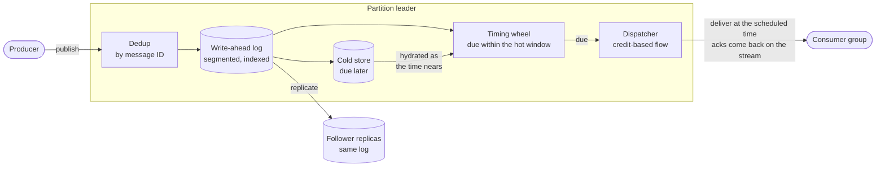
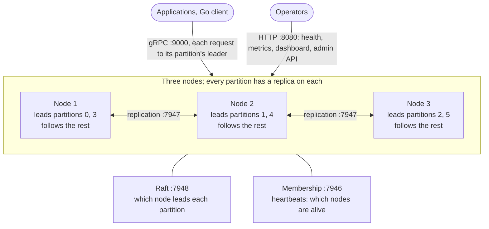

# CronosDB

> Distributed Timestamp-Triggered Event Database with Built-in Scheduling, Pub/Sub & Replay

[](https://golang.org)
[](https://www.rust-lang.org)
[](LICENSE)
[](https://github.com/jatin711-debug/cronos_db_golang/releases)
[](#status)

> **Production Readiness:** The current release is [`v0.7.0`](https://github.com/jatin711-debug/cronos_db_golang/releases/tag/v0.7.0). What a release promises, the test behind each promise, and what has not been shown yet are in the [release requirements](docs/PRODUCTION_RELEASE.md); findings and their status are in the [September](docs/PRODUCTION_AUDIT_2026-09-27.md) and [October](docs/PRODUCTION_AUDIT_2026-10-16.md) audits. Transactions, online partition splitting and cross-region replication are disabled by default and require `--dev --experimental-features`; they are unsupported in production. End-to-end exactly-once delivery is not supported.

CronosDB is a distributed database purpose-built for **timestamp-triggered event processing**. Publish events with a future timestamp — CronosDB stores them durably and delivers them precisely when the time arrives.

It combines the durability of a write-ahead log, the precision of a hierarchical timing wheel, and the scalability of partitioned, replicated storage — all accessible through a streaming gRPC API.

## Key Numbers

Measured on 2026-10-16 on the server code of `v0.7.0`, with three server
processes on one AMD Ryzen 7 6800H laptop (16 threads, one NVMe SSD), 256-byte
payloads and the Go bloom filter, alternating with `v0.6.0` under the same
conditions. They show what the code does on one machine; they are not a
capacity to plan a deployment on, and no throughput or latency figure is
promised. See the
[validation record](docs/CLUSTER_PERFORMANCE_VALIDATION_2026-10-16.md).

| Metric | Value |
|--------|-------|
| **Production settings, delivered** | **~17–19K events/sec** accepted, every event checked as delivered — RF=3, minISR=2, `batch` fsync, dedup, TLS, mTLS, auth and encryption at rest; batches of 1,000, 3 partitions, nodes capped at 2 CPUs. v0.6.0: ~17–18K |
| **RF=3, minISR=2 publish** | **~204K events/sec median** — `periodic` fsync, dedup enabled, 16 partitions, batch 4,000, 240K events, three runs, publish answers only. v0.6.0: ~191K |
| **RF=1 raw publish** | **647K–856K events/sec** — `periodic` fsync, dedup bypassed, 32 partitions, batch 4,000, 4.8M events, two runs, publish answers only. v0.6.0: 357K–705K |
| **Single-event publish, production settings** | **~50 events/sec per publisher**, ~19 ms median: each publish waits for its fsync, so batch for throughput |
| **Reported publish errors** | **0** in every completed profile |
| **Timer Precision** | 10ms tick default (`-tick-ms`; configurable) |
| **Dedup False Positive Rate** | <1% (bloom filter, confirmed against PebbleDB) |

> The RF=1 and RF=3 publish profiles use `periodic` fsync, which production mode refuses, and no consumer. The 1M+ figure of earlier versions of this README was not reproduced and has no preserved evidence.

---

## Features

### Storage & Durability
- **Append-Only WAL v2** — Segmented logs (512MB), per-entry Raft term + CRC32 integrity, sparse indexing. Upgrading from earlier builds requires a clean data directory.
- **Memory-Mapped Reads** — Zero-copy segment reads on Linux/Windows
- **Configurable Fsync** — `every_event` | `batch` (default) | `periodic` modes
- **Damage Detection** — A log that holds unreadable bytes anywhere but at its end refuses to open instead of dropping what follows; `cronos-admin check-log` reports and repairs offline
- **Automatic Compaction** — Removes closed WAL segments only after every relevant consumer group has completed every event. In a cluster the partition's leader removes them from the start of the log and the other replicas follow
- **Retention Enforcer** — Age/size policies use the same completion checks and preserve future timers and active segments
- **Backups** — Independent backups of every loaded partition, hourly by default (`-backup-interval`, `-backup-dir`): event log including the active segment, consumer progress, dedup store, dead-letter queue and epoch, with per-file checksums and all logs cut at one instant; `cronos-admin restore` verifies and restores one into an empty data directory, and can check the encryption key first (see [maintenance validation](docs/MAINTENANCE_VALIDATION_2026-09-29.md))
- **Hierarchical Timing Wheel** — O(1) timer add/remove/tick for millions of events
- **Two-Tier Cold/Hot Scheduler** — PebbleDB cold store for far-future events (>1hr); adaptive hydrator adjusts scan frequency based on load (5s–5min). Keeps hot memory bounded.
- **Absolute Time Tracking** — No drift across overflow wheel cascades
- **Batch Scheduling** — Single lock acquisition for entire batch
- **Crash Recovery** — A restart times again the events of the log that are not due yet; those already due stay in the log and their subscriptions read them at the consumers' pace, so a backlog larger than memory does not stop a node from coming back

### Deduplication
- **Rust Bloom Filter (FFI)** — Lock-free AtomicU64 arrays, XxHash64, Rayon parallel batch
- **PebbleDB Fallback** — LSM tree with 64MB memtable, 7-day TTL auto-expiration
- **Two-Tier Fast Path** — 99% of checks skip disk entirely

### Delivery
- **Credit-Based Flow Control** — Backpressure prevents consumer overload
- **Non-Blocking Retry Heap** — Min-heap by `retryAt` keeps `timeoutLoop` responsive; no inline `time.Sleep`
- **Per-Subscription Circuit Breaker** — Atomic state machine (Closed→Open→HalfOpen) skips dead subscribers automatically
- **At-Least-Once Semantics** — Ack-based, with configurable retries whose delay grows with each attempt (`-retry-backoff` × attempt)
- **Dead Letter Queue** — Append-only binary segments (CRC32, 64MB rotation) for inspection/replay
- **32-Shard Dispatcher** — Reduced lock contention under high concurrency

### Distributed
- **Multi-Node Clustering** — 3+ nodes with automatic partition distribution
- **Raft Consensus** — Metadata consistency (HashiCorp Raft)
- **Membership** — TCP heartbeats between all nodes; a node counted as failed keeps being tried and is taken back when it answers
- **Mutual TLS Between Nodes** — Replication, membership and Raft accept only callers that hold a certificate of the cluster's CA. Certificates and the CA are replaced without a restart, and `--http-tls-enabled` serves the HTTP port over TLS
- **Consistent Hashing** — SHA-256 placement ring with virtual nodes (`-virtual-nodes`, default 2048); partition ID routing uses FNV-1a
- **Raft-committed leadership** — Raft records which node leads each partition; the hash ring only proposes placement. When a leader dies, the replicas that answer are first fenced at a new epoch, and the one with the most complete log is elected. A rebalance moves leadership by a staged handoff that waits until the target's log is equal
- **Quorum replication over dedicated internal gRPC** — Followers on a separate listener (default `:7947`); a publish is acknowledged once `--min-insync-replicas` replicas, the leader included, hold it. Replication traffic is isolated from the public API on `:9000`, and production requires mutual TLS on it
- **Bulk snapshot install** — `ReplicationService.Snapshot` streams segment and index files with per-file size and CRC32; the follower stages them, checks every file, and installs them through a journaled swap that recovers from a crash at any point. An interrupted transfer resumes with the files that already arrived. Used to fill a new or emptied replica
- **Node removal** — `cronos-admin cluster remove-node` takes a node that is lost for good out of Raft and off every node's member list, so it no longer counts towards a majority
- **Clock Skew Detection** — Cross-node heartbeat timestamp comparison; warns if absolute skew exceeds 5 seconds

### API
- **gRPC Streaming** — Bidirectional subscribe, streaming replay
- **Batch Publish** — 100-4000 events per call for maximum throughput
- **Consumer Groups** — Persistent PebbleDB offsets, group metadata, and per-event completion records; the leader sends a group's progress to its followers, so a new leader does not deliver finished work again (what finished in the last moments before a failover can be)
- **Replay Engine** — Time-range or offset-based historical replay

---

## Architecture Overview

Events are spread over partitions by key. Every partition has one leader node, and its other replicas live on other nodes. An event goes to its partition's leader, is written to the log and copied to the other replicas, and is acknowledged once enough of them hold it. It waits in a timer until its scheduled time and is then delivered to a consumer group.

### How an event moves



A publish is acknowledged only after `--min-insync-replicas` replicas, the leader included, hold it. A consumer that does not acknowledge in time gets the event again, and an event that keeps failing goes to the dead-letter queue.

### How a cluster fits together



Raft records which node leads each partition. When a leader dies, the surviving replica with the most complete log takes over. Between nodes, the replication, membership and Raft ports speak mutual TLS with the cluster's certificates.

For the details see **[ARCHITECTURE.md](ARCHITECTURE.md)** and the per-feature docs in **[docs/architecture/](docs/architecture/README.md)**. What a release promises, and the test behind each promise, is in **[docs/PRODUCTION_RELEASE.md](docs/PRODUCTION_RELEASE.md)**.

---

## Quick Start

### Install a release

Each release has binaries of the server and of `cronos-admin` for Linux and macOS (amd64, arm64) and Windows (amd64), with `SHA256SUMS`, on the [releases page](https://github.com/jatin711-debug/cronos_db_golang/releases). They are built without cgo and use the bloom filter written in Go. The container image uses the one written in Rust:

```bash
docker pull johnny711dock/cronos-db:0.7.0    # also :latest
```

### Prerequisites to build

- **Go 1.26.9** (the version `go.mod` names)
- **npm** for the dashboard that `make build` compiles into the server
- **Rust** (optional) for the faster bloom filter through cgo — install via [rustup](https://rustup.rs). Without cgo the server uses the one written in Go
- **protoc** only to regenerate the gRPC code (`make proto`)

### Build

```bash
# Build Rust bloom filter + Go binaries (includes admin dashboard SPA, requires npm)
make build

# Or build only the server binary (no dashboard, no npm needed)
make build-api

# Or step by step:
make rust-dedup          # Build Rust shared library
make ensure-build-dir    # Create bin/ directory
go build -o bin/cronos-api ./cmd/api/main.go      # Linux / macOS
go build -o bin/cronos-api.exe ./cmd/api/main.go  # Windows
```

### Run Single Node

```bash
# Development mode (disables production security requirements)
./bin/cronos-api --dev -node-id=node1 -data-dir=./data
```

### Run 3-Node Cluster

```bash
# Makefile targets start nodes in developer mode for local benchmarking.
# Terminal 1: Bootstrap leader
make node1

# Terminal 2: Join cluster
make node2

# Terminal 3: Join cluster
make node3

# Verify health
make health
```

### Admin Dashboard

CronosDB ships with a self-hosted React admin dashboard embedded in the
`cronos-api` binary. After `make build`, it is served from `/ui/` on the HTTP
address.

```bash
# Start a node with the HTTP UI exposed
./bin/cronos-api --dev --node-id=node1 --http-addr=127.0.0.1:8080 --data-dir=./data

# Open the dashboard
open http://127.0.0.1:8080/ui/
```

The dashboard includes:

- **Cluster topology** — nodes, partitions, ISR, and follower offsets.
- **Partition health** — per-partition WAL, scheduler, dedup, and replay stats.
- **Replication lag** — leader HWM and per-follower lag with a snapshot bar chart.
- **Consumer groups** — group/partition listing and committed-vs-HWM lag charts.
- **Schema registry** — browse registered topic schemas (`/ui/schemas`).
- **Tenant usage** — the page for per-tenant in-flight and storage accounting (`/ui/tenants`). Nothing sets tenant limits yet, and usage is only counted for tenants that have them, so it shows zeros in this release.
- **Operations** — run retention and compaction. Rebalancing is driven by membership; the rebalance action only reports that.
- **Dark / light / system theme** toggle.
- **Toast notifications** for async operations.

When auth is enabled, sign in through the UI with a JWT or generate one with the
admin CLI:

```bash
./bin/cronos-admin generate-token --secret "$(cat jwt-secret.txt)" --subject admin --ttl 24h
```

### Admin CLI

`cronos-admin` is the operator CLI. It comes with each release, is in the image at `/app/cronos-admin`, and builds with:

```bash
go build -o bin/cronos-admin ./cmd/admin
```

The operator commands are under `admin` and use the client port:

```bash
./bin/cronos-admin --server=localhost:9000 admin topology              # nodes, partitions, in-sync replicas
./bin/cronos-admin --server=localhost:9000 admin partition-health 0
./bin/cronos-admin --server=localhost:9000 admin replication-lag       # omit the partition for all local leaders
./bin/cronos-admin --server=localhost:9000 admin consumer-groups list
./bin/cronos-admin --server=localhost:9000 admin consumer-group-lag my-group 0
./bin/cronos-admin --server=localhost:9000 admin schema-list
./bin/cronos-admin --server=localhost:9000 admin tenant-usage
./bin/cronos-admin --server=localhost:9000 admin retention-run --partition-id=0
./bin/cronos-admin --server=localhost:9000 admin compaction-run --partition-id=0
```

The cluster commands are asked on the port the nodes use with each other (`--cluster-grpc-addr`), with the cluster's certificates:

```bash
TLS="--tls --tls-ca=ca.crt --tls-cert=tls.crt --tls-key=tls.key"
./bin/cronos-admin --server=node1:7947 $TLS cluster status
./bin/cronos-admin --server=node1:7947 $TLS cluster voters
./bin/cronos-admin --server=node1:7947 $TLS cluster remove-node node4   # a node that is gone for good
```

Offline tools, run on the data directory of a stopped node:

```bash
./bin/cronos-admin restore --from=/backups/<backup> --data-dir=/data       # checks every file, then restores
./bin/cronos-admin check-log --data-dir=/data                              # reports damage inside a log
./bin/cronos-admin check-log --data-dir=/data --partition=3 --repair       # cuts it out, naming what is lost
```

`--tls`, `--tls-ca`, `--tls-cert` and `--tls-key` connect to a node that serves TLS; `--jwt-token <token>` authenticates when auth is on.

### Load Test

```bash
# Max-throughput profile from Makefile presets
make loadtest-max

# Standard benchmark
make loadtest-batch PUBLISHERS=20 EVENTS=50000 BATCH_SIZE=1000

# Custom profile (example)
make loadtest-batch PUBLISHERS=32 EVENTS=100000 BATCH_SIZE=4000
```

### Windows Development

The Rust bloom-filter DLL lives in `internal/dedup/cronos_dedup.dll`. On Windows,
both the built binary and `go test` binaries need it on `PATH` because they run
outside the repository root.

**Run a single node:**

```powershell
.\scripts\run-node-windows.ps1 -NodeID node1 -GRPCAddr localhost:9000
```

**Run unit tests:**

```powershell
# From repository root
$env:PATH = "$PWD\internal\dedup;$env:PATH"
go test ./internal/storage/... ./internal/scheduler/... ./internal/dedup/... ./internal/partition/... ./internal/cluster/... ./internal/api/...
```

Or use the provided helper:

```powershell
.\scripts\run-tests-windows.ps1
```

### Docker

```bash
# Build image (multi-stage: Rust → Go → Debian slim)
make docker

# Single node (developer mode)
make docker-single

# 3-node cluster (developer mode)
make docker-cluster

# View logs
make docker-logs
```

### Production Deployment & Security

Without `--dev` the server runs in production mode and refuses to start unless it has:

| Requirement | Flag / Config | Value |
|-------------|---------------|-------|
| Replication factor | `--replication-factor` | ≥ 3 |
| Min in-sync replicas | `--min-insync-replicas` | ≥ 2 |
| gRPC TLS | `--tls-enabled`, `--tls-cert-file`, `--tls-key-file` | Enabled |
| Authentication | `--auth-enabled`, `--auth-jwt-secret` or `--auth-jwt-public-key` | Enabled |
| Authorization policy | `--auth-policy-file` | Required: without it every authenticated subject is an admin |
| Encryption at rest | `--encryption-enabled`, `--encryption-key-file` | Enabled |
| Mutual TLS between nodes (replication, membership, Raft) | `--replication-tls-enabled`, `--replication-tls-ca-file`, `--replication-tls-cert-file`, `--replication-tls-key-file` | Enabled, all three files |
| Fsync mode | `--fsync-mode` | `batch` or `every_event` |
| Seeds | `--cluster-seeds` | Every node names every node; exactly one node also gets `--cluster-bootstrap` |

It also refuses `--experimental-features`, `--exactly-once-commits` and a `--pprof-addr` that is not a loopback address. `--http-tls-enabled` serves the HTTP port (health, metrics, dashboard, admin API) over TLS with the certificate of the client port.

Example startup of the first of three nodes. The other two differ in their ID and addresses, and leave out `--cluster-bootstrap`. With TLS between nodes, each node's gossip, cluster gRPC and Raft addresses must be ones the other nodes can reach, and its certificate must be valid for them:

```bash
./bin/cronos-api \
  --node-id=node1 \
  --data-dir=/var/lib/cronos \
  --cluster \
  --cluster-bootstrap \
  --cluster-seeds=node1.cronos:7946,node2.cronos:7946,node3.cronos:7946 \
  --cluster-gossip-addr=node1.cronos:7946 \
  --cluster-grpc-addr=node1.cronos:7947 \
  --cluster-raft-addr=node1.cronos:7948 \
  --replication-factor=3 \
  --min-insync-replicas=2 \
  --fsync-mode=batch \
  --tls-enabled \
  --tls-cert-file=/etc/cronos/tls/tls.crt \
  --tls-key-file=/etc/cronos/tls/tls.key \
  --http-tls-enabled \
  --auth-enabled \
  --auth-jwt-secret="${CRONOS_JWT_SECRET}" \
  --auth-policy-file=/etc/cronos/auth/policy.json \
  --encryption-enabled \
  --encryption-key-file=/etc/cronos/encryption/master.key \
  --replication-tls-enabled \
  --replication-tls-ca-file=/etc/cronos/replication-tls/ca.crt \
  --replication-tls-cert-file=/etc/cronos/replication-tls/tls.crt \
  --replication-tls-key-file=/etc/cronos/replication-tls/tls.key
```

For Kubernetes, use `values-production.yaml` and create the referenced TLS/auth/encryption secrets before installing:

```bash
helm install cronos-db ./charts/cronos-db -f ./charts/cronos-db/values-production.yaml
```

**Note:** The on-disk WAL segment format was upgraded to v2 (per-entry terms). Upgrading from older builds requires a clean `--data-dir`.

### Test with grpcurl

```bash
# Publish a single event
grpcurl -plaintext \
  -d '{"event":{"messageId":"test-1","scheduleTs":'$(date -u +%s%3N)',"payload":"SGVsbG8=","topic":"orders"}}' \
  localhost:9000 cronos_db.EventService.Publish

# Publish batch (high throughput)
grpcurl -plaintext \
  -d '{"events":[{"messageId":"batch-1","scheduleTs":'$(date -u +%s%3N)',"payload":"SGVsbG8=","topic":"orders"}]}' \
  localhost:9000 cronos_db.EventService.PublishBatch

# Subscribe to events
grpcurl -plaintext \
  -d '{"consumerGroup":"processors","topic":"orders","partitionId":0}' \
  localhost:9000 cronos_db.EventService.Subscribe
```

---

## Go Client SDK (`pkg/client`)

The repository ships a production-oriented Go SDK with metadata-based routing, pooled gRPC connections, producer/consumer APIs, replay, retries, and compatibility checks.

### Install

```bash
go get github.com/jatin711-debug/cronos_db_golang@latest
```

```go
import client "github.com/jatin711-debug/cronos_db_golang/pkg/client"
```

### Producer example (JSON + scheduled delivery)

```go
ctx := context.Background()

// Name the nodes; the client finds each partition's leader among them and
// remembers it. (NodeIDToAddress can map node IDs to addresses up front.)
cfg := client.DefaultConfig("127.0.0.1:9000", "127.0.0.1:9001", "127.0.0.1:9002")
cfg.Security.Insecure = true

c, err := client.Dial(ctx, cfg)
if err != nil {
    return err
}
defer c.Close()

producer, err := client.NewProducer(c, client.DefaultProducerConfig())
if err != nil {
    return err
}
defer producer.Close()

_, err = producer.Send(ctx, client.Message{
    Topic:        "orders",
    PartitionKey: "orders", // keep routing stable for matching consumers
    Value: map[string]any{
        "order_id": "ord-1001",
        "status":   "created",
    },
    Codec:      client.JSONCodec{},
    ScheduleTS: time.Now().Add(10 * time.Second).UnixMilli(),
})
if err != nil {
    return err
}
```

### Consumer example (auto-ack)

```go
// PartitionID defaults to -1: one stream per partition, so the consumer sees
// the whole topic however publishers key their events. The handler then runs
// concurrently across partitions.
cons := client.DefaultConsumerConfig("orders", "order-processors")
cons.AckMode = client.AckModeAuto

err = c.Subscribe(ctx, cons, func(ctx context.Context, d client.Delivery) error {
    var payload map[string]any
    if err := d.Decode(client.JSONCodec{}, &payload); err != nil {
        return err
    }
    log.Printf("received message_id=%s payload=%v", d.Event.GetMessageId(), payload)
    return nil
})
if err != nil {
    return err
}
```

### Replay and compatibility helpers

- `Client.Replay`, `ReplayByOffsetRange`, `ReplayByTimeRange`, `ReplayToLive`
- `Client.DetectCapabilities` and `RequireCapabilities`
- `Client.RouteForPartition` for explicit routing/diagnostics

### End-to-end demo

```bash
# Start a local dev node first
./bin/cronos-api --dev --node-id=node1 --data-dir=./data

# In another terminal
go run ./examples/pubsub_demo
```

This demo connects to `localhost:9000`, publishes one JSON event scheduled 10 seconds in the future, and prints the received delivery metadata/payload.
Use `-addr` to target a different node. Run `make demo` if a node is already up.

---

## Performance

### Benchmarks (3-Node Cluster on Single Machine)

Measured on 2026-10-16 with three server processes on one host (AMD Ryzen 7 6800H, NVMe SSD) and 256-byte payloads, alternating `v0.7.0` with `v0.6.0` under the same conditions:

| Profile | v0.7.0 | v0.6.0 | Settings |
|--------|------------|-------|-------|
| Production settings, delivered | **18.6K / 17.5K events/sec** | 18.1K / 16.6K | RF=3, minISR=2, `batch` fsync, dedup, TLS, mTLS, auth, encryption at rest; 3 partitions, batch 1,000, one publisher, nodes capped at 2 CPUs and a 384 MiB budget; every accepted event checked as delivered |
| RF=3, minISR=2 publish | **204K events/sec median** | 191K | `periodic` fsync, dedup enabled, 16 partitions, batch 4,000, 240K events, three runs |
| RF=1 raw publish | **856K / 647K events/sec** | 705K / 357K | `periodic` fsync, dedup bypassed, 32 partitions, batch 4,000, 4.8M events |

With production settings, delivery rather than publishing set the ceiling: one consumer group with one worker per partition fell 2–6 seconds behind at batches of 1,000, and more publishers only grew the backlog. A single-event publish waits for its fsync, about 19 ms here. The `periodic` profiles count publish answers only, with no consumer; RF=3 at 960K events outgrew this laptop's memory on both builds. Runs on this host vary by ±20% and more, and the three nodes share one CPU and SSD, so the [validation record](docs/CLUSTER_PERFORMANCE_VALIDATION_2026-10-16.md) lists every run and its limits; the [2026-09-29 record](docs/CLUSTER_PERFORMANCE_VALIDATION_2026-09-29.md) has the earlier v0.5.0 comparison. Re-run with your storage, network, and durability settings before sizing a deployment.

### Durability & Fault Tolerance

With replication enabled (`--replication-factor=3 --min-insync-replicas=2`), a publish is acknowledged only once the required replicas hold it, and in `batch` or `every_event` fsync mode each of them has it on disk before it answers. Without enough replicas the publish is refused, e.g.:

```
replication for partition 13: not enough replicas: min-insync-replicas=2 but no connected followers
```

CI runs a fault campaign against three server processes on every change to `main`: leaders and followers killed, a leader frozen and released, every node restarted, a node replaced with an empty one, the whole cluster killed. It keeps a ledger of every acknowledged event and checks that each was delivered and that the replicas' logs are equal. What each promise rests on, and what it does not cover, is in the [release requirements](docs/PRODUCTION_RELEASE.md#what-a-release-promises-and-what-that-rests-on).

Replication health is in the `cronos_replication_lag` metric (`curl http://<node>:8080/metrics | grep replication_lag`, `https://` with `--http-tls-enabled`) and in `cronos-admin admin topology`, which shows the in-sync replicas each partition's leader reports.

> RF=1 (the default in the `make node*` / benchmark profiles) keeps one copy of each event. Production mode requires RF≥3 and minISR≥2.

### What Makes It Fast

| Optimization | Impact |
|-------------|--------|
| Rust bloom filter (FFI, in the image) | Lock-free atomics, parallel batch via Rayon |
| sync.Pool for timers & buffers | Near-zero GC pressure on hot path |
| Memory-mapped segment writes | No copy through a write buffer |
| Group commit in `batch` fsync | Writers that append during a sync share the next one |
| Batch WAL + Batch Schedule | Single lock per 1000 events |
| 32-shard dispatcher | Lock contention eliminated |
| PebbleDB NoSync + disabled WAL | Our WAL provides durability |
| FNV-1a event partitioning; SHA-256 node ownership ring | Stable routing with balanced small-cluster placement |
| Atomic CAS credits | Lock-free flow control |
| Cold store (offsets only, ~16B/key) | Millions of far-future events without RAM bloat |
| Retry heap (non-blocking) | `timeoutLoop` stays responsive under retry storms |
| Circuit breaker (atomic state machine) | Instant skip of dead subscribers, no goroutine leaks |

---

## Use Cases

| Use Case | How CronosDB Helps |
|----------|-------------------|
| **Scheduled Tasks** | Publish event with future `schedule_ts`, get delivery at that time |
| **Event Sourcing** | Durable append-only log with offset-based replay |
| **Temporal Workflows** | Chain events with different timestamps for multi-step flows |
| **Distributed Cron** | Cluster-wide scheduled execution with at-least-once guarantee |
| **Delayed Message Queue** | Pub/sub with configurable delivery delay |
| **Time-Series Ingestion** | High-throughput ordered event streams |

---

## Configuration

### Flags

Defaults are sourced from `internal/config/defaults.go`. Every flag can also be
set through an environment variable (see [Environment Variables](#environment-variables)).
`cronos-api --help` lists them all.

| Flag | Default | Description |
|------|---------|-------------|
| `-node-id` | *(empty)* | Unique node identifier |
| `-data-dir` | `./data` | Data directory for WAL, dedup, offsets, snapshots |
| `-grpc-addr` | `:9000` | Public gRPC listen address |
| `-http-addr` | `:8080` | HTTP health + metrics address |
| `-partition-count` | `1` | Number of partitions (use 8-16 for clusters) |
| `-replication-factor` | `1` | Replication factor (production target ≥3) |
| `-segment-size` | `512MB` | WAL segment size before rotation |
| `-index-interval` | `1000` | Sparse index interval (events per entry) |
| `-fsync-mode` | `batch` | `every_event` \| `batch` \| `periodic` — `batch` is the durable default, `periodic` is the throughput ceiling |
| `-flush-interval` | `1000` | Background flush interval (ms) |
| `-backup-interval` | `1h` | How often the node backs up its partitions, at wall-clock multiples of the interval, so the nodes of a cluster back up at the same moment. `0` = no scheduled backups |
| `-backup-retention` | `168h` | How long a backup is kept. `0` = for good |
| `-backup-dir` | *(empty)* | Where backups go; default `backups` under `-data-dir`. A backup on the volume of the data it copies does not survive the loss of that volume |
| `-retention-max-age-hours` | `168` | Remove WAL segments older than this many hours, once every consumer group has finished them and the change feed has exported them; in a cluster only the leader removes, from the start of the log (0 = disable) |
| `-retention-max-size-gb` | `0` | Keep WAL segments within this many GB by removing the oldest, under the same conditions (0 = disable) |
| `-compaction-interval` | `10m` | How often finished segments are removed from the start of each log |
| `-dev` | `false` | Developer mode: disables production security requirements |
| `-tick-ms` | `10` | Timing wheel tick duration in ms |
| `-wheel-size` | `600` | Slots per timing wheel level |
| `-hot-window-minutes` | `60` | Events beyond this window go to cold store (0 = disable) |
| `-hydrator-min-interval` | `5000` | Minimum adaptive hydrator scan interval in ms |
| `-hydrator-max-interval` | `300000` | Maximum adaptive hydrator scan interval in ms |
| `-max-ready-queue` | `1000000` | Max ready queue depth per partition (admission control) |
| `-max-timing-wheel-size` | `10000000` | Max active timers in hot timing wheel (admission control) |
| `-max-in-flight` | `500000` | Max in-flight deliveries per partition (admission control) |
| `-ack-timeout` | `30s` | Default delivery ack timeout |
| `-max-retries` | `5` | Maximum delivery retry attempts |
| `-retry-backoff` | `1s` | Delay before a retry, multiplied by the attempt number |
| `-max-credits` | `1000` | Max delivery credits per subscriber |
| `-cb-failure-threshold` | `0.5` | Circuit breaker failure rate to trip (0.0–1.0) |
| `-cb-min-attempts` | `10` | Min attempts before circuit breaker evaluates |
| `-cb-open-duration-ms` | `30000` | Circuit breaker open duration in milliseconds |
| `-dedup-ttl` | `168` | Dedup TTL in hours (7 days) |
| `-bloom-capacity` | `100000000` | Bloom filter capacity per partition (100M items) |
| `-replication-batch` | `100` | Replication batch size |
| `-replication-timeout` | `10s` | Deadline for one replication Append RPC to a follower |
| `-min-insync-replicas` | `1` | Minimum in-sync replicas (incl. leader) required to ack a write; production target ≥2 |
| `-snapshot-catchup-threshold` | `10000` | Intended: replication lag (events) above which a follower requests a full snapshot. **Currently a dead config key** — parsed but never read; snapshot install is unconditional on the join/`SyncPartitionFromLeader` path and no lag-driven trigger is wired |
| `-raft-dir` | `./raft` | Raft data directory |
| `-raft-join` | *(empty)* | Parsed but not used; nodes join through `-cluster-seeds` |
| `-cluster` | `false` | Enable cluster mode |
| `-cluster-gossip-addr` | `:7946` | Cluster membership (gossip) TCP address; other nodes reach this node by it |
| `-cluster-grpc-addr` | `:7947` | Cluster internal gRPC listener (`InternalGRPCServer`, replication + Raft) |
| `-advertise-grpc-addr` | *(empty)* | Address (`host:port`) clients reach this node's gRPC port at. Partition metadata gives it to clients, so they reach leaders they were not configured with, nodes added later included. Empty: not given |
| `-cluster-raft-addr` | `:7948` | Cluster Raft listen address |
| `-cluster-seeds` | *(empty)* | Comma-separated membership addresses of the cluster's nodes. Name every node, on every node |
| `-cluster-bootstrap` | `false` | This node creates the cluster, if it has no state and no other node in `-cluster-seeds` belongs to one. Give it to exactly one node |
| `-cluster-expected-nodes` | `0` | Nodes a new cluster starts with; partitions get their first leaders as soon as that many are up (`1` for a single-node cluster). `0` = unknown |
| `-cluster-formation-wait` | `5s` | With the expected nodes unknown or not all up: how long membership must be unchanged before first leaders are assigned; publishes are refused with a retryable error until then. `0` assigns at once |
| `-virtual-nodes` | `2048` | Virtual nodes per physical node in hash ring |
| `-heartbeat-interval` | `1s` | Cluster heartbeat interval |
| `-failure-timeout` | `5s` | Node failure detection timeout |
| `-suspect-timeout` | `3s` | Node suspect timeout |
| `-use-memberlist` | `false` | Not supported; the server refuses to start with it |
| `-clock-skew-threshold-ms` | `5000` | Max allowed clock skew from leader in ms (0 = disabled) |
| `-node-rack` | *(empty)* | Rack / AZ label for topology-aware placement |
| `-node-zone` | *(empty)* | Zone label for topology-aware placement |
| `-node-region` | *(empty)* | Region label for topology-aware placement |
| `-tls-enabled` | `false` | Enable TLS for the public gRPC listener |
| `-tls-ca-file` | *(empty)* | Path to CA certificate for public gRPC TLS |
| `-tls-cert-file` | *(empty)* | Path to TLS certificate for public gRPC |
| `-tls-key-file` | *(empty)* | Path to TLS private key for public gRPC |
| `-tls-client-auth` | `false` | Require client certificates on public gRPC (mTLS) |
| `-http-tls-enabled` | `false` | Serve the HTTP port (health, metrics, dashboard, admin API) over TLS with the certificate of the client port |
| `-replication-tls-enabled` | `false` | Mutual TLS for all traffic between nodes: replication, membership and Raft. Needs the three files below |
| `-replication-tls-ca-file` | *(empty)* | CA that signed the certificates of the cluster's nodes |
| `-replication-tls-cert-file` | *(empty)* | This node's certificate, valid for the address other nodes reach it by, for server and client use |
| `-replication-tls-key-file` | *(empty)* | Private key of that certificate |
| `-auth-enabled` | `false` | Enable JWT authentication |
| `-auth-jwt-secret` | *(empty)* | HMAC secret for JWT verification |
| `-auth-jwt-public-key` | *(empty)* | Path to Ed25519/RSA public key for JWT verification |
| `-auth-policy-file` | *(empty)* | Path to RBAC policy JSON file |
| `-experimental-features` | `false` | Enable unverified transactions, online splitting and cross-region replication (`CRONOS_REGIONS`); requires `--dev` |
| `-exactly-once-commits` | `false` | Experimental commit-ID storage; rejected in production, does not provide end-to-end exactly-once delivery |
| `-follower-reads` | `false` | Allow follower nodes to serve replay reads |
| `-load-shedding-threshold` | `0.0` | Load shedding threshold (0.0-1.0, 0 = disabled) |
| `-encryption-enabled` | `false` | Enable AES-256-GCM encryption at rest for WAL segments |
| `-encryption-key-file` | *(empty)* | Path to 32-byte encryption key file |
| `-topic-rate-limit` | `0` | Per-subject per-topic rate limit (events/sec, 0 = disabled) |
| `-topic-rate-burst` | `0` | Per-subject per-topic rate limit burst (0 = disabled) |
| `-max-memory-percent` | `80` | Publishes are refused while the process holds this share of its memory limit or more (0 = never) |
| `-memory-limit` | `0` | Memory the process may use, in bytes. `0` = the container's limit, or the machine's memory |
| `-memory-check-interval` | `1000` | How long a memory measurement is used, in milliseconds |
| `-max-ingest-rate` | `0` | Max events/sec per partition (0 = unlimited) |
| `-ingest-burst-size` | `0` | Token bucket burst size for ingest rate limit |
| `-tracing-enabled` | `false` | Enable OpenTelemetry tracing |
| `-tracing-exporter` | `none` | Tracing exporter (`none`, `stdout`, `otlp`) |
| `-tracing-otlp-endpoint` | `127.0.0.1:4317` | OTLP gRPC endpoint for trace export |
| `-tracing-sample-ratio` | `0.01` | Sampling ratio (0.0-1.0); lower keeps overhead low |
| `-tracing-insecure` | `true` | Disable TLS when exporting via OTLP |
| `-pprof-addr` | *(empty)* | Serve `net/http/pprof` (CPU, block, mutex profiles) on this address; empty disables. Must be a loopback address outside `--dev` |

### Environment Variables

Every flag can be set through `CRONOS_` followed by its name in upper case with
dashes as underscores: `-cluster-seeds` is `CRONOS_CLUSTER_SEEDS`,
`-replication-tls-ca-file` is `CRONOS_REPLICATION_TLS_CA_FILE`. Two have
different names: `CRONOS_DEDUP_TTL_HOURS` sets `-dedup-ttl` and
`CRONOS_MIN_IN_SYNC_REPLICAS` sets `-min-insync-replicas`. A flag given on the
command line wins over the variable.

---

## Project Structure

```
cronos_db/
├── cmd/api/main.go                 # Server entry point, bootstrap, graceful shutdown
├── cmd/admin/                      # cronos-admin: operator commands, cluster, restore, check-log
├── internal/
│   ├── api/                        # Public gRPC server + dedicated internal cluster listener
│   ├── audit/                      # Audit interceptor + structured audit logger
│   ├── auth/                       # JWT + policy-file authentication
│   ├── cdc/                        # Change data capture sinks (Kafka, webhook)
│   ├── cluster/                    # Raft, membership, hash ring, elections, handoffs, node removal
│   ├── compliance/                 # Retention enforcer + protected-paths policy
│   ├── config/                     # Flag parsing, defaults, validation, env overrides, SIGHUP reload
│   ├── consumer/                   # Consumer groups, persistent offset store
│   ├── dedup/                      # Bloom filter (Rust FFI, or Go without cgo) + PebbleDB two-tier
│   │   └── rust/src/lib.rs         # Rust: lock-free bloom, Rayon parallel batch
│   ├── delivery/                   # Dispatcher (32 shards), circuit breaker, retry heap, DLQ, expiry
│   ├── metrics/                    # Prometheus metric definitions shared across modules
│   ├── partition/                  # Partition lifecycle, WAL replay, admission control, recovery snapshot
│   ├── replay/                     # Time-range and offset-based replay engine
│   ├── replication/                # Leader/follower replication, mTLS, gRPC snapshot install, experimental cross-region
│   ├── scheduler/                  # Hierarchical timing wheel, cold store, hydrator, checkpoint
│   ├── schema/                     # Topic schema registry, compatibility, Avro/protobuf
│   ├── slo/                        # SLO recorder (latency, error rate) + bounded windows
│   ├── storage/                    # WAL v2, segments, sparse index, mmap, fsync coalescer, encryption
│   ├── sysmem/                     # Memory limit of the process or container, for the memory guard
│   ├── tenant/                     # Per-tenant accounting and limits (not configurable yet, so not in use)
│   ├── tracing/                    # OpenTelemetry provider + gRPC interceptor
│   ├── tlsfiles/                   # Certificates and CAs read again when their files change
│   └── tx/                         # Experimental 2PC coordinator + transaction service handler
├── pkg/
│   ├── client/                     # Go SDK (connection pool, metadata cache/routing foundation)
│   ├── types/                      # Config, protobuf generated, errors
│   └── utils/                      # FNV-1a hashing, CRC32, atomic file writes
├── proto/                          # events.proto (client and cluster APIs), admin.proto (AdminService)
├── web/dashboard/                  # Admin dashboard (React), compiled into the server
├── charts/cronos-db/               # Helm chart; values-production.yaml for production mode
├── tests/acceptance/               # Fault campaign and other tests against real server processes
├── Makefile                        # Build, test, cluster, loadtest, docker
├── Dockerfile                      # Multi-stage: Rust → Go → Debian slim
├── docker-compose.yml              # Single node + 3-node cluster (RF=3 / minISR=2)
└── ARCHITECTURE.md                 # Deep-dive with 30+ Mermaid diagrams
```

### Codebase Walkthrough (by workflow)

| Workflow | Start Here | Main Components |
|----------|------------|-----------------|
| **Publish event** | `internal/api/handlers.go` (`Publish`, `PublishBatch`) | `internal/partition` → `internal/dedup` → `internal/storage` → `internal/scheduler` |
| **Scheduled trigger** | `internal/scheduler/scheduler.go` | `internal/scheduler/timing_wheel.go` |
| **Delivery to consumers** | `internal/delivery/worker.go` | `internal/delivery/dispatcher.go`, `internal/consumer/group.go` |
| **Consumer offsets + ack** | `internal/api/handlers.go` (`Ack`) | `internal/consumer/group.go`, `internal/consumer/offset_store.go` |
| **Replay/history** | `internal/api/handlers.go` (`Replay`) | `internal/replay` + `internal/storage` |
| **Cluster routing/leadership** | `internal/cluster/manager.go` | `internal/cluster/router.go`, `internal/cluster/raft.go`, `internal/cluster/membership.go` |
| **Go client SDK** | `pkg/client/client.go` | `pkg/client/producer.go`, `pkg/client/consumer.go`, `pkg/client/replay.go` |

---

## gRPC API

### Services

| Service | Methods | Purpose |
|---------|---------|---------|
| **EventService** | `Publish`, `PublishBatch`, `Subscribe`, `Ack`, `Replay` | Core pub/sub |
| **PartitionService** | `GetPartition`, `ListPartitions`, `GetWALStatus`, `GetSchedulerStatus`, `Compact`, `RunRetention`, `SplitPartition` | Partition metadata and admin |
| **ConsumerGroupService** | `CreateConsumerGroup`, `GetConsumerGroup`, `ListConsumerGroups`, `RebalanceConsumerGroup` | Group management |
| **ReplicationService** | `Append`, `Sync`, `Snapshot`, `Position`, `LeaderReport`, `SyncConsumerProgress` | Internal: replication, elections, topology (intra-cluster, internal listener) |
| **RaftService** | `Join`, `Leave`, `Status` | Internal cluster (intra-cluster, internal listener) |
| **CrossRegionService** | `ReplicateEvents`, `FetchEvents` | Experimental cross-region replication; registered only with `--dev --experimental-features` |
| **AdminService** | `GetClusterTopology`, `GetPartitionHealth`, `GetReplicationLag`, `ListConsumerGroups`, `GetConsumerGroupLag`, `RunRetention`, `RunCompaction`, `ListSchemas`, `GetSchema`, `GetTenantUsage`, `TriggerRebalance` | Operator API, also served as JSON under `/api/admin/` |
| **TransactionService** | `BeginTransaction`, `PrepareTransaction`, `CommitTransaction`, `AbortTransaction` | Experimental 2PC; registered only with `--dev --experimental-features` |

### Key RPCs

```protobuf
service EventService {
  rpc Publish(PublishRequest) returns (PublishResponse);
  rpc PublishBatch(PublishBatchRequest) returns (PublishBatchResponse);
  rpc Subscribe(stream SubscribeRequest) returns (stream Delivery);
  rpc Ack(stream AckRequest) returns (stream AckResponse);
  rpc Replay(ReplayRequest) returns (stream ReplayEvent);
}
```

See [proto/events.proto](proto/events.proto) for the complete specification.

---

## Status

[`v0.7.0`](https://github.com/jatin711-debug/cronos_db_golang/releases/tag/v0.7.0) is the current release. Every pull request and every push to `main` runs the following, and `main` moves only to a commit on which all of it has passed:

- build, vet, and the test suite under the race detector, and once without cgo, with the release archives built for five systems;
- a fault campaign and other acceptance tests against three server processes, with a ledger of every acknowledged event;
- links cut between three containers of the image, and the image scanned for known vulnerabilities;
- the production Helm chart in a disposable Kubernetes cluster: TLS, JWT auth, encryption at rest, mutual TLS between nodes, a rolling restart;
- `govulncheck` and the dashboard's tests.

The acceptance tests also run three times over every night. What each promise rests on, the known limits, and what `v0.7.0` was released without are in the [release requirements](docs/PRODUCTION_RELEASE.md); findings and their status are in the [September](docs/PRODUCTION_AUDIT_2026-09-27.md) and [October](docs/PRODUCTION_AUDIT_2026-10-16.md) audits.

Experimental and refused in production: transactions, online partition splitting, cross-region replication, and exactly-once commits.

---

## Technology Stack

| Component | Technology | Why |
|-----------|-----------|-----|
| **Language** | Go 1.26.9 | Concurrency, performance, ecosystem |
| **Bloom Filter** | Rust (FFI via CGO) in the image; Go without cgo | Lock-free atomics |
| **Storage** | PebbleDB (CockroachDB) | LSM tree, built-in compaction, Go-native |
| **Consensus** | HashiCorp Raft | Battle-tested, BoltDB backend |
| **Serialization** | Protocol Buffers | Efficient, typed, gRPC-native |
| **RPC** | gRPC | Streaming, multiplexing, code generation |
| **Metrics** | Prometheus | Industry standard, pull-based |
| **Tracing** | OpenTelemetry | Vendor-neutral, W3C TraceContext |
| **Containers** | Docker + Compose | Reproducible deployments |

---

## Documentation

The full docs site (MkDocs Material — search, dark mode, zoomable diagrams) builds with
`make docs-serve` (local preview at http://127.0.0.1:8000) and deploys to GitHub Pages
automatically on every docs change via `.github/workflows/docs.yml`.

| Document | Description |
|----------|-------------|
| **[mkdocs.yml](mkdocs.yml)** | MkDocs Material site config — root docs are injected at build time by `docs/hooks/github_source_links.py` (single source of truth) |
| **[docs/PRODUCTION_RELEASE.md](docs/PRODUCTION_RELEASE.md)** | What a release promises, the test behind each promise, configuration for production, and what has not been shown yet |
| **[docs/PRODUCTION_AUDIT_2026-09-27.md](docs/PRODUCTION_AUDIT_2026-09-27.md)** | Production-readiness audit: findings, what each hardening batch changed, what remains |
| **[ARCHITECTURE.md](ARCHITECTURE.md)** | Deep-dive with Mermaid diagrams — data flows, sequence diagrams, state machines |
| **[docs/architecture/README.md](docs/architecture/README.md)** | Architecture split by feature (cluster, compliance, dedup, delivery, schema, slo, storage, and more) — all diagrams embedded inline so they render on GitHub |
| [docs/DEVELOPER_ARCHITECTURE_GUIDE.md](docs/DEVELOPER_ARCHITECTURE_GUIDE.md) | Comprehensive developer-oriented architecture and navigation guide |
| **[docs/system-design/README.md](docs/system-design/README.md)** | Learn system design from this codebase: what is used where, why, and at what cost — with nine SVG diagrams, trade-off tables and the lessons from the audit |
| [proto/events.proto](proto/events.proto), [proto/admin.proto](proto/admin.proto) | gRPC API specification |
| [pkg/client](pkg/client) | Production Go SDK (producer/consumer/replay/metadata routing) |
| [pkg.go.dev/client page](https://pkg.go.dev/github.com/jatin711-debug/cronos_db_golang/pkg/client) | Generated API reference and package docs |
| [examples/pubsub_demo/main.go](examples/pubsub_demo/main.go) | Runnable publish+subscribe demo with scheduled delivery |
| [Makefile](Makefile) | All build, test, cluster, and loadtest targets |
| [Dockerfile](Dockerfile) | Multi-stage build: Rust → Go → Debian slim |
| [docker-compose.yml](docker-compose.yml) | Single node + 3-node cluster configurations |
| [DOCKER.md](DOCKER.md) | Docker deployment guide |

---

## Contributing

This is a reference implementation demonstrating production-grade patterns for distributed systems:

- Hierarchical timing wheels for O(1) scheduling
- Two-tier deduplication (bloom filter in Rust or Go, then PebbleDB)
- gRPC-based replication with mTLS and snapshot install
- Consistent hashing with virtual nodes
- Credit-based backpressure flow control
- Lock-free concurrent data structures

See [CONTRIBUTING.md](CONTRIBUTING.md) for guidelines.

---

## License

Apache 2.0 — see [LICENSE](LICENSE).

---

## Resources

- [Timing Wheels — Varghese & Lauck (1987)](https://www.cs.columbia.edu/~nahum/w6998/papers/sosp87-timing-wheels.pdf)
- [Raft Consensus Algorithm](https://raft.github.io/)
- [Patterns of Distributed Systems — Martin Fowler](https://martinfowler.com/articles/patterns-of-distributed-systems/)
- [Write-Ahead Logging](https://en.wikipedia.org/wiki/Write-ahead_logging)
- [PebbleDB (CockroachDB)](https://github.com/cockroachdb/pebble)
- [Bloom Filters — Wikipedia](https://en.wikipedia.org/wiki/Bloom_filter)

---

**CronosDB** — Where time meets data. ⏰📊
