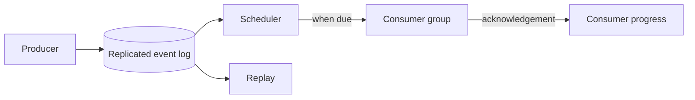

# CronosDB

**A distributed event database with scheduling, pub/sub, and replay.**

[](https://go.dev/)
[](LICENSE)
[](https://github.com/jatin711-debug/cronos_db_golang/releases/latest)

Publish an event with a timestamp. CronosDB retains it, makes it eligible for
delivery when it is due, and tracks consumer acknowledgements. Retained events
can also be replayed by offset or time range.

[Documentation](https://jatin711-debug.github.io/cronos_db_golang/) ·
[Releases](https://github.com/jatin711-debug/cronos_db_golang/releases) ·
[Contributing](CONTRIBUTING.md)

## What it provides

- **Scheduled delivery:** a timing wheel for near-term events and a disk-backed
  cold store for events further in the future.
- **Durable storage:** a segmented write-ahead log, configurable fsync,
  deduplication, backups, and replay.
- **Replicated partitions:** leader routing, configurable replica
  acknowledgements, and recovery after node failures.
- **Consumer groups:** at-least-once delivery, flow control, retries, and a
  dead-letter queue.
- **Operations:** TLS, JWT authorization, encryption at rest, an admin CLI,
  an embedded dashboard, metrics, and tracing.

## How it works

Each partition has a leader and, in a cluster, follower replicas. Accepted
events wait for their scheduled time before being offered to consumers.



See the [architecture overview](ARCHITECTURE.md) for replication, scheduling,
and recovery details.

## Quick start

Run a local development node with Docker using Linux containers:

```bash
docker run --rm --name cronos-dev \
  -p 127.0.0.1:9000:9000 \
  -p 127.0.0.1:8080:8080 \
  -v cronos-data:/data \
  johnny711dock/cronos-db:0.8.1 \
  --dev --node-id=local --data-dir=/data
```

Keep it running and check readiness from another terminal:

```bash
curl --fail http://127.0.0.1:8080/health/ready
```

The gRPC API is at `127.0.0.1:9000` and the dashboard is at
[http://127.0.0.1:8080/ui/](http://127.0.0.1:8080/ui/). The named volume keeps
data between runs. `--dev` disables production security requirements.

The published container targets Linux amd64. For Compose, image digest pins,
and production examples, see the [Docker guide](DOCKER.md). Standalone server
and admin binaries for Linux, macOS, and Windows are on the
[release page](https://github.com/jatin711-debug/cronos_db_golang/releases/latest).

## Go client

With Go 1.26.10 or later, add the SDK to your application:

```bash
go get github.com/jatin711-debug/cronos_db_golang@v0.8.1
```

This program connects to the development node and publishes a JSON event
scheduled ten seconds in the future:

```go
package main

import (
    "context"
    "log"
    "time"

    client "github.com/jatin711-debug/cronos_db_golang/pkg/client"
)

func main() {
    ctx, cancel := context.WithTimeout(context.Background(), 10*time.Second)
    defer cancel()

    c, err := client.Dial(ctx, client.DefaultConfig("127.0.0.1:9000"))
    if err != nil {
        log.Fatal(err)
    }
    defer c.Close()

    producer, err := c.NewProducer(client.DefaultProducerConfig())
    if err != nil {
        log.Fatal(err)
    }
    defer producer.Close()

    result, err := producer.Send(ctx, client.Message{
        Topic:        "orders",
        PartitionKey: "orders",
        Value:        map[string]string{"order_id": "ord-1001"},
        Codec:        client.JSONCodec{},
        ScheduleAt:   time.Now().Add(10 * time.Second),
    })
    if err != nil {
        log.Fatal(err)
    }
    log.Printf("accepted message %s", result.MessageID)
}
```

For consuming, acknowledgements, replay, and a runnable publish/subscribe
demo, see the [Go client guide](docs/CLIENT_GUIDE.md).

## Production scope

Delivery is **at least once**. Consumer capacity, load, and failures can delay
delivery beyond the scheduled timestamp; no latency bound is promised.
Production mode requires replication, TLS, authentication and an authorization
policy, encryption at rest, and mutual TLS between nodes.

Future-event cancellation and rescheduling are opt-in and have upgrade
constraints. Transactions, online partition splitting, cross-region
replication, and exactly-once commits are refused in production.
Read the [release requirements and limits](docs/PRODUCTION_RELEASE.md) and
[upgrade notes](docs/RELEASE_V0.8.1.md) before deploying.

## Performance

The recorded v0.7.0 tests delivered roughly **17–19K events/second** with
production security and durability settings on three processes sharing one
laptop. These are dated measurements, not a deployment capacity guarantee.
The [benchmark record](docs/CLUSTER_PERFORMANCE_VALIDATION_2026-10-16.md)
includes the hardware, settings, comparisons, and limits.

## Documentation

| Task | Guide |
|------|-------|
| Run Docker or Compose | [Docker guide](DOCKER.md) |
| Publish, consume, or replay | [Go client guide](docs/CLIENT_GUIDE.md) |
| Use the dashboard and admin CLI | [Administration](docs/ADMINISTRATION.md) |
| Configure flags and environment variables | [Configuration reference](docs/CONFIGURATION.md) |
| Deploy and assess guarantees | [Release requirements](docs/PRODUCTION_RELEASE.md) |
| Use cancellation and rescheduling | [Event lifecycle contract](docs/RETENTION_AND_EVENT_LIFECYCLE.md) |
| Understand the implementation | [Architecture](ARCHITECTURE.md) · [Developer guide](docs/DEVELOPER_ARCHITECTURE_GUIDE.md) · [Feature docs](docs/architecture/README.md) |
| Inspect the wire API | [Event services](proto/events.proto) · [Admin service](proto/admin.proto) |
| Build, test, or contribute | [Contributing](CONTRIBUTING.md) |

## License

[Apache 2.0](LICENSE).
