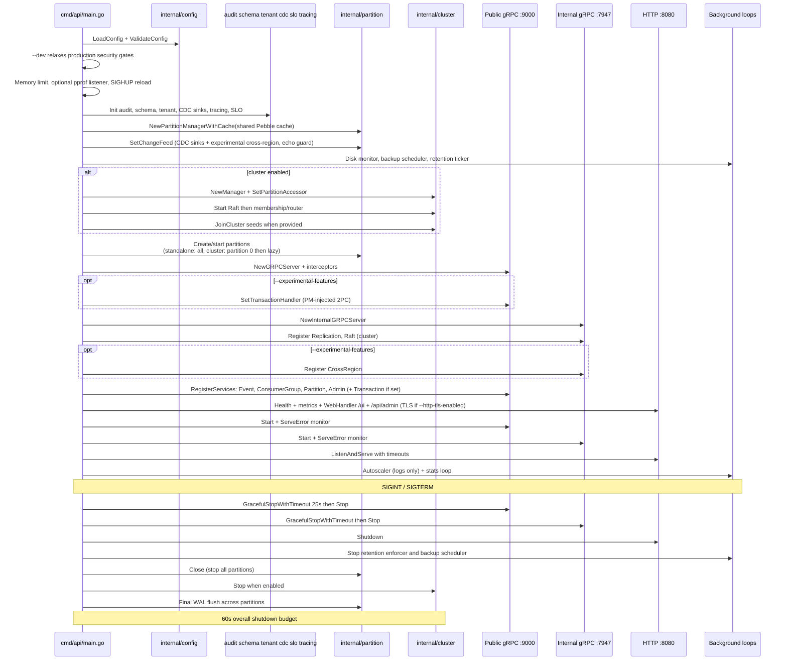
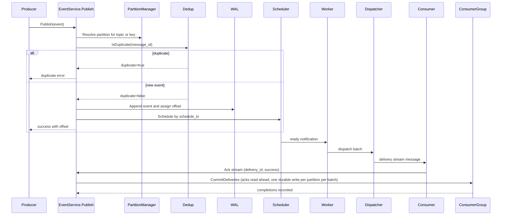
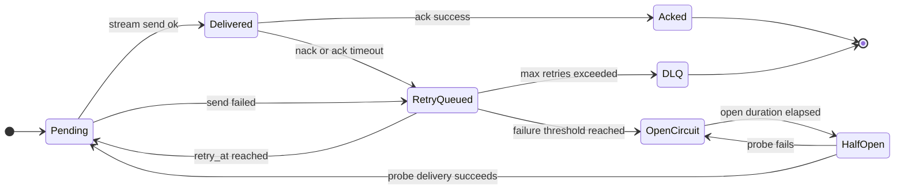
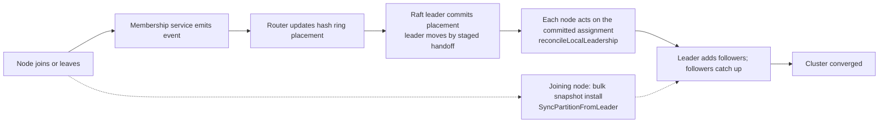
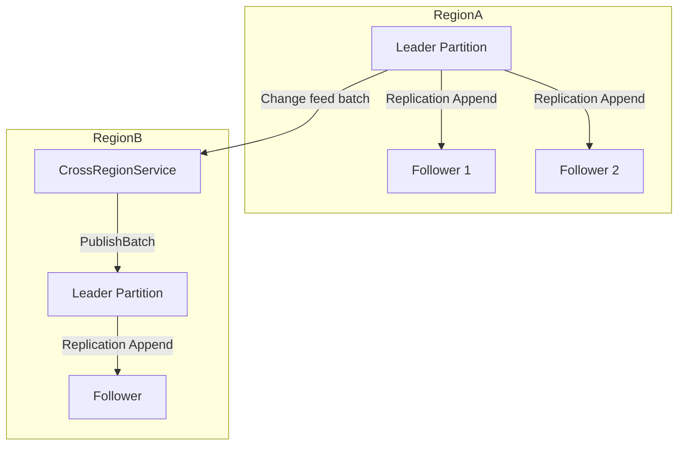
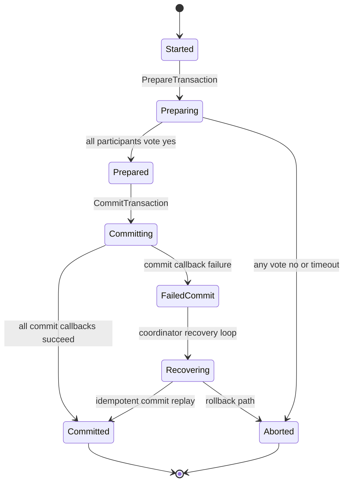
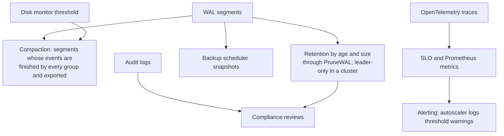

# CronosDB Developer Architecture Guide

> Comprehensive codebase walkthrough for developers and code readers.

This document explains the production architecture as implemented in code, not only at a conceptual level. Use it as a map to navigate subsystems, understand reliability decisions, and trace end-to-end flows.

Related docs:

- Feature-split architecture index: [docs/architecture/README.md](architecture/README.md)
- Inline-rendered diagrams: see the [Diagram Index](architecture/README.md#diagram-index)

## Table of Contents

- [1. Why This Guide Exists](#1-why-this-guide-exists)
- [2. How To Read This Codebase](#2-how-to-read-this-codebase)
- [3. System Overview](#3-system-overview)
- [4. Startup Composition and Lifecycle](#4-startup-composition-and-lifecycle)
- [5. End-to-End Runtime Flows](#5-end-to-end-runtime-flows)
- [6. Feature Deep Dive by Module](#6-feature-deep-dive-by-module)
- [7. Reliability and Production Decisions](#7-reliability-and-production-decisions)
- [8. Debugging and Navigation Playbook](#8-debugging-and-navigation-playbook)
- [9. Extension Points for Future Development](#9-extension-points-for-future-development)
- [10. Suggested Reading Order](#10-suggested-reading-order)

## 1. Why This Guide Exists

CronosDB is a distributed, timestamp-triggered event platform with many cooperating modules. The architecture is intentionally layered but operationally dense. This guide helps you:

- Understand how requests move through data and control planes.
- Find the right file quickly for a feature or bug.
- Understand reliability tradeoffs behind current implementation choices.
- Onboard engineers without relying on tribal knowledge.

## 2. How To Read This Codebase

### 2.1 Repository Shape

- `cmd/api/main.go`: composition root and runtime lifecycle owner.
- `internal/*`: production implementation by subsystem.
- `pkg/*`: reusable SDK and shared types/utilities.
- `proto/events.proto`: contract source for all gRPC services.

### 2.2 Mental Model

Think in three planes:

- Data plane: publish, schedule, dispatch, ack, replay.
- Control plane: cluster membership, routing, leader metadata.
- Reliability plane: dedup, auth, audit, retention, metrics, tracing, SLO.

## 3. System Overview

The canonical system-overview diagram lives in
[docs/architecture/README.md](architecture/README.md#system-overview) (rendered inline on
GitHub). In brief:

- **Clients** (Producer/Consumer SDKs, ops CLI + dashboard) hit the **process edge**:
  public gRPC `:9000`, HTTP `:8080` (health/metrics/UI), internal gRPC `:7947`.
- The **data plane** (handlers → partition manager → per-partition WAL, scheduler,
  worker, dispatcher, consumer groups, DLQ, dedup) serves event traffic.
- The **control plane** (cluster manager, hash-ring router, gossip membership, Raft
  metadata, leader-follower replication, and experimental cross-region replication)
  manages placement and consistency.
- **Guardrails** (JWT+RBAC, audit, schema registry, tenant accounting, SLO/metrics/tracing,
  retention/backup) and **production security** (public TLS, optional HTTP TLS,
  encryption at rest v2, replication mTLS, `--dev` bypass) wrap both planes.
- **Experimental features** — transactions (2PC), online partition splitting and
  cross-region replication — run only with `--dev --experimental-features`;
  production validation refuses the flag.

## 4. Startup Composition and Lifecycle

### 4.1 Composition Root

The runtime is composed in `cmd/api/main.go` in this order:

1. Load config (includes production validation unless `--dev`), determine the memory limit (`--memory-limit`, else the cgroup limit, else machine memory), start the optional `--pprof-addr` listener, and install the hot-reload listener.
2. Initialize guardrails (`audit`, `schema`, `tenant`, `cdc`, `slo`, `tracing`).
3. Initialize partition manager with shared Pebble cache (its backpressure manager refuses publishes above `--max-memory-percent`), and give it the change feed for CDC and, when `CRONOS_REGIONS` is set with `--experimental-features`, cross-region replication before any partition exists.
4. Start operational loops (`disk_pressure`, `backup_scheduler`, retention enforcer).
5. If cluster mode: start cluster manager (`raft` + membership + router), join seeds.
6. Create initial partitions (standalone: all; cluster: partition 0 then lazy-create). Each partition created, now or later, starts its change feed.
7. Build **public** gRPC (`:9000`): Event, ConsumerGroup, Partition, Admin; the Transaction handler (`tx.NewHandler(pm)`) only with `--experimental-features`.
8. Build **internal** gRPC (`:7947`): Replication, Raft (cluster mode); CrossRegion only with `--experimental-features` (replication mTLS in production).
9. Start HTTP (`:8080`): health, metrics, embedded dashboard `/ui/`, `/api/admin/*`; over TLS with `--http-tls-enabled`.
10. Start serve monitors, the autoscaler (always started; it only logs CPU, memory, disk and lag threshold warnings), and the stats loop.
11. On signal: graceful stop public/internal gRPC and HTTP, stop retention and backups, stop partitions, stop the cluster manager, then a final WAL flush.

### 4.2 Startup and Shutdown Sequence

This is the canonical startup/shutdown diagram:

## 5. End-to-End Runtime Flows

### 5.1 Publish to Delivery Flow

### 5.2 Delivery Reliability State Machine

## 6. Feature Deep Dive by Module

This section is organized by feature area and tells you where to read first, what the control flow is, and which reliability decisions matter.

### 6.1 API Layer (gRPC, handlers, middleware)

- Purpose: external and internal RPC surface.
- Key files:
  - `internal/api/grpc_server.go` (public listener on `:9000`)
  - `internal/api/internal_grpc_server.go` (internal cluster listener on `:7947`; registers `ReplicationServiceServer`, `RaftServiceServer` in cluster mode, and `CrossRegionServiceServer` only with `--experimental-features`)
  - `internal/api/handlers.go`
  - `internal/api/consumer_handler.go`
  - `internal/api/partition_handler.go`
  - `internal/api/replication_server.go`
  - `internal/api/raft_server.go` (Raft join/leave/status, node removal)
  - `internal/api/crossregion_server.go` (experimental)
  - `internal/tx/transaction_handler.go` (registered on the public listener via `RegisterTransactionServiceServer` only with `--experimental-features`)
  - `internal/api/tls.go` (public gRPC and HTTP TLS configuration; certificates re-read when their files change)
  - `internal/api/admin_handler.go` (operator-facing `AdminService`)
  - `internal/api/web_handler.go` (HTTP JSON proxy for `AdminService` + embedded dashboard SPA)
  - `internal/api/health.go`
- Main flow:
  - Requests enter interceptor chain (tracing, SLO, version, auth, topic limit, audit, metrics, IP limit).
  - Handlers enforce request validation, routing, dedup, and downstream invocation.
  - Partition admin methods provide WAL/scheduler status, compaction, retention, and split (split refused unless `--experimental-features`).
- Reliability decisions:
  - Explicit gRPC message size limits and keepalive policy.
  - `Start()` returns listen errors; asynchronous serve errors are surfaced via `ServeError()`.
  - `GracefulStopWithTimeout(ctx)` drains in-flight RPCs and falls back to forced `Stop` if the context expires.
  - Health/metrics server startup errors are propagated so the node fails fast on bind or serving failures.
  - Unavailable vs failed precondition semantics for cluster ownership and follower-read gating.
  - Acks on a stream are read ahead and recorded in batches (up to 256), one durable write per partition (`processAcks`).
  - `--exactly-once-commits` is refused in production; the Ack path does not read it.
  - With `--http-tls-enabled` the HTTP port serves TLS with the `--tls-cert-file` certificate; `--pprof-addr` is a separate listener, loopback-only in production.

### 6.2 Configuration and Runtime Reload

- Purpose: unify defaults, flags, env overrides, and runtime reload.
- Key files:
  - `internal/config/defaults.go`
  - `internal/config/config.go`
  - `internal/config/reload.go`
  - `charts/cronos-db/values.yaml`
  - `charts/cronos-db/values-production.yaml`
- Main flow:
  - Config is loaded once at startup from flags and environment variables. Every flag reads `CRONOS_<FLAG>` (upper-cased, `-` replaced by `_`; aliases `CRONOS_DEDUP_TTL_HOURS`, `CRONOS_MIN_IN_SYNC_REPLICAS`); an explicit flag wins.
  - SIGHUP listener allows reload updates without process restart.
  - New flags include retention controls (`--retention-max-age-hours`, `--retention-max-size-gb`) and the full security surface (TLS, auth, replication mTLS, encryption at rest).
- Reliability decisions:
  - Default WAL fsync mode is `batch`.
  - `--dev` disables production security requirements; production mode requires TLS, auth with a policy file, encryption at rest, replication mTLS, `--replication-factor>=3`, `--min-insync-replicas>=2`, fsync mode `batch` or `every_event`, and `--cluster-seeds` in cluster mode, and refuses `--experimental-features`, `--exactly-once-commits` and a non-loopback `--pprof-addr`.
  - Environment variables: every flag has one (see above). Others read by the binary: SIGHUP-reloadable `CRONOS_*` tunables (`internal/config/reload.go`), CDC sinks (`CRONOS_CDC_*`), and `CRONOS_REGIONS` (experimental cross-region; refused without `--experimental-features`).
  - Helm chart defaults to `config.dev=true`; `values-production.yaml` disables dev mode and requires TLS, auth, encryption, and replication-mTLS secrets.
  - Conservative defaults for durability and cluster behavior.
  - Feature flags for controlled rollout (`follower-reads`, tracing, TLS, auth); `--experimental-features` (requires `--dev`) gates transactions, online splitting and cross-region replication.

### 6.3 Partition Runtime and Lifecycle

- Purpose: aggregate per-partition components and lifecycle operations.
- Key files:
  - `internal/partition/manager.go`
  - `internal/partition/retention.go` (`PruneWAL`, `FollowLogStart`)
  - `internal/partition/split.go` (experimental)
  - `internal/partition/disk_pressure.go`
  - `internal/partition/backpressure.go` (admission control and the memory guard)
- Main flow:
  - Partition creation wires WAL, scheduler, dedup, consumer group, dispatcher, worker.
  - A partition start replays timers (`replayWALTimers`) only for events whose time has not come. Events already due stay in the log; each subscription reads what its group has not finished at its consumers' pace (`redriveRetained`), so a restart does not load the backlog into memory.
  - Lookup can be lazy in cluster mode via hash-derived partition IDs.
  - Manager also handles leader promotion/demotion and follower registration.
- Reliability decisions:
  - Epoch fencing to reduce split-brain risk.
  - Admission control across ready queue, timing wheel depth, and in-flight deliveries.
  - Memory guard: publishes are refused while the process holds `--max-memory-percent` (default 80) of its memory limit.
  - Disk-pressure callback triggers emergency compaction.

### 6.4 Storage (WAL, segments, index, backup, crypto)

- Purpose: durable ordered log with seekability and maintenance loops.
- Key files:
  - `internal/storage/wal.go`
  - `internal/storage/segment.go`
  - `internal/storage/index.go`
  - `internal/storage/backup_scheduler.go`
  - `internal/storage/backup.go`
  - `internal/storage/crypto.go`
  - `pkg/utils/atomicfile.go`
- Main flow:
  - Append assigns offsets and writes WAL v2 records to the active segment; each record carries an 8-byte Raft term and a 4-byte trailing checksum, and the sparse index is updated.
  - Segment rotation and compaction reduce long-term storage cost. Compaction runs every `--compaction-interval` and removes closed segments whose events are due, finished by every consumer group and exported by the change feed (`Partition.PruneWAL`).
  - In a cluster only the partition's leader prunes, and only from the start of the log; followers drop what lies below the leader's log start (`FollowLogStart`), and a replica whose log ends before it restarts its log there.
  - Backup scheduler checkpoints every partition at wall-clock multiples of `--backup-interval` and keeps backups for `--backup-retention`. `cronos-admin restore` copies a backup into an empty data directory, checking every file against the manifest; `cronos-admin check-log` reports (and with `--repair` cuts) a damaged segment.
- Reliability decisions:
  - WAL v2 record format includes a Raft term and trailing checksum; upgrading from older builds requires a clean `--data-dir`.
  - CRC32 validation for integrity checks.
  - Default fsync mode is `batch`; `every_event` and `periodic` remain available for stricter or looser durability.
  - Critical metadata (transaction logs, encryption key files, backup manifests/checkpoints) is persisted via `utils.AtomicWriteFile` (temp file + fsync + rename + parent-dir fsync).
  - Optional encryption at rest with key-file managed segment cipher.

### 6.5 Scheduler (timing wheel + cold store)

- Purpose: time-accurate delivery scheduling at scale.
- Key files:
  - `internal/scheduler/timing_wheel.go`
  - `internal/scheduler/scheduler.go`
  - `internal/scheduler/cold_store.go`
- Main flow:
  - Near-future events stay in hot timing wheel.
  - Far-future events move to cold store and are hydrated as due time approaches.
  - Ready events are pushed to worker for dispatch.
- Reliability decisions:
  - O(1) wheel operations for predictable behavior under load.
  - Adaptive hydrator intervals to balance IO and readiness.
  - Recovery path from WAL/checkpoints.

### 6.6 Deduplication (Rust bloom + Pebble fallback)

- Purpose: message idempotency and duplicate suppression.
- Key files:
  - `internal/dedup/store.go`
  - `internal/dedup/bloom_store.go`
  - `internal/dedup/pebble_store.go`
  - `internal/dedup/rust_bloom_unix.go`
  - `internal/dedup/rust_bloom_windows_cgo.go` / `internal/dedup/rust_bloom_nocgo.go`
- Main flow:
  - Fast probabilistic check first, persistent confirmation fallback when needed.
  - Store update keeps recent message IDs with TTL behavior.
- Reliability decisions:
  - Two-tier design balances speed and correctness.
  - Persistent fallback prevents false-positive-only behavior from dropping valid messages.

### 6.7 Delivery (dispatcher, worker, retry, circuit breaker, DLQ)

- Purpose: robust subscriber delivery with backpressure and failure handling.
- Key files:
  - `internal/delivery/dispatcher.go`
  - `internal/delivery/worker.go`
  - `internal/delivery/retry_queue.go`
  - `internal/delivery/circuit_breaker.go`
  - `internal/delivery/dlq.go`
  - `internal/delivery/dlq_segment.go`
- Main flow:
  - Worker drains ready events and submits to dispatcher.
  - Dispatcher tracks credits, in-flight deliveries, and timeout/retry progression.
  - Failed deliveries escalate to retry queue and eventually DLQ.
- Reliability decisions:
  - Circuit breaker isolates bad subscribers.
  - Non-blocking retry heap avoids hot-loop blocking.
  - DLQ segments preserve failure evidence for replay and forensics.

### 6.8 Consumer Groups and Offset Store

- Purpose: group membership and durable commit position tracking.
- Key files:
  - `internal/consumer/group.go`
  - `internal/consumer/offset_store.go`
- Main flow:
  - Subscribe/ack APIs feed into group manager.
  - Offsets, group metadata/assignments and per-event completions are persisted in the PebbleDB `OffsetStore`.
- Reliability decisions:
  - Delivery ID parsing routes ack to correct partition path.
  - `OffsetStore.CommitOffsetExactlyOnce` (commit IDs) exists but is not called by the Ack path; `--exactly-once-commits` is refused in production.
  - The leader sends consumer progress to followers (`SyncConsumerProgress`) on each maintenance tick when it changed, and at least every 30 s. Completions recorded since the last send can be redelivered after a failover; a replication-factor-1 handoff does not carry progress.

### 6.9 Cluster Control Plane (membership, router, raft)

- Purpose: ownership, routing, and metadata consensus for distributed mode.
- Key files:
  - `internal/cluster/manager.go`
  - `internal/cluster/leadership.go` — `reconcileLocalLeadership`, fenced elections (`electNewLeader`, `fencedPositions`), staged handoff (`handoffMayStart`, `advanceTransfers`), `syncClusterState`
  - `internal/cluster/election.go` — `ChooseFailoverLeader`, fallback used only without a replica-position source
  - `internal/cluster/autoscaler.go` — logs CPU, memory, disk and lag threshold warnings; changes nothing
  - `internal/cluster/router.go`
  - `internal/cluster/membership.go`
  - `internal/cluster/transport.go` — mutual TLS for the membership and Raft ports
  - `internal/cluster/memberlist_adapter.go` — not connected: the server refuses `--use-memberlist`
  - `internal/cluster/raft.go`
  - `internal/cluster/hashring.go`
- Main flow:
  - Membership events update the ring, which proposes replicas and a preferred leader per partition.
  - The Raft-committed assignment is the only source of leadership: each node leads what is committed to it, follows what it is a replica of, and releases the rest (`reconcileLocalLeadership`). A partition with no committed assignment has no leader.
  - The Raft leader commits ring placement (`syncClusterState`). A move of a live leader is a staged handoff: the intent is committed, the leader refuses publishes, and leadership changes once the target's log ends at the same entry; a handoff that takes too long is abandoned.
  - A dead leader is replaced by a fenced election: the Raft leader first commits that the partition has no leader at a new epoch, asks the replicas where their logs end (`ReplicationService.Position` with `fence_epoch`; each replica refuses older leaders before it answers), and commits the most complete one at a higher epoch.
  - Each node logs under-replication for the partitions it leads (`updateReplicaOffsets`, `noteInSync`); the admin topology reads in-sync replicas from each partition's leader (`ReplicationService.LeaderReport`).
  - `cronos-admin cluster remove-node <node-id>` removes a node that is lost for good from Raft and from every node's member list; a running node is refused.
- Reliability decisions:
  - Configured virtual nodes reduce leadership skew.
  - Join/rebalance includes state transfer hooks to avoid empty ownership.
  - Raft persistence via Bolt-backed log store.
  - Membership and Raft ports use the replication mTLS certificates; certificates, keys and CAs are re-read when their files change (`internal/tlsfiles`).

### 6.10 Cluster Rebalance Flow

### 6.11 Replication (intra-cluster and cross-region)

- Purpose: keep intra-cluster followers in sync for durability, and push
  events to remote regions for geo-resilience.
- Key files:
  - `internal/replication/leader.go` — `Leader.Replicate`, `Leader.catchUpFollower`, `FollowerInfo` and ISR/quorum accounting.
  - `internal/replication/follower.go` — `Follower.InstallSnapshot`, `Follower.dialCredentials`.
  - `internal/replication/mtls.go` — `MTLSConfig`, `BuildClientTLS` (re-reads certificate, key and CA when their files change), `BuildClientTLSConfig`, `BuildServerTLSConfig`.
  - `internal/replication/region.go` — `CrossRegionReplicator`, per-region batched async push (experimental).
  - `internal/api/replication_server.go` — `ReplicationServiceHandler.Append`, `.Sync`, `.Snapshot`, `.Position`, `.LeaderReport`, `.SyncConsumerProgress`.
  - `internal/api/internal_grpc_server.go` — `InternalGRPCServer` on the dedicated internal listener (default `:7947`).
  - `internal/api/crossregion_server.go` — `CrossRegionServiceServer`.
  - `internal/partition/manager.go` — `PartitionManager.SyncPartitionFromLeader` (trigger for bulk install).
  - `internal/cluster/manager.go` — `Manager.JoinCluster` (calls `SyncPartitionFromLeader` on join; the cluster router also calls it during partition moves).
- Main flow:
  - **Happy path** — `Leader.Replicate(events)` fans the contiguous batch out concurrently to every connected follower via gRPC `ReplicationService.Append` on the internal listener. The call carries `PartitionId`, `Events`, `ExpectedNextOffset`, `Term`, `PrevLogTerm`, and an IEEE CRC32 batch checksum.
  - **Quorum** — `Leader.Replicate` returns success to the client only after `min-insync-replicas` replicas **including the leader** have appended via `WAL.AppendReplicatedBatch`. In `every_event` and `batch` fsync modes a follower syncs the batch before it acknowledges (`batch` through group commit); only `periodic` acknowledges before the data is on disk, and production mode refuses `periodic`.
  - **Incremental catch-up** — when a follower reports `NextOffset < events[0].Offset`, `Leader.catchUpFollower` slices `[from, to)` from the leader's WAL into `batchSize`-sized chunks and replays them through `Append`. For very long ranges the leader also serves the server-streaming `ReplicationService.Sync` RPC.
  - **Bulk install** — `Follower.InstallSnapshot(ctx, leaderAddr, partitionID, 0)` dials the leader over the internal listener and calls `ReplicationService.Snapshot`. The leader flushes its active segment and streams each segment + sparse-index file with a `ReplicationSnapshotHeader` (per-file IEEE CRC32, first/last offset, file size, `is_index`) followed by 1 MB data chunks and a final trailer carrying `{success, last_offset, epoch}`. The follower stages files under `<dataDir>/snapshot-staging/{segments,index}/` and checks every file's size and CRC32 against its header as it completes. An interrupted transfer resumes: staged files are reported to the leader, which answers unchanged ones with a `reuse` header. A trailer epoch below the epoch this replica has accepted is refused. `WAL.InstallCheckpoint` then swaps the logs under a journal (`snapshot-install.state`): old `segments`/`index` moved to `*.old`, staged dirs moved in, the new log loaded and verified, then `*.old` removed; a crash before completion restores the old log.
  - **Trigger** — bulk install is invoked by `PartitionManager.SyncPartitionFromLeader` under a 10-minute context, called from `Manager.JoinCluster` when a node joins and iterates its `router.GetLocalPartitions()`, and from the router during partition moves. After formation, `Manager.reconcileLocalLeadership` runs every 5s and idempotently wires up `PromoteToLeader` + `AddFollower` on every locally-led partition, which is what enables streaming `Append` on a healthy cluster.
  - **Cross-region (experimental)** — `CrossRegionReplicator` queues per region, batches (100 events / 100 ms), and pushes via `CrossRegionService.ReplicateEvents`. Best-effort, no ISR semantics. Runs only with `--dev --experimental-features`.
- Reliability decisions:
  - **Channel isolation** — replication traffic runs over `InternalGRPCServer` (default `:7947`), a separate listener from the public API on `:9000`. Public clients cannot reach replication.
  - **Per-batch CRC32** on `ReplicationAppendRequest` — computed by the leader and verified by the follower handler before anything is applied, along with each event's payload checksum and contiguous offsets.
  - **Per-file CRC32 and size** on `ReplicationSnapshotHeader`; the follower verifies every file and aborts on a mismatch, leaving the local log untouched.
  - **Term fencing** in `ReplicationServiceHandler.Append`: rejects `req.Term < p.Epoch`, rejects a second leader at the current term, and on a newer term persists it to `epoch.json` (stepping down first if this node was leading) before applying the sender's entries. Elections use fence epochs (`fence_epoch` on `Position`), so a replaced leader cannot gather confirmations once the replicas have answered.
  - **Gap rejection** — the handler rejects a batch whose `ExpectedNextOffset` does not match its first event and a batch that starts beyond the local log end ("log gap: catch-up required"); `WAL.AppendReplicatedBatch` also rejects non-contiguous offsets. Both drive leader-side catch-up.
  - **Quorum durability** — `min-insync-replicas` enforced before client ack. With RF=3 / minISR=2 the leader + at least one follower must ack; cluster degradation below minISR fails closed rather than silently succeeding on leader-only.
  - **Journaled swap** during snapshot install — WAL closed before rename; every crash point recovers to one complete generation (`RecoverSnapshot` on WAL open).
  - **mTLS between nodes** — `--replication-tls-enabled` plus `--replication-tls-{ca,cert,key}-file`, all three required. The same certificates secure the membership and Raft ports (`internal/cluster/transport.go`). Server enforces `tls.RequireAndVerifyClientCert`; both sides pin against the cluster CA. Certificates, keys and CAs are re-read when their files change, so they are replaced without a restart. `Follower.dialCredentials` falls back to insecure credentials when the flag is off (intentional for `--dev`, refused by `config.ValidateConfig` in production).
  - **Cross-region** (experimental) is intentionally separate from intra-cluster — no ISR, last-write-wins conflict handling, fire-and-forget.
  - **Trigger caveat** — `--snapshot-catchup-threshold` (default `10000`) is a **dead config key** (parsed, never read). Automatic mid-flight lag-driven InstallSnapshot is **not** wired; a far-behind connected follower still uses incremental `Sync`/`Append` catch-up.

### 6.12 Cross-Region Topology

Experimental: only with `--dev --experimental-features` and `CRONOS_REGIONS`.

### 6.13 Replay Engine

- Purpose: stream historical events by time or offset.
- Key files:
  - `internal/replay/engine.go`
  - `internal/api/handlers.go` (Replay handler)
- Main flow:
  - Replay query maps to partition WAL scans.
  - Results stream in chunks to avoid memory spikes.
- Reliability decisions:
  - Context cancellation safe exits.
  - Optional follower-read support via config gate.

### 6.14 Transactions (2PC coordinator)

- Purpose: multi-step prepare/commit orchestration with crash recovery. **Experimental**: `TransactionService` is registered only with `--dev --experimental-features`.
- Key files:
  - `internal/tx/coordinator.go`
  - `internal/tx/transaction_handler.go`
- Main flow:
  - `tx.NewHandler(pm)` injects PartitionManager so participants write durable markers.
  - `PrepareTransaction` executes prepare-only path.
  - Commit path proceeds from prepared state with idempotent behavior.
- Reliability decisions:
  - Durable coordinator log (`tx_log.json`) for recovery replay.
  - Explicit state transitions reduce phase conflation bugs.

### 6.15 Transaction State Model

### 6.16 Schema Registry and Compatibility

- Purpose: prevent unsafe payload evolution on topic contracts.
- Key files:
  - `internal/schema/registry.go`
  - `internal/schema/compatibility.go`
  - `internal/schema/avro.go`
  - `internal/schema/protobuf.go`
- Main flow:
  - Register schema version per topic.
  - Validate new versions against compatibility mode.
  - Publish path can enforce schema checks before storage.
- Reliability decisions:
  - Type-aware validators and compatibility modes reduce deployment breakage.

### 6.17 Compliance, Retention, and Data Governance

- Purpose: automated data lifecycle enforcement and protected paths.
- Key files:
  - `internal/compliance/retention.go`
  - `internal/api/partition_handler.go` (admin compaction/retention)
- Main flow:
  - An hourly loop applies the max age and max size policies (`--retention-max-age-hours`, `--retention-max-size-gb`).
  - The retention enforcer parses each segment's header (`firstOffset`, `createdTS`) to pick candidates and always preserves the active segment per partition. It removes nothing itself: each candidate goes through the partition (`PartitionManager.RemoveRetainedSegment` then `Partition.PruneWAL`), with the same checks as compaction. In a cluster only the partition's leader removes segments, and only from the start of the log.
  - Matching `.index` files are deleted alongside reclaimed segments.
  - Partition admin RPC can trigger immediate retention and compaction actions.
- Reliability decisions:
  - Protected directories are skipped to prevent accidental cleanup.
  - The enforcer honors context cancellation so shutdown does not leave partial deletes.
  - Admin actions return explicit success/error and reclaimed counters.

### 6.18 CDC (Change Data Capture)

- Purpose: stream write-side changes to external sinks.
- Key files:
  - `internal/cdc/sink.go`
  - `internal/cdc/kafka_sink.go`
  - `internal/cdc/webhook_sink.go`
- Main flow:
  - Each partition's change feed (`internal/partition/changefeed.go`) reads the log behind the accepted watermark and hands events over in log order, on the partition's leader only.
  - `cdc.Manager.Deliver` writes each batch to every sink in order and reports failure; the feed then offers the same events again.
  - The feed's position is stored per partition and sent to followers, so restarts and failovers continue it.
- Reliability decisions:
  - Publishing never waits for a sink: a failing sink makes its partition's feed lag, and nothing is dropped.
  - Nothing queues in memory; events stay in the log until they are handed over.

### 6.19 Auth and Audit

- Purpose: security and traceability.
- Key files:
  - `internal/auth/auth.go`
  - `internal/api/audit_interceptor.go`
  - `internal/audit/audit.go`
- Main flow:
  - Auth interceptors validate JWT and enforce policy.
  - Audit interceptor records important request actions.
- Reliability decisions:
  - Safe defaults with optional strict policy file.
  - Audit writes are guarded for thread safety.

### 6.20 SLO, Metrics, and Tracing

- Purpose: operational visibility and target tracking.
- Key files:
  - `internal/slo/slo.go`
  - `internal/api/metrics.go`
  - `internal/tracing/tracing.go`
  - `internal/tracing/grpc_interceptor.go`
- Main flow:
  - Interceptors capture request latency and errors.
  - Recorder aggregates p95/p99 and error rates.
  - Prometheus endpoint and tracing exporters expose telemetry.
- Reliability decisions:
  - Bounded recording windows prevent unbounded memory growth.
  - Tracing can degrade gracefully to no-op mode.

### 6.21 Tenant Resource Accounting

- Purpose: per-tenant publish and delivery control.
- Key files:
  - `internal/tenant/tenant.go`
  - `internal/api/handlers.go` (tenant extraction and accounting hooks)
- Main flow:
  - Tenant identity is extracted from auth claims or metadata.
  - Publish and delivery paths record resource usage.
- Reliability decisions:
  - Token-bucket based controls protect shared clusters from noisy tenants.

### 6.22 Admin Dashboard and CLI

- Purpose: operator-facing visibility and control without writing custom clients.
- Key files:
  - `internal/api/admin_handler.go` — gRPC `AdminService` implementation (topology, partition health, replication lag, consumer groups, schemas, tenant usage, retention, compaction, rebalance).
  - `internal/api/web_handler.go` — HTTP JSON proxy for `AdminService` and SPA static file serving.
  - `web/dashboard/*` — React 19 + Vite admin dashboard, embedded via `//go:embed`.
  - `cmd/admin/main.go` — `cronos-admin` gRPC CLI.
- Main flow:
  - The dashboard calls `/api/admin/*` endpoints served by the JSON proxy.
  - In dev mode (`--dev`) the proxy allows anonymous requests; with auth enabled it validates the `Authorization: Bearer <jwt>` header via `auth.ParseToken` and `auth.CheckAdminPermission`.
  - The dashboard polls topology/health/lag endpoints and renders snapshot bar charts for replication and consumer lag.
- Reliability decisions:
  - The SPA is built into the Go binary, so the UI is always version-locked to the server.
  - Background refetches keep existing data visible to avoid scroll jumps.
  - Read-only accessors in `internal/schema` and `internal/tenant` limit the admin surface while reusing existing registries.

## 7. Reliability and Production Decisions

### 7.1 Operational Feedback Loops

### 7.2 Reliability Matrix

- Durability:
  - WAL v2 (term + trailing checksum) + CRC32 + fsync modes + backup scheduler (`cronos-admin restore`) + atomic metadata writes.
- Correctness:
  - Dedup, schema validation, epoch checks, transaction state machine.
- Backpressure:
  - Credits, admission control, memory guard (`--max-memory-percent`), rate limiters, tenant accounting, `cronos_dispatcher_backpressure_skips_total`.
  - A restart schedules only future timers; due events are read from the log at consumer pace.
  - Events held back by flow control are redelivered from the WAL when credits return; redrive needs a connected subscriber ([delivery.md](architecture/features/delivery.md), [ARCHITECTURE known limitations](../ARCHITECTURE.md#known-limitations)).
- Fault isolation:
  - Circuit breaker, retry queue, DLQ, service-level error boundaries.
- Operability:
  - Health endpoints, metrics, tracing, audit logs, periodic stats, admin dashboard; topology ISR from each partition's leader (`LeaderReport`); `cronos-admin cluster remove-node`; certificate hot reload; HTTP TLS.
  - **Gap (documented):** `TriggerRebalance` admin RPC is a soft stub; membership-driven rebalance works ([cluster.md](architecture/features/cluster.md)).
- Replication catch-up:
  - Join bulk snapshot + incremental follower catch-up.
  - **Gap (documented):** no mid-flight auto InstallSnapshot when lag exceeds threshold ([replication.md](architecture/features/replication.md)).

## 8. Debugging and Navigation Playbook

### 8.1 "Publish succeeded but not delivered"

1. Check API validation and dedup path in `internal/api/handlers.go`.
2. Confirm WAL append and offsets in `internal/storage/wal.go`.
3. Check schedule timestamp and wheel placement in `internal/scheduler/scheduler.go`.
4. Inspect worker/dispatcher flow in `internal/delivery/worker.go` and `internal/delivery/dispatcher.go`.
5. Verify subscriber credits and ack behavior.

### 8.2 "Node ownership or routing looks wrong"

1. Inspect router assignments in `internal/cluster/router.go`.
2. Check cluster member health in `internal/cluster/membership.go`.
3. Verify raft metadata state in `internal/cluster/raft.go` and manager sync in `internal/cluster/manager.go`.
4. Confirm `virtual-nodes` and replication settings in config.

### 8.3 "High duplicate rates or dedup false positives"

1. Review bloom capacity and TTL in config.
2. Inspect dedup backend behavior in `internal/dedup/bloom_store.go` and `internal/dedup/pebble_store.go`.
3. Validate message_id generation quality from producers.

### 8.4 "Replay inconsistent between nodes"

1. Check follower-read flag and ownership checks in replay path.
2. Verify replication lag and ISR status.
3. Compare partition high-watermarks and local WAL state.

## 9. Extension Points for Future Development

- New external sinks:
  - Add implementation under `internal/cdc` and register via startup wiring.
- New auth policy backend:
  - Extend `internal/auth` policy layer and interceptor path.
- New storage policy:
  - Extend WAL compaction/retention rules and backup integration.
- New tenant controls:
  - Add policy dimensions in `internal/tenant` and enforce in handlers.
- New cluster balancing strategy:
  - Extend hash ring weighting and move planner in `internal/cluster`.

## 10. Suggested Reading Order

For a developer new to the codebase:

1. `cmd/api/main.go` (composition and lifecycle).
2. `internal/api/grpc_server.go` (public API listener, interceptors), `internal/api/internal_grpc_server.go` (internal replication + Raft listener), and `internal/api/handlers.go` (entry points).
3. `internal/partition/manager.go` (system core assembly).
4. `internal/storage/wal.go` and `internal/scheduler/scheduler.go` (data and time model).
5. `internal/delivery/dispatcher.go` and `internal/consumer/group.go` (delivery and ack semantics).
6. `internal/cluster/manager.go`, `router.go`, `raft.go` (distributed control plane).
7. `internal/replication/*` (leader/follower/mTLS/region) and `internal/api/replication_server.go` (advanced reliability paths).
8. `internal/compliance`, `internal/schema`, `internal/slo`, `internal/tracing` (operational hardening).

---

If you keep this document open while stepping through `cmd/api/main.go` and the API handlers, every major production flow in CronosDB becomes straightforward to trace and reason about.
