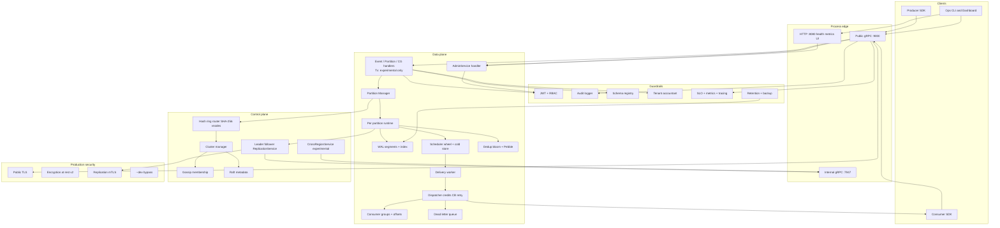

# CronosDB Architecture By Feature

This folder contains the architecture split by feature so developers can read
subsystem docs independently.

## Production-Hardening Highlights (current code)

- **WAL v2 record format** with Raft term and payload checksum; pre-v2 layouts have no
  automatic migration. The v0.7.0 to v0.8.0 upgrade uses capability agreement.
- **Encryption at rest v2** uses a **random 12-byte GCM nonce per record**;
  legacy v1 counter nonces remain decrypt-only.
- **Persistent consumer group metadata** in `OffsetStore`. Exactly-once commit
  IDs exist in `OffsetStore`, but `--exactly-once-commits` is refused in
  production and the Ack path does not read it.
- **DLQ wired per partition** at create time (`NewDispatcherWithDLQ`).
- **Dedup crash recovery** reseeds claims from the WAL tail on partition start.
- **Restart does not load the backlog**: timer replay schedules only events
  whose time has not come; events already due stay in the log and each
  subscription reads them at its consumers' pace (`redriveRetained`).
- **Change feed for CDC** (and experimental cross-region replication):
  accepted events only, in log order, from the partition's leader, with a
  position that survives restarts and failovers. A failing sink makes its feed
  lag; nothing is dropped.
- **Log-start pruning**: compaction and retention remove segments only through
  `Partition.PruneWAL`. Active events must be due, completed and exported;
  accepted terminal controls and superseded copies have no consumer obligation.
  Replicated and standalone lifecycle partitions prune a contiguous prefix;
  followers follow their leader's log start. Optional bounded relocation moves
  never-due work only after the replacement is accepted.
- **Backups and restore**: scheduled checkpoints of every partition at
  wall-clock multiples of `--backup-interval`; `cronos-admin restore`, and
  `cronos-admin check-log` to report or cut a damaged segment.
- **Memory guard**: publishes are refused while the process holds
  `--max-memory-percent` of its memory limit (cgroup limit by default).
- **Listener split:**
  - Public gRPC `:9000` — Event, Partition, ConsumerGroup, **Admin**
    (Transaction only with `--dev --experimental-features`)
  - Internal gRPC `:7947` — **Replication, Raft** (mTLS in production;
    CrossRegion only with `--dev --experimental-features`)
  - HTTP `:8080` — health, metrics, `/ui/` dashboard, `/api/admin/*`;
    TLS with `--http-tls-enabled`
- **Certificate hot reload**: public TLS, HTTP TLS and node-to-node mTLS
  certificates, keys and CAs are re-read when their files change.
- **Bulk snapshot install** (`ReplicationService.Snapshot`) for join/wipe recovery.
- **Raft-authoritative leadership** for local promote/demote reconcile (not
  gossip-only); the hash ring only proposes placement.
- **Fenced elections and staged handoff**: an election first commits that the
  partition has no leader, fences the replicas at that epoch, then picks the
  most complete one; a planned leader move waits until the target's log ends
  at the same entry.
- **Current-term commitment**: after capability agreement, a new leader must
  replicate a durable term-start record before committing an older prefix.
  Mixed clusters retain legacy behavior until agreement; activation is one-way.
- **Lifecycle (off by default)**: future-event cancellation/rescheduling uses
  stable references and idempotent revision checks. Replicated operations require
  majority acknowledgements and capable replicas/voters. Recovery snapshots bind
  consumer progress and dead letters to the matching WAL generation. See the
  [lifecycle contract](../RETENTION_AND_EVENT_LIFECYCLE.md) and
  [term-start protocol](../REPLICATION_TERM_START.md).
- **Topology from leaders**: the admin topology reads each partition's
  in-sync replicas from its leader (`ReplicationService.LeaderReport`).
- **Node removal**: `cronos-admin cluster remove-node <node-id>` takes a lost
  node out of Raft and off every node's member list.
- **Experimental gate**: transactions (2PC), online partition splitting and
  cross-region replication run only with `--dev --experimental-features`.
- **Production security gate** (unless `--dev`): TLS, JWT auth **and** policy
  file, encryption at rest, replication mTLS, RF≥3, minISR≥2, fsync mode
  `batch` or `every_event`, `--cluster-seeds` in cluster mode; refuses
  `--experimental-features`, `--exactly-once-commits` and a non-loopback
  `--pprof-addr`.

## Known Limitations (documented gaps)

These are known product gaps. The [release requirements](../PRODUCTION_RELEASE.md)
also distinguish unvalidated operating conditions from implemented guarantees.
Details and mermaid: [ARCHITECTURE.md § Known Limitations](../../ARCHITECTURE.md#known-limitations).

| Gap | What works | What does not (yet) | Primary doc |
|-----|------------|---------------------|-------------|
| **Lag-driven snapshot** | Bulk `InstallSnapshot` on join / `SyncPartitionFromLeader` | Mid-flight auto-snapshot; `--snapshot-catchup-threshold` is parsed but unused | [replication.md](features/replication.md) |
| **Admin TriggerRebalance** | Automatic rebalance on membership + Raft reconcile (~5s) | On-demand `TriggerRebalance` RPC/UI is a soft stub (descriptive response) | [cluster.md](features/cluster.md), [dashboard.md](features/dashboard.md) |
| **Delivery redrive** | Credits, CB, DLQ, WAL redrive and replicated progress; lifecycle snapshots carry consistent recovery state | A disconnected group makes no progress; completions not yet transferred may be redelivered after failover; legacy RF=1 handoff has no atomic progress transfer | [delivery.md](features/delivery.md) |

## Start Here

- Composition root: [cmd/api/main.go](../../cmd/api/main.go)
- Narrative guide: [docs/DEVELOPER_ARCHITECTURE_GUIDE.md](../DEVELOPER_ARCHITECTURE_GUIDE.md)
- Why it is built this way, and what each choice costs: [docs/system-design/README.md](../system-design/README.md)
- Full architecture: [ARCHITECTURE.md](../../ARCHITECTURE.md)
- Released lifecycle behavior: [RETENTION_AND_EVENT_LIFECYCLE.md](../RETENTION_AND_EVENT_LIFECYCLE.md)
- Commitment and rolling upgrades: [REPLICATION_TERM_START.md](../REPLICATION_TERM_START.md)
- Diagrams: embedded inline (see [Diagram Index](#diagram-index)) so they render on GitHub

## Feature Documents

- API Layer: [features/api.md](features/api.md)
- Audit: [features/audit.md](features/audit.md)
- Auth: [features/auth.md](features/auth.md)
- CDC: [features/cdc.md](features/cdc.md)
- Cluster Control Plane: [features/cluster.md](features/cluster.md)
- Compliance and Retention: [features/compliance.md](features/compliance.md)
- Config and Reload: [features/config.md](features/config.md)
- Consumer Groups: [features/consumer.md](features/consumer.md)
- Dashboard: [features/dashboard.md](features/dashboard.md)
- Deduplication: [features/dedup.md](features/dedup.md)
- Delivery Pipeline: [features/delivery.md](features/delivery.md)
- Partition Runtime: [features/partition.md](features/partition.md)
- Replay Engine: [features/replay.md](features/replay.md)
- Replication: [features/replication.md](features/replication.md)
- Scheduler and Timing Wheel: [features/scheduler.md](features/scheduler.md)
- Schema Registry: [features/schema.md](features/schema.md)
- SLO and Metrics: [features/slo.md](features/slo.md)
- Storage and WAL: [features/storage.md](features/storage.md)
- Tenant Accounting: [features/tenant.md](features/tenant.md)
- Tracing: [features/tracing.md](features/tracing.md)
- Transactions (2PC, experimental): [features/tx.md](features/tx.md)

## Recommended Reading Path

1. [features/api.md](features/api.md)
2. [features/partition.md](features/partition.md)
3. [features/storage.md](features/storage.md)
4. [features/scheduler.md](features/scheduler.md)
5. [features/delivery.md](features/delivery.md)
6. [features/consumer.md](features/consumer.md)
7. [features/cluster.md](features/cluster.md)
8. [features/replication.md](features/replication.md)
9. Remaining reliability and governance modules

## Diagram Index

Diagrams are embedded inline in their canonical feature doc so they render
directly on GitHub (single source of truth — no separate `.mmd` files):

- System overview: below
- Startup lifecycle: [DEVELOPER_ARCHITECTURE_GUIDE.md §4.2](../DEVELOPER_ARCHITECTURE_GUIDE.md#42-startup-and-shutdown-sequence)
- Publish flow: [features/api.md](features/api.md#publish-flow)
- Delivery state model: [features/delivery.md](features/delivery.md#delivery-state-machine)
- Scheduler hot/cold path: [features/scheduler.md](features/scheduler.md#scheduler-hot-cold-path)
- WAL lifecycle: [features/storage.md](features/storage.md#wal-lifecycle)
- Dedup decision path: [features/dedup.md](features/dedup.md#dedup-decision-flow)
- Cluster rebalance: [features/cluster.md](features/cluster.md#cluster-rebalance)
- Cross-region replication: [features/replication.md](features/replication.md#cross-region-replication)
- Transaction state model: [features/tx.md](features/tx.md#transaction-state-machine)
- Schema validation: [features/schema.md](features/schema.md#schema-validation)
- Observability feedback loop: [features/slo.md](features/slo.md#observability-feedback-loop)

### System overview

