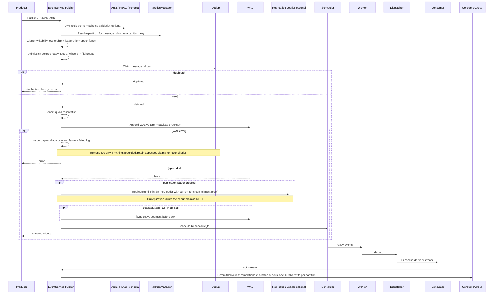

# API Layer Architecture

## Purpose

The API layer is the system entrypoint for all client and internal RPC traffic. It translates contracts into partition-aware operations and enforces security, guardrails, and observability through interceptors.

## Key Files

- [internal/api/grpc_server.go](../../../internal/api/grpc_server.go) — public listener on `:9000`; registers `EventService`, `PartitionService`, `ConsumerGroupService`, and **`AdminService`**; `TransactionService` only with `--experimental-features` (which requires `--dev`).
- [internal/api/internal_grpc_server.go](../../../internal/api/internal_grpc_server.go) — dedicated internal listener (`InternalGRPCServer`, default `:7947`); registers **`ReplicationService`** and, in cluster mode, **`RaftService`**; **`CrossRegionService`** only with `--experimental-features` (`cmd/api/main.go`). Peer traffic never shares the public client port.
- [internal/api/handlers.go](../../../internal/api/handlers.go) — `EventService` handlers (`Publish`, `PublishBatch`, `Subscribe`, `Ack`, `Replay`) with dedup claims and append-outcome reconciliation.
- [internal/api/event_lifecycle.go](../../../internal/api/event_lifecycle.go) — `GetEventState`, `CancelEvent`, `RescheduleEvent`; leader routing, publish authorization and disk admission for opt-in lifecycle operations.
- [internal/api/admin_handler.go](../../../internal/api/admin_handler.go) — operator AdminService (topology, health, lag, retention, compaction, schemas, tenants; **`TriggerRebalance` soft-stub** — see Known Limitations).
- [internal/api/web_handler.go](../../../internal/api/web_handler.go) — embedded SPA + `/api/admin/*` JSON proxy on HTTP `:8080`.
- [internal/api/consumer_handler.go](../../../internal/api/consumer_handler.go)
- [internal/api/partition_handler.go](../../../internal/api/partition_handler.go) — partition metadata + admin compact/retention/split (authz gated).
- [internal/api/replication_server.go](../../../internal/api/replication_server.go) — `Append`, versioned `AppendLifecycle` / `AppendTermStart`, `Sync`, `Snapshot`, `Position`, `LeaderReport`, `SyncConsumerProgress` on the internal listener.
- [internal/api/raft_server.go](../../../internal/api/raft_server.go) — Raft join/leave/status and node removal (`cronos-admin cluster remove-node`) (internal).
- [internal/api/crossregion_server.go](../../../internal/api/crossregion_server.go) — CrossRegion inject/fetch with LWW (internal only).
- [internal/api/audit_interceptor.go](../../../internal/api/audit_interceptor.go) — request-level audit interceptor.
- [internal/api/health.go](../../../internal/api/health.go) — HTTP health endpoints.
- [internal/api/metrics.go](../../../internal/api/metrics.go) — Prometheus collectors.
- [internal/api/ratelimit.go](../../../internal/api/ratelimit.go), [internal/api/topic_ratelimit.go](../../../internal/api/topic_ratelimit.go) — IP and per-topic rate limiters.
- [internal/api/stream_interceptors.go](../../../internal/api/stream_interceptors.go) — stream interceptor wiring.
- [internal/api/tls.go](../../../internal/api/tls.go) — public gRPC TLS / mTLS configuration.
- [internal/api/version.go](../../../internal/api/version.go) — wire version gate / rolling upgrade helpers.
- [proto/events.proto](../../../proto/events.proto), [proto/admin.proto](../../../proto/admin.proto) — wire contracts.

## Listener matrix

| Listener | Default | Services |
|----------|---------|----------|
| Public gRPC | `:9000` | Event, Partition, ConsumerGroup, Admin; Transaction (experimental only) |
| Internal gRPC | `:7947` | Replication, Raft (cluster mode); CrossRegion (experimental only) |
| HTTP | `:8080` | `/health*`, `/metrics`, `/ui/`, `/api/admin/*`; TLS with `--http-tls-enabled` (certificate from `--tls-cert-file` / `--tls-key-file`, no client certificate) |
| pprof | off | `/debug/pprof/*` on `--pprof-addr` when set; a separate listener, loopback-only in production (`cmd/api/pprof.go`) |

## Main Request Flow

1. `cmd/api/main.go` starts **public** and **internal** gRPC servers plus HTTP.
2. Public unary/stream interceptors apply tracing, SLO, version, auth, topic limits, audit, metrics, and IP rate limiting (heavy ones skipped in `--dev`).
3. Handlers validate, authorize, and route via partition manager / cluster router.
4. Internal replication/cross-region RPCs use optional cluster mTLS credentials.

## Production Decisions

- `Start()` exposes `ServeError()` so server startup failures are observable.
- `GracefulStopWithTimeout(ctx)` falls back to forced `Stop` if the deadline expires.
- Health-server startup errors are propagated rather than swallowed.
- Message size and keepalive limits are configured in server options to avoid unbounded payload and idle-connection risk.
- Partition ownership checks in handlers prevent writes on non-owner nodes and fence stale leaders.
- Replay path respects follower-read policy flags for consistency control.
- Acks on one stream are read ahead and recorded in batches (up to 256): each partition's completions in a batch are written with one durable commit (`processAcks` in handlers.go).
- `--exactly-once-commits` is refused in production; the Ack path records per-event completions and does not read the flag.
- Lifecycle RPCs require topic **publish** permission, including `GetEventState`,
  and run on the partition leader. Save the publish receipt's partition, offset,
  term, message ID and topic. Mutations require an expected revision and request
  ID; retry an ambiguous result unchanged. Only future events can be changed.
  Standalone RF=1 and capable replicated clusters are supported with
  `--event-lifecycle`; replicated operations require majority acknowledgements.
  See the [lifecycle contract](../../RETENTION_AND_EVENT_LIFECYCLE.md).
- Public publishes reject reserved `cronos.internal.*` metadata. Delivery and
  replay expose active logical events, strip lifecycle envelopes and omit
  term-start records. Physical offsets can therefore have gaps in public output.

## Known Limitations (API surface)

| RPC / path | Status | Detail |
|------------|--------|--------|
| `AdminService.TriggerRebalance` | Soft stub | Membership-driven rebalance works; on-demand trigger does not move partitions. [cluster.md](cluster.md), [ARCHITECTURE](../../../ARCHITECTURE.md#known-limitations) |
| Cross-region on public port | **Not exposed** | Only on internal `:7947`, and only with `--dev --experimental-features` |
| `TransactionService` | Experimental | Registered only with `--dev --experimental-features` |
| Subscribe control-stream `Recv` | Not used for credits | Flow control via credits/Ack path; control Recv is unused |

## Debug Pointers

- Publish and replay behavior: [internal/api/handlers.go](../../../internal/api/handlers.go)
- Partition admin behavior: [internal/api/partition_handler.go](../../../internal/api/partition_handler.go)
- Service registration and middleware chain: [internal/api/grpc_server.go](../../../internal/api/grpc_server.go)
- Rebalance stub response: [internal/api/admin_handler.go](../../../internal/api/admin_handler.go)

## Diagrams

### Publish flow

### Related diagrams

- [System overview](../README.md#system-overview)
- [Startup lifecycle](../../DEVELOPER_ARCHITECTURE_GUIDE.md#42-startup-and-shutdown-sequence)
