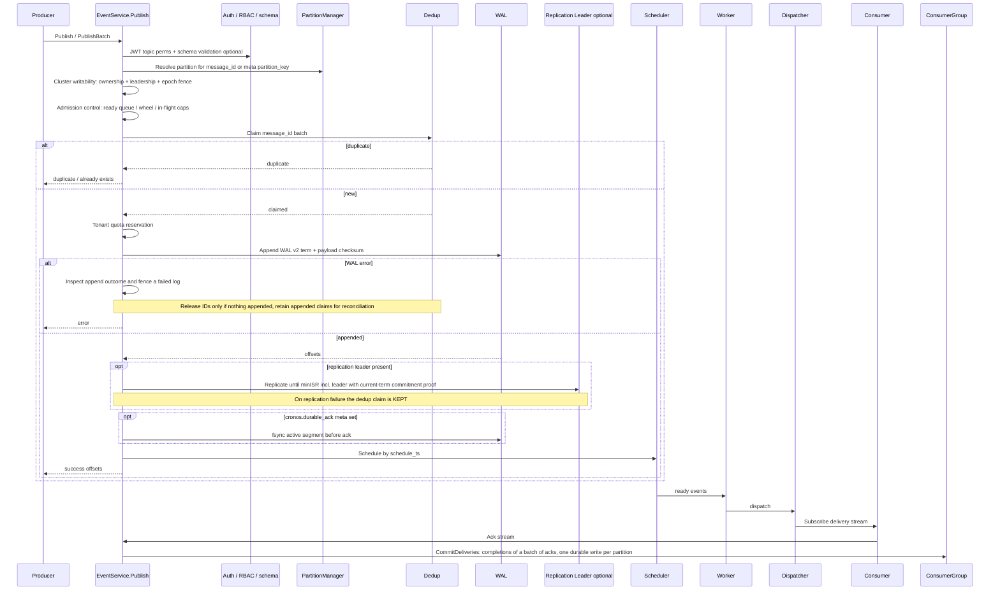

# API Layer Architecture

## Purpose

The API layer is the system entrypoint for all client and internal RPC traffic. It translates contracts into partition-aware operations and enforces security, guardrails, and observability through interceptors.

## Key Files

- [internal/api/grpc_server.go](../../../internal/api/grpc_server.go) — public listener on `:9000`; registers `EventService`, `PartitionService`, `ConsumerGroupService`, and **`AdminService`**; `TransactionService` only with `--experimental-features` (which requires `--dev`).
- [internal/api/internal_grpc_server.go](../../../internal/api/internal_grpc_server.go) — dedicated internal listener (`InternalGRPCServer`, default `:7947`); registers **`ReplicationService`** and, in cluster mode, **`RaftService`**; **`CrossRegionService`** only with `--experimental-features` (`cmd/api/main.go`). Peer traffic never shares the public client port.
- [internal/api/handlers.go](../../../internal/api/handlers.go) — `EventService` handlers (`Publish`, `PublishBatch`, `Subscribe`, `Ack`, `Replay`) with dedup claims and append-outcome reconciliation.
- [internal/api/event_lifecycle.go](../../../internal/api/event_lifecycle.go) — `GetEventState`, `CancelEvent`, `RescheduleEvent`; leader routing, publish authorization and disk admission for opt-in lifecycle operations.
- [internal/api/admin_handler.go](../../../internal/api/admin_handler.go) — operator AdminService (topology, health, lag, retention, compaction, schemas, tenants; `TriggerRebalance` returns `Unimplemented` — see Known Limitations). Every RPC requires the global policy flag `"admin": true` when auth is enabled.
- [internal/api/web_handler.go](../../../internal/api/web_handler.go) — embedded SPA + `/api/admin/*` JSON proxy on HTTP `:8080`.
- [internal/api/consumer_handler.go](../../../internal/api/consumer_handler.go) — `ConsumerGroupService` (create, get, list, rebalance) over the consumer-group state of the first local partition (partition 0); requires global `"admin": true` when auth is enabled.
- [internal/api/partition_handler.go](../../../internal/api/partition_handler.go) — partition metadata (a valid token is enough) + compact/retention/split (global `"admin": true` when auth is enabled). See [authorization by RPC](auth.md#authorization-by-rpc).
- [internal/api/replication_server.go](../../../internal/api/replication_server.go) — `Append`, versioned `AppendLifecycle` / `AppendTermStart`, `Sync`, `Snapshot`, `Position`, `LeaderReport`, `SyncConsumerProgress` on the internal listener.
- [internal/api/raft_server.go](../../../internal/api/raft_server.go) — Raft join/leave/status and node removal (`cronos-admin cluster remove-node`) (internal).
- [internal/api/crossregion_server.go](../../../internal/api/crossregion_server.go) — `CrossRegionService`: `ReplicateEvents` (inject with last-write-wins) and `FetchEvents` (server-streams a partition's events from `start_offset` to a remote region for catch-up). Internal listener, `--dev --experimental-features` only.
- [internal/api/audit_interceptor.go](../../../internal/api/audit_interceptor.go) — request-level audit interceptor.
- [internal/api/health.go](../../../internal/api/health.go) — HTTP health endpoints.
- [internal/api/metrics.go](../../../internal/api/metrics.go) — Prometheus collectors.
- [internal/api/ratelimit.go](../../../internal/api/ratelimit.go), [internal/api/topic_ratelimit.go](../../../internal/api/topic_ratelimit.go) — IP and per-topic rate limiters.
- [internal/api/stream_interceptors.go](../../../internal/api/stream_interceptors.go) — stream interceptor wiring.
- [internal/api/tls.go](../../../internal/api/tls.go) — public gRPC TLS / mTLS configuration.
- [internal/api/version.go](../../../internal/api/version.go) — wire version gate / rolling upgrade helpers.
- [proto/events.proto](../../../proto/events.proto), [proto/admin.proto](../../../proto/admin.proto) — wire contracts.

## Listener matrix

| Listener | Default | Services |
|----------|---------|----------|
| Public gRPC | `:9000` | Event, Partition, ConsumerGroup, Admin; Transaction (experimental only) |
| Internal gRPC | `:7947` | Replication, Raft (cluster mode); CrossRegion (experimental only) |
| HTTP | `:8080` | `/health*`, `/metrics`, `/ui/`, `/api/admin/*`; TLS with `--http-tls-enabled` (certificate from `--tls-cert-file` / `--tls-key-file`, no client certificate) |
| pprof | off | `/debug/pprof/*` on `--pprof-addr` when set; a separate listener, loopback-only in production (`cmd/api/pprof.go`) |

## RPC catalogue

"Admin" is the global `"admin": true` policy flag, required only with `--auth-enabled` (see [authorization by RPC](auth.md#authorization-by-rpc)). Without auth, nothing is checked.

| Service | RPC | Purpose, availability |
|---------|-----|-----------------------|
| `EventService` | `Publish`, `PublishBatch` | Append events; topic `publish`. |
| | `Subscribe`, `Ack` | Delivery stream and acknowledgement stream; topic `subscribe`. |
| | `Replay` | Stream historical events; topic `subscribe`. See [replay.md](replay.md). |
| | `GetEventState`, `CancelEvent`, `RescheduleEvent` | Lifecycle operations on a future event; topic `publish`, leader only, need `--event-lifecycle`. |
| `PartitionService` | `GetPartition` | Leader, replicas and (for a local partition) high watermark, last offset, segment count and disk usage. A valid token is enough. |
| | `ListPartitions` | Partition metadata for discovery, optionally filtered by `topic`. Cluster mode lists every partition of the cluster; standalone lists local ones. Includes `node_addresses` (nodes that set `--advertise-grpc-addr`) and `discovery_version` 1. A valid token is enough. |
| | `GetWALStatus` | Local WAL segment files, first and last offset, oldest and newest segment timestamps and total size of one partition (`NotFound` if not local). `index_entries` and `available_space_bytes` are always 0. A valid token is enough. |
| | `GetSchedulerStatus` | Local scheduler timers, ready events, tick and wheel size. A valid token is enough. |
| | `Compact`, `RunRetention` | Prune the WAL of one local partition; admin. |
| | `SplitPartition` | Split a partition at an offset; admin, and **experimental**: `Unimplemented` unless `--dev --experimental-features`. See [partition.md](partition.md). |
| `ConsumerGroupService` | `CreateConsumerGroup`, `GetConsumerGroup`, `ListConsumerGroups`, `RebalanceConsumerGroup` | Group metadata of this node; admin. See [consumer.md](consumer.md). |
| `AdminService` | `GetClusterTopology`, `GetPartitionHealth`, `GetReplicationLag`, `ListConsumerGroups`, `GetConsumerGroupLag`, `RunRetention`, `RunCompaction`, `ListSchemas`, `GetSchema`, `GetTenantUsage` | Operator views and actions behind the dashboard; every one is admin. See [dashboard.md](dashboard.md). |
| | `TriggerRebalance` | `Unimplemented`; admin check first. |
| `TransactionService` | `BeginTransaction`, `PrepareTransaction`, `CommitTransaction`, `AbortTransaction` | **Experimental**; public listener, `--dev --experimental-features` only. See [tx.md](tx.md). |
| `ReplicationService` | `Append`, `AppendLifecycle`, `AppendTermStart`, `Sync`, `Snapshot`, `Position`, `LeaderReport`, `SyncConsumerProgress` | Internal listener; no JWT, mTLS with `--replication-tls-enabled`. See [replication.md](replication.md). |
| `RaftService` | `Join`, `Leave`, `Status` | Internal listener, cluster mode only. |
| `CrossRegionService` | `ReplicateEvents`, `FetchEvents` | **Experimental**; internal listener, `--dev --experimental-features` only. |

## Main Request Flow

1. `cmd/api/main.go` starts **public** and **internal** gRPC servers plus HTTP.
2. Public unary/stream interceptors apply tracing, SLO, version, authentication, topic limits, audit, metrics, and IP rate limiting (SLO, metrics and IP rate limiting are skipped when auth is disabled, whether or not `--dev` is set).
3. Handlers validate, authorize, and route via partition manager / cluster router.
4. Internal replication/cross-region RPCs use optional cluster mTLS credentials.

## Production Decisions

- `Start()` exposes `ServeError()` so server startup failures are observable.
- `GracefulStopWithTimeout(ctx)` falls back to forced `Stop` if the deadline expires.
- Health-server startup errors are propagated rather than swallowed.
- Message size and keepalive limits are configured in server options to avoid unbounded payload and idle-connection risk.
- Partition ownership checks in handlers prevent writes on non-owner nodes and fence stale leaders.
- Replay path respects follower-read policy flags for consistency control.
- Acks on one stream are read ahead and recorded in batches (up to 256): each partition's completions in a batch are written with one durable commit (`processAcks` in handlers.go).
- `--exactly-once-commits` is refused in production; the Ack path records per-event completions and does not read the flag.
- Lifecycle RPCs require topic **publish** permission, including `GetEventState`,
  and run on the partition leader. Save the publish receipt's partition, offset,
  term, message ID and topic. Mutations require an expected revision and request
  ID; retry an ambiguous result unchanged. Only future events can be changed.
  Standalone RF=1 and capable replicated clusters are supported with
  `--event-lifecycle`; replicated operations require majority acknowledgements.
  See the [lifecycle contract](../../RETENTION_AND_EVENT_LIFECYCLE.md).
- Public publishes reject reserved `cronos.internal.*` metadata. Delivery and
  replay expose active logical events, strip lifecycle envelopes and omit
  term-start records. Physical offsets can therefore have gaps in public output.

## Known Limitations (API surface)

| RPC / path | Status | Detail |
|------------|--------|--------|
| `AdminService.TriggerRebalance` | `Unimplemented` (since v0.11.0) | Returns gRPC `Unimplemented` after the admin check; it used to return `Success=true` and do nothing. Leadership reconciles automatically after membership changes; the dashboard action is disabled. [cluster.md](cluster.md), [ARCHITECTURE](../../../ARCHITECTURE.md#known-limitations) |
| Cross-region on public port | **Not exposed** | Only on internal `:7947`, and only with `--dev --experimental-features` |
| `TransactionService` | Experimental | Registered only with `--dev --experimental-features`; production mode refuses `--experimental-features` (`internal/config/config.go`) |
| `PartitionService.SplitPartition` | Experimental | Admin check first, then `Unimplemented` ("online partition splitting is disabled") unless `--dev --experimental-features` |
| `CrossRegionService` (`ReplicateEvents`, `FetchEvents`) | Experimental | Internal listener only, `--dev --experimental-features`; production refuses it and `CRONOS_REGIONS` without the flag |
| Subscribe control-stream `Recv` | Not used for credits | Flow control via credits/Ack path; control Recv is unused |

## Debug Pointers

- Publish and replay behavior: [internal/api/handlers.go](../../../internal/api/handlers.go)
- Partition admin behavior: [internal/api/partition_handler.go](../../../internal/api/partition_handler.go)
- Service registration and middleware chain: [internal/api/grpc_server.go](../../../internal/api/grpc_server.go)
- Rebalance `Unimplemented` response: [internal/api/admin_handler.go](../../../internal/api/admin_handler.go)

## Diagrams

### Publish flow

### Related diagrams

- [System overview](../README.md#system-overview)
- [Startup lifecycle](../../DEVELOPER_ARCHITECTURE_GUIDE.md#42-startup-and-shutdown-sequence)
