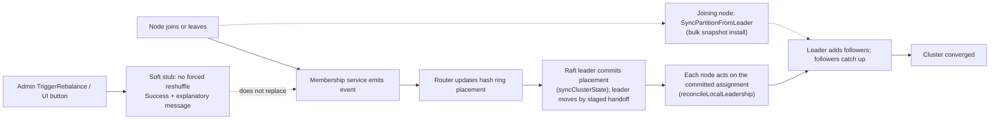

# Cluster Control Plane Architecture

## Purpose

The cluster module provides node membership, partition routing, leader assignment, and metadata consensus.

## Key Files

- [internal/cluster/manager.go](../../../internal/cluster/manager.go) — `Manager.JoinCluster`, the control loop (5 s tick and 500 ms leader tick), `updateReplicaOffsets` / `noteInSync` (in-sync replicas of the partitions this node leads).
- [internal/cluster/leadership.go](../../../internal/cluster/leadership.go) — `reconcileLocalLeadership` (acts on committed assignments: `PromoteToLeader`, `DemoteFromLeader`, `AddFollower`), fenced elections (`electNewLeader`, `fencedPositions`), staged handoff (`handoffMayStart`, `advanceTransfers`), `syncClusterState`, `checkPartitionHealth`.
- [internal/cluster/router.go](../../../internal/cluster/router.go)
- [internal/cluster/hashring.go](../../../internal/cluster/hashring.go)
- [internal/cluster/membership.go](../../../internal/cluster/membership.go)
- [internal/cluster/transport.go](../../../internal/cluster/transport.go) — mutual TLS for the membership and Raft ports.
- [internal/cluster/memberlist_adapter.go](../../../internal/cluster/memberlist_adapter.go) — not connected; the server refuses `--use-memberlist`.
- [internal/cluster/raft.go](../../../internal/cluster/raft.go)
- [internal/cluster/capabilities.go](../../../internal/cluster/capabilities.go) — one-way partition format requirements, replica/handoff/voter compatibility and activation.
- [internal/cluster/election.go](../../../internal/cluster/election.go) — `ChooseFailoverLeader`, the fallback choice used by `electNewLeader` only when no replica-position source is wired; the normal election asks the replicas for their log positions (see leadership.go).
- [internal/cluster/autoscaler.go](../../../internal/cluster/autoscaler.go) — logs warnings when CPU, memory, disk or partition lag cross a threshold; it changes nothing in the cluster.
- [internal/cluster/service.go](../../../internal/cluster/service.go), [internal/cluster/types.go](../../../internal/cluster/types.go)
- [cmd/api/main.go](../../../cmd/api/main.go)

## Main Flow

1. Cluster manager starts Raft and membership services.
2. Router computes partition placement, and the leader it would prefer, via
   the consistent hash ring.
3. The Raft leader commits each partition's assignment. A partition that has
   never had a leader gets one as soon as `--cluster-expected-nodes` nodes are
   up, or once membership has been unchanged for `--cluster-formation-wait`
   (5 s), so a cluster whose nodes start one after another is assigned once,
   across all of them. It first asks the partition's replicas what they
   already hold: in a new cluster nothing, and the ring's choice stands; after
   a restore the replica with the most complete log leads, at an epoch above
   any a replica has accepted.
4. Each node acts on the committed assignments only: it leads what is
   committed to it, follows what it is a replica of, and unloads what it no
   longer holds. A partition with no committed assignment has no leader.
5. Leader-only tasks elect a replacement for a dead leader and move leadership
   to the ring's preferred replica by a staged handoff. Both are described in
   [replication.md](replication.md#leadership-and-fencing).

## Production Decisions

- Production clusters require `--replication-factor>=3` and `--min-insync-replicas>=2`.
- The coordinator activates `term-start/1` only after every assigned replica,
  handoff target and Raft voter is alive and capable. Lifecycle operations are
  separately opt-in with `--event-lifecycle`, require majority acknowledgements
  and the lifecycle append/recovery formats, and exclude CDC/experimental
  features. Committed requirements constrain future placement, elections,
  handoffs and replacement voters. Before agreement, legacy old-term commitment
  behavior remains; after activation, downgrade to an incompatible build is
  unsupported. See [term-start](../../REPLICATION_TERM_START.md) and
  [lifecycle upgrades](../../RETENTION_AND_EVENT_LIFECYCLE.md#replication-and-rolling-upgrades).
- A node skips its own entry in the seed list, introduces itself to every other seed and keeps retrying the ones that do not answer. Nodes that start together therefore find each other in any order; a node that cannot reach its cluster stays not ready.
- Nodes keep sending heartbeats to the nodes they count as failed, every heartbeat interval while a node is suspected and every fifth once it is counted as dead, and a heartbeat says where its sender is found. Two nodes that lost contact therefore meet again when the network lets them, and a node that restarted with an empty member list, which is the case for the node that names no seeds, learns the others from the heartbeats they still send it. A node that was itself not running for longer than the failure timeout (a frozen process, a suspended machine) gives the others a full timeout to be heard from before it suspects them.
- A node asked where a partition's log ends answers from disk if the partition is not loaded, which is the state of every partition after a restart. Elections and first assignments would otherwise take a restarted replica for an empty one.
- All traffic between nodes is mutual TLS in production, with the certificates of `--replication-tls-*`: replication (see [replication.md](replication.md)), membership and Raft. The membership and Raft ports decide who belongs to the cluster and who leads; they used to be plain TCP even with replication TLS on, and a join request from anyone who could reach the membership port made the sender a member, which the Raft leader then added as a voter. Now a caller must present a certificate signed by the cluster's CA before anything it sends is read, and a node checks that the certificate of the node it calls is valid for the address it called (`TestTransportTLS_*` in [transport_test.go](../../../internal/cluster/transport_test.go)). A certificate, its key and the CA file are read again when they change, at the next connection a node makes or accepts, so they are replaced without a restart ([tlsfiles](../../../internal/tlsfiles/tlsfiles.go)). `ca.crt` may hold more than one CA certificate, which is how a CA is replaced: both, then new certificates, then the new one alone.
- A node that is lost for good is removed by hand: `cronos-admin cluster remove-node <node-id>`, asked of any node on the port the nodes use with each other. A dead node stays a member until then, which lets it come back, and keeps counting towards what a majority is in Raft; four nodes with one lost need three of four. The removal takes the node out of the Raft configuration and, through the Raft log, off every node's list of members (`Manager.RemoveNode`, `Manager.forgetNode`). A node that runs is refused, since it would be heard from and join again. `cronos-admin cluster voters` lists the nodes that count.
- A node that joins a running cluster is found by clients that are already connected (since `v0.7.0`), when it is started with `--advertise-grpc-addr`: partition metadata names a leader by node ID and gives the address each node advertised, and a client adds the addresses it learns to its address map. Addresses given in `NodeIDToAddress` take precedence. The address travels between nodes in membership messages (`ClientAddr`), which nodes of `v0.6.0` ignore. It is not the cluster gRPC address, which serves replication and Raft only. Clients of `v0.6.0` and before, and nodes started without the flag, work as before: a client has addresses only for the nodes it was started with or was given.
- A node of this version does not form a cluster with nodes of 0.6.0-rc.2 or earlier when replication TLS is on, because those speak plain TCP on the membership and Raft ports. Such a cluster is upgraded by stopping all its nodes and starting them on the new version together; a rolling update stalls at the first pod.
- A cluster is created once, by the node given `--cluster-bootstrap`, and only when that node has no Raft state and every other node in its seed list has said it belongs to no cluster ([bootstrap.go](../../../internal/cluster/bootstrap.go)). One node that belongs to a cluster settles it: the node joins that cluster and is filled from it. A node that does not answer leaves the question open, and the node waits, logging whom it waits for. The node that creates a cluster used to be the one that names no seeds, and it created a cluster whenever it started without state: back with an empty disk, it created a second one, added the other nodes to it, and left them with two histories of who leads what. In the chart that was pod 0 with a replaced volume. A node that names no other node still behaves that way and says so in its log; production mode refuses to start one.
- A leader takes a publish only while it counts enough of the partition's replicas as alive, itself included, to make up `--min-insync-replicas`. A leader that is cut off from the others is still the committed leader as far as it can tell, because the change that replaces it is committed by the nodes it cannot hear; it could never acknowledge a publish, but it used to take each one and hold its sender until replication timed out. It now answers at once that the publish has to go to another node (`seesEnoughReplicas` in [leadership.go](../../../internal/cluster/leadership.go)).
- A heartbeat connection is used again only while the node at its other end is being heard from, and for ten heartbeat intervals at most. A write into a connection that carries nothing succeeds, and after a network failure such a connection stays silent long after the network has returned; two nodes that kept theirs stayed dead to each other.
- `/health/deep` reports which node decides who leads the partitions: the check `cluster_role` reads `coordinator` on the node that leads the cluster's Raft group and `member` on the others.
- A node whose partition has accepted a newer epoch than its own records of the cluster show has been replaced as leader, and has not heard it from the cluster yet. It refuses publishes and subscriptions for that partition with an answer that sends the client to the leader (`ensureClusterPartitionLed` in [handlers.go](../../../internal/api/handlers.go)).
- A node that the ring gives a partition does not start a bulk copy from a leader it counts as dead: the copy cannot be made, and the attempt held the partition's log locked until the connection timed out.
- An election changes who leads a partition and leaves alone where the ring wants its replicas. It used to write the replica list it had started from over the ring's entry. When a node had come back in the meantime, that entry was the only place that said the node belongs to the partition again; with it gone the partition ran on one replica, refusing publishes for want of a second, until another node joined or left. The fault campaign found this in CI.
- A node that was counted as failed and announces itself again is put back in the ring at once. The router used to hear nothing of the return and went on without the node until its periodic comparison, up to ten seconds later, and a Raft leader elected in that time committed every partition without it.
- Configurable virtual nodes improve partition leadership balance (default `2048`, raised from the older `150` because sparse vnode counts produced severe ownership skew in small clusters).
- Consensus metadata is persisted with Raft and Bolt-backed storage.
- Rebalance path uses partition accessor hooks to avoid ownership without data.
- Explicit epoch usage supports leader fencing behavior.
- New-node join path: `Manager.JoinCluster` iterates `router.GetLocalPartitions()` and calls `PartitionManager.SyncPartitionFromLeader(partitionID, leader.Address)`, which triggers `Follower.InstallSnapshot` (bulk `ReplicationService.Snapshot` install) for each partition the joining node owns.
- In-sync replicas are known only to each partition's leader. Every node, every 5 s, puts the in-sync replicas and replica offsets of the partitions it leads into its router and logs when a partition is under-replicated or back to full (`updateReplicaOffsets`, `noteInSync` in manager.go). The ISR in the committed assignment is what it was when placement last changed; the admin topology reads the ISR from each partition's leader (`LeaderReport`).
- `reconcileLocalLeadership` runs whenever a committed assignment changes, and every 5s, and uses **Raft-committed assignments** only to idempotently `PromoteToLeader` / demote / `AddFollower` for local partitions — enabling streaming `ReplicationService.Append` on a healthy cluster. A node that has just joined leads nothing until it has received the assignments.
- `/health/ready` answers 503 while a partition has no committed leader, while this node is still loading a partition committed to it, or while one of its partitions is being handed over. Publishes for those partitions are refused with a retryable error in the meantime.
- Under replication factor 1 a handoff copies the log to the target by snapshot; consumer progress does not move with it, so the target may redeliver.
- Partition ID routing for keys uses **FNV-1a**; node placement on the ring uses **SHA-256 virtual nodes** (default 2048).

## Known Limitation: Admin `TriggerRebalance` soft stub

| | |
|--|--|
| **Automatic rebalance (works)** | Membership join/leave → router assignment → Raft apply → `reconcileLocalLeadership` (~5s) promotes/demotes and may `SyncPartitionFromLeader`. |
| **On-demand RPC (stub)** | `AdminService.TriggerRebalance` / dashboard `POST /api/admin/cluster/rebalance` is **implemented as a soft stub**: RBAC still required; response is `Success=true` with an explanatory `Error` string and `PartitionsMoved=0`. It does **not** force a full ring reshuffle. |
| **Why** | Prevents unsafe operator thrash until a controlled drain/move API exists. |
| **Code** | [internal/api/admin_handler.go](../../../internal/api/admin_handler.go) (`TriggerRebalance`) |
| **See also** | [ARCHITECTURE.md § Known Limitations](../../../ARCHITECTURE.md#known-limitations), [dashboard.md](dashboard.md) |

**Operator guidance:** To change placement, change membership (add/remove nodes) or wait for
failure detection; do not rely on the Rebalance button as a manual “reshuffle now” tool.

## Debug Pointers

- Ownership/routing confusion: [internal/cluster/router.go](../../../internal/cluster/router.go)
- Metadata drift: [internal/cluster/manager.go](../../../internal/cluster/manager.go)
- Raft status and peers: [internal/cluster/raft.go](../../../internal/cluster/raft.go)
- Why UI rebalance did nothing: [internal/api/admin_handler.go](../../../internal/api/admin_handler.go)

## Diagrams

### Cluster rebalance

Note: the steps above run across different loops in code (router rebalance
goroutine, the Raft leader's `syncClusterState` / `advanceTransfers` every
500 ms, and `reconcileLocalLeadership` on every committed change and every 5 s),
so the depicted order is logical rather than a single linear sequence. The ring
proposes placement; only the Raft-committed assignment makes a node a leader.

### Related diagrams

- [System overview](../README.md#system-overview)
- [Startup lifecycle](../../DEVELOPER_ARCHITECTURE_GUIDE.md#42-startup-and-shutdown-sequence)
