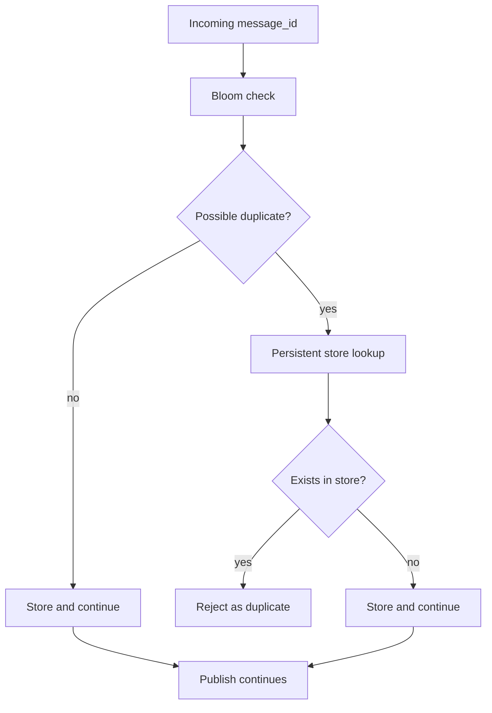

# Deduplication Architecture

## Purpose

Deduplication prevents duplicate message processing while keeping publish latency low.

## Key Files

- [internal/dedup/store.go](../../../internal/dedup/store.go)
- [internal/dedup/bloom_store.go](../../../internal/dedup/bloom_store.go)
- [internal/dedup/pebble_store.go](../../../internal/dedup/pebble_store.go)
- [internal/dedup/rust_bloom_unix.go](../../../internal/dedup/rust_bloom_unix.go) — Unix CGO bindings for the Rust bloom filter.
- [internal/dedup/rust_bloom_windows_cgo.go](../../../internal/dedup/rust_bloom_windows_cgo.go) / [internal/dedup/rust_bloom_nocgo.go](../../../internal/dedup/rust_bloom_nocgo.go) — Windows CGO and non-CGO bindings (the older `rust_bloom_windows.go` was split into these two files when the Windows build added a non-CGO fallback path).
- [internal/dedup/rust/src/lib.rs](../../../internal/dedup/rust/src/lib.rs) — Rust crate: lock-free `AtomicU64` arrays, XxHash64, Rayon parallel batch.

## Main Flow

1. Handler checks message identifier through dedup manager.
2. Fast probabilistic path handles common-case duplicate checks.
3. Persistent fallback confirms and stores dedup state with TTL behavior.
4. Result controls whether publish continues or exits as duplicate.

## Production Decisions

- Two-tier design balances speed and correctness (bloom fast-path, Pebble source of truth).
- The Rust bloom filter is used only in cgo builds. Any build without cgo, on any system, uses the pure-Go bloom filter (`rust_bloom_nocgo.go` returns nil and callers fall back to `GoBloomFilter`); the release binaries are built this way. The Docker image is built with cgo and ships `libcronos_dedup.so`, so it uses the Rust filter.
- Publish path **claims** IDs before WAL append and **`RollbackBatch`** on write failure so retries are not spurious duplicates.
- **Crash recovery:** on partition start, `recoverDedupFromWAL` re-seeds claims from the WAL tail, because the dedup Pebble store writes with `DisableWAL` + `NoSync` and can lose recent claims in a crash. The tail is bounded to the last 500,000 events (`maxDedupRecoveryEvents`) and skips events older than the dedup TTL.
- TTL pruning bounds store growth (default 7 days).

## Debug Pointers

- Duplicate false positives or misses: [internal/dedup/bloom_store.go](../../../internal/dedup/bloom_store.go)
- Persistence and TTL behavior: [internal/dedup/pebble_store.go](../../../internal/dedup/pebble_store.go)
- Recovery: [internal/partition/manager.go](../../../internal/partition/manager.go) (`recoverDedupFromWAL`)

## Diagrams

### Dedup decision flow

### Related diagrams

- [Publish flow](api.md#publish-flow)
