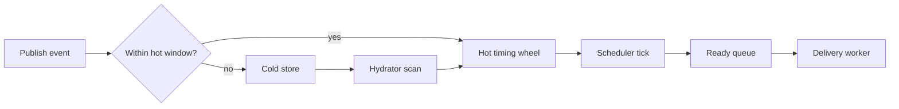

# Scheduler and Timing Wheel Architecture

## Purpose

The scheduler controls when events become deliverable, using a hot timing wheel and cold store hydration under a node-wide payload budget.

## Key Files

- [internal/scheduler/scheduler.go](../../../internal/scheduler/scheduler.go)
- [internal/scheduler/timing_wheel.go](../../../internal/scheduler/timing_wheel.go)
- [internal/scheduler/cold_store.go](../../../internal/scheduler/cold_store.go)

## Main Flow

1. Publish path schedules events by schedule timestamp.
2. Near-future events live in hot timing wheel slots.
3. Far-future events and payloads over the memory budget are staged as references in the cold store.
4. Hydrator moves due-near events into hot wheel.
5. Ready events are emitted to the worker queue.

## Production Decisions

- Hierarchical wheel gives near O(1) scheduling behavior.
- Defaults: **`-tick-ms=10`**, **`-wheel-size=600`** (6s root span); hot window default 60 minutes.
- Adaptive hydrator interval (5s–5min) manages cold-store scan pressure.
- `--scheduler-memory` defaults to 64 MiB across all partitions (minimum 32 MiB). Payloads, metadata and timer/accounting overhead count toward this budget. It excludes worker queues, Pebble caches and temporary WAL read buffers, so it is not an RSS limit.
- Hydration scans at most 1,024 references per pass, with WAL payload reads serialized across partitions. Within a partition, earlier work can evict later timers back to disk. Draining ready events wakes hydration.
- `--hot-window-minutes=0` disables time-based cold routing; budget overflow still uses cold references.
- **Crash recovery:** restore `timer_state.json` when present and rebase `currentTick` from the wall clock. `replayWALTimers` then walks the retained log from its first offset and schedules only the events that are not due yet. A replicated partition does this when its node becomes leader, not at start. Events that came due while the node was down are not queued: they stay in the log, and a subscription reads what its group has not finished from the log when it starts, at the pace its consumers take it (`redriveRetained` in `internal/api/handlers.go`). Nothing is dropped, and the backlog is not loaded into memory at start.
- Ready-queue and wheel size admission limits reject publish under overload (`ResourceExhausted`).

## Debug Pointers

- Delayed or early trigger issues: [internal/scheduler/timing_wheel.go](../../../internal/scheduler/timing_wheel.go)
- Hydration lag / recovery: [internal/scheduler/scheduler.go](../../../internal/scheduler/scheduler.go)
- Partition WAL timer replay: [internal/partition/manager.go](../../../internal/partition/manager.go)

## Diagrams

### Scheduler hot-cold path

### Related diagrams

- [Publish flow](api.md#publish-flow)
