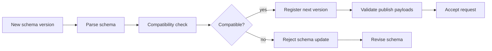

# Schema Registry Architecture

## Purpose

Schema module provides topic schema registration and compatibility checks to reduce unsafe payload evolution.

## Key Files

- [internal/schema/registry.go](../../../internal/schema/registry.go)
- [internal/schema/compatibility.go](../../../internal/schema/compatibility.go)
- [internal/schema/json_schema.go](../../../internal/schema/json_schema.go)
- [internal/schema/avro.go](../../../internal/schema/avro.go)
- [internal/schema/protobuf.go](../../../internal/schema/protobuf.go)
- [internal/api/admin_handler.go](../../../internal/api/admin_handler.go) — `ListSchemas`, `GetSchema`.

## Main Flow

1. Schemas are registered per topic and version (library call `Registry.Register`; see "What the server exposes").
2. Compatibility mode validates proposed changes. The default mode is `BACKWARD`; `NONE`, `FORWARD` and `FULL` also exist.
3. `Publish` and `PublishBatch` call `Registry.Validate` on the latest schema of the event's topic. A topic with no schema accepts every payload. Unknown schema types are refused. A refused payload fails with `schema validation failed: ...`.

## What the server exposes

- The shipped server only reads the registry. It loads `<data-dir>/schemas/<topic>_v<N>.json` once at startup, and no RPC, flag or command registers a schema, so the registry is normally empty and every payload is accepted. Register through the Go package or place the version files before starting the node.
- Unreadable or malformed schema files, unknown types, missing required envelope
  fields and duplicate topic versions fail startup. A failed reload preserves
  the previous in-memory registry. Keep the same schema files on every node;
  configuration distribution is the operator's responsibility.
- `AdminService.ListSchemas` (topic, latest version, compatibility mode) and `GetSchema` (one version of a topic; version 0 is the latest, `NotFound` when absent) are read-only and require global `"admin": true` when auth is enabled. The dashboard and `cronos-admin admin schema-list` / `schema-get` call them.
- Compatibility modes are held in memory only and nothing in the server sets one, so `ListSchemas` reports `BACKWARD` for every topic.

## What JSON validation enforces

`validateJSONSchema` (a deliberately small subset) enforces:

- `type`, as a single string: `object`, `array`, `string`, `number`, `integer`, `boolean`, `null`. An unknown type name, or a `type` that is an array of names, is not checked.
- `properties`, only when `type` is `object`: each property present in the payload is validated against its schema. Absent properties are not an error here.
- `required`, only when `type` is `object`: every listed name must be present, otherwise `missing required property "<name>"`. A schema that lists `required` without `"type": "object"` does not enforce it. Presence is all that is checked; a `null` value counts as present.
- `items`, only when `type` is `array`: every element is validated against the one `items` schema (not the tuple form).

Not enforced and silently ignored: `enum`, `const`, `pattern`, `format`, `minimum`/`maximum`, `minLength`/`maxLength`, `minItems`/`maxItems`, `additionalProperties`, `oneOf`/`anyOf`/`allOf`, `$ref`. `required` has been enforced since v0.11.0; before that it was accepted and ignored. Avro payloads must decode against the schema. Protobuf validation covers the well-known `Timestamp`, `Duration`, `Any` and `Struct` types; any other message needs a descriptor, and the dynamic path currently returns an error unless the descriptor's file is registered in the process-wide protobuf registry, so such payloads are refused.

## Production Decisions

- Separate compatibility logic supports policy upgrades without handler rewrites.
- Versioned registry behavior prevents destructive schema drift.
- Multiple schema formats support mixed integration environments.

## Debug Pointers

- Registration failures: [internal/schema/registry.go](../../../internal/schema/registry.go)
- Compatibility rejections: [internal/schema/compatibility.go](../../../internal/schema/compatibility.go)

## Diagrams

### Schema validation

### Related diagrams

- [Publish flow](api.md#publish-flow)
