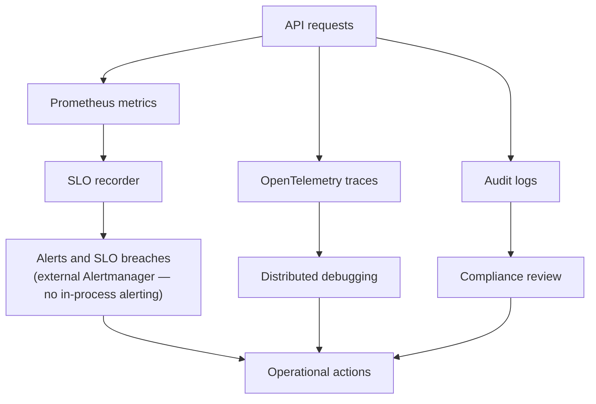

# SLO and Metrics Architecture

## Purpose

SLO module records service health signals such as latency and error rate and exposes them for operational decisions.

## Key Files

- [internal/slo/slo.go](../../../internal/slo/slo.go)
- [internal/api/metrics.go](../../../internal/api/metrics.go)
- [internal/api/grpc_server.go](../../../internal/api/grpc_server.go)
- [cmd/api/main.go](../../../cmd/api/main.go)

## Main Flow

1. SLO recorder is initialized at startup.
2. Interceptor records request latency and error outcome.
3. Prometheus collectors expose time-windowed SLO and module metrics.
4. Stats loop updates low-frequency gauges and cluster counters.

## Production Decisions

- SLO recorder uses bounded windows to avoid unbounded memory: a fixed-bucket latency histogram (100 us to 10 s) that `Reset` clears every minute, with targets fixed in `cmd/api/main.go` (p99 at most 500 ms, error rate at most 0.1%); there is no flag to change them. Percentiles are bucket upper bounds, and the gauges report them in whole milliseconds, so a sub-millisecond p99 reads 0.
- The recorder is exported as `cronos_slo_p99_latency_ms`, `cronos_slo_p95_latency_ms`, `cronos_slo_error_rate` and `cronos_slo_compliant` (1 = within target). Only `p99` and the error rate decide compliance; `p95` is exported but has no target.
- **Only with authentication on.** The SLO, metrics and IP rate-limit interceptors are installed only when `--auth-enabled` is set; without it (including `--dev` without auth) the SLO gauges stay at zero and read as compliant (`NewGRPCServer` in `internal/api/grpc_server.go`).
- A unary call counts as an error when it returns an error or a response whose `success` is false. A stream (`Subscribe`, `Ack`, `Replay`) is one sample whose latency is the whole stream's duration, so long-lived streams land in the top buckets.
- Metrics collection is integrated into request path and background loops.
- Nothing in the process acts on the SLO: no scaling and no alerting. `internal/cluster/autoscaler.go` only logs warnings, and alerts come from an external Alertmanager.

## Debug Pointers

- Latency and error measurements: [internal/slo/slo.go](../../../internal/slo/slo.go)
- Metric names and labels: [internal/api/metrics.go](../../../internal/api/metrics.go)

## Diagrams

### Observability feedback loop

### Related diagrams

- [System overview](../README.md#system-overview)
