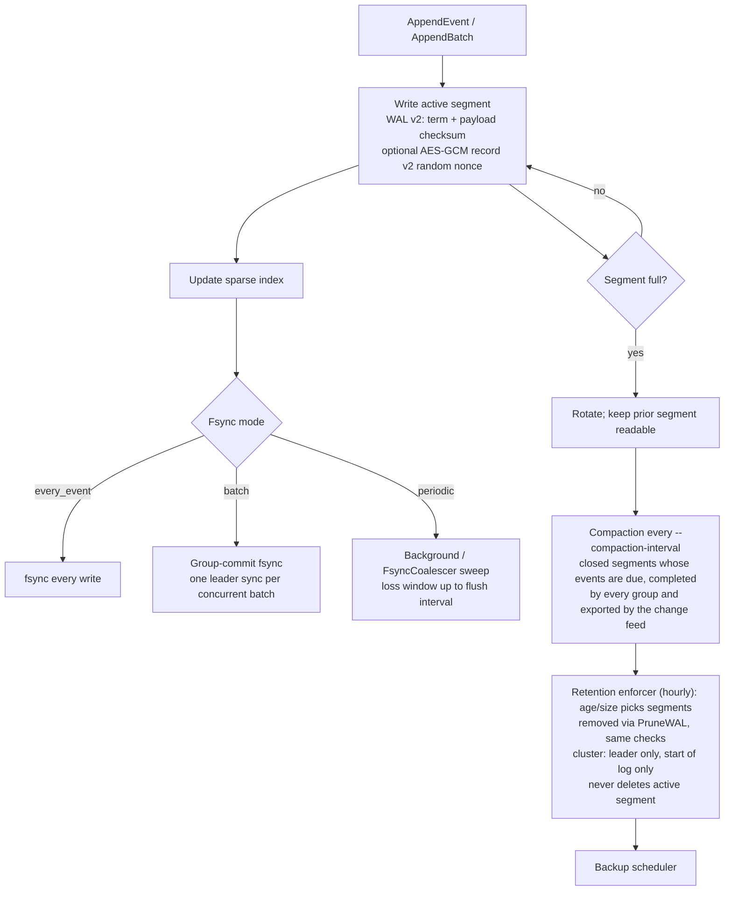

# Storage and WAL Architecture

## Purpose

Storage module provides durable append-only event persistence with indexed reads, compaction, backup, and optional encryption.

## Key Files

- [internal/storage/wal.go](../../../internal/storage/wal.go) — segmented WAL, append/replay/recovery. A follower's snapshot install goes through `WAL.InstallCheckpoint` (journaled swap of the staged log; see [replication.md](replication.md#bulk-install-snapshot)).
- [internal/storage/retention.go](../../../internal/storage/retention.go) — `WAL.Prune`: removes closed segments whose events are all due and accepted by the caller's check.
- [internal/partition/retention.go](../../../internal/partition/retention.go) — `Partition.PruneWAL`, the one path by which compaction, retention and operator pruning remove segments; `FollowLogStart` on followers.
- [internal/storage/segment.go](../../../internal/storage/segment.go), [internal/storage/mmap_unix.go](../../../internal/storage/mmap_unix.go), [internal/storage/mmap_windows.go](../../../internal/storage/mmap_windows.go) — segment file format and platform mmap shims.
- [internal/storage/index.go](../../../internal/storage/index.go) — sparse index for O(log N) seeks.
- [internal/storage/fsync_coalescer.go](../../../internal/storage/fsync_coalescer.go) — shared periodic flusher for many WALs (used with `periodic` / background flush; **not** the same as `batch` group-commit).
- [internal/storage/backup_scheduler.go](../../../internal/storage/backup_scheduler.go) — periodic backup scheduler loop.
- [internal/storage/backup.go](../../../internal/storage/backup.go) — backup manifest / restore primitives (distinct from the scheduler).
- [internal/storage/crypto.go](../../../internal/storage/crypto.go) — AES-256-GCM at rest; **record cipher v2** embeds a random 12-byte nonce per record (v1 counter nonce is decrypt-only).

## Main Flow

1. Append assigns offsets and writes WAL v2 records (8-byte Raft term + 4-byte payload checksum) to the active segment.
2. Sparse index tracks offsets for read and replay efficiency.
3. Durability depends on fsync mode:
   - `every_event` — fsync each write
   - `batch` (default) — **group-commit** fsync (concurrent writers share one sync)
   - `periodic` — background / coalescer flush with a bounded loss window
4. Segment rotation keeps prior segments **readable**; compaction and retention reclaim space.
5. The backup scheduler periodically checkpoints every partition, including
   the active segment. A checkpoint pauses appends only while it notes where
   each file ends; the bytes are copied while appends continue. A backup cuts
   the logs of all partitions at one instant and starts at wall-clock
   multiples of the interval, so every node of a cluster takes its backup at
   the same moment.

## Production Decisions

- WAL records use format v2: each record carries an 8-byte Raft term and a 4-byte payload checksum (written immediately after the payload, before metadata). Upgrading from older builds requires a clean `--data-dir`.
- CRC checks protect record integrity; critical metadata uses `utils.AtomicWriteFile`.
- Default fsync mode is `batch`.
- Encryption at rest v2 uses random GCM nonces to avoid cross-segment keystream reuse; v1 remains readable for migration.
- Segment-level compaction supports retention and admin operations; retention never deletes the active segment and removes matching `.index` files.
- **Every record a log takes can be read back.** A record's length field may say at most 10 MiB (`storage.MaxRecordLength`); readers and recovery take a larger length for damage. An event is therefore taken only if its record, metadata included, is at most `storage.MaxEventRecordSize`, 64 bytes less, which leaves room for encryption, so encrypted and plaintext replicas take the same events. Publishes check this before they claim the message ID (`storage.CheckEventSize`), and the log checks it again. Up to v0.6.0 a publish limited only the payload, to 4 MiB, and an event with a lot of metadata could be acknowledged and then not be read.
- **The term of an entry is the log's.** An entry a log appends for itself (a publish, a cross-region event, a split, a transaction) is stored under the log's current term, whatever term the event carried; only a follower stores the term its leader sent. Elections and the matching of logs rely on terms saying which leader wrote an entry. Up to v0.6.0 a producer could put any term in an event and have it stored and replicated.
- **A failed write stops the log, and the node.** After a write or fsync of a segment fails, nothing says what the disk holds: a failed fsync may drop the pages it did not write, so a later fsync that succeeds proves nothing about them. The log then takes no more appends (`storage.ErrLogFailed`), a follower whose log failed acknowledges nothing, and the node shuts down and exits with status 1, so that it is restarted, reads its logs again from disk, and other replicas lead its partitions meanwhile. An append reports whether its events reached the log (`storage.EventsAppended`): a publish whose events did is held for its retry to finish, as when replication fails, and only one whose events did not gives its message IDs back. Up to v0.6.0 every append error gave them back, so a retry could append the same event a second time, and background flush errors were only counted.
- **A segment that cannot be started does not fail an append.** Rotation happens after the append that filled the segment, which is complete by then. If the new segment cannot be made, the full one takes the next append, which tries again; `cronos_wal_rotation_errors_total` counts the failures.
- **Opening a log reads each segment once**, record by record, checking every CRC. It used to read each segment a second time to verify it, the whole segment into memory at once, so starting a node took as much memory as its largest segment (512 MiB by default).
- **Publishes stop before the disk is full.** When the filesystem holding `--data-dir` is `--max-disk-usage` full (default 95%), publishes are refused with `RESOURCE_EXHAUSTED` until it is two points below; deliveries, acknowledgements, replication and retention go on. `cronos_disk_publish_refused` is 1 meanwhile. Usage is sampled every 2 seconds, so a publish costs one atomic load.
- **A segment holds a write buffer only while it is written through one.** An unencrypted segment is written through its mapping and has none. An encrypted segment is written through a 4 MiB buffer, which is made on its first append and released when the segment stops taking appends. Every segment used to get the buffer when it was created or opened and keep it, so a node held 4 MiB of heap for each segment of its logs.
- **Bytes that are not valid records** mean different things in different places, and the log treats them accordingly when it opens ([wal.go](../../../internal/storage/wal.go), `judgeInvalidTails`):
  - *At the end of the log* they are what a crash leaves behind: a write that did not finish. The log ends before them, a warning says so, and they are overwritten with zeros. In the `batch` and `every_event` fsync modes nothing that was acknowledged can lie there.
  - *Anywhere else*, inside a segment that later segments follow, they are damage: segments are closed complete, so records were there. The partition refuses to open and the error names the segment, the byte and the offsets that cannot be read. Opening used to take such bytes for the end of the segment and carry on without the events behind them.
  - Repair depends on whether the partition has other replicas. **In a cluster**, stop the node and remove the partition's directory (`partitions/<id>`): the node rejoins the partition with nothing and the leader fills it again; nothing is lost. **Without another replica**, restore a backup (`cronos-admin restore`), or run `cronos-admin check-log --data-dir <dir> --partition <id> --repair` with the node stopped, which cuts the damaged segment after its last valid record and reports the offsets it gives up. `cronos-admin check-log --data-dir <dir>` alone only reports.
- **What may go.** A closed segment is removed when every event in it is due, at least one consumer group takes it, every group that does has finished it, and the change feed has exported it. An event no group takes is kept. A pass runs every `--compaction-interval` (default 10 minutes), reads segments without the lock appends take, and asks about one event at a time, so it holds up neither publishes nor acknowledgements.
- **In a cluster only the start of the log is removed**, by the partition's leader ([retention.go](../../../internal/partition/retention.go)). Replicas are compared, caught up and elected by where a log ends, which means something only while everything before the end is there, so the log has to stay one unbroken range: a pass stops at the first segment that has to stay. One event that cannot go yet, such as one scheduled far ahead, therefore keeps every later segment too. The other replicas follow the leader ([replication.md](replication.md#log-start)). A partition with a single replica removes any finished segment, wherever it is.
- **Retention by age and size** (`--retention-max-age-hours`, `--retention-max-size-gb`) runs hourly ([compliance/retention.go](../../../internal/compliance/retention.go)). It only picks segments; each is removed through `PartitionManager.RemoveRetainedSegment` → `Partition.PruneWAL`, with the same checks as compaction. In a cluster a replica that does not lead the partition removes nothing, and the leader removes only from the start of the log.
- **Consumer progress follows the log.** What lies below the start of a log was finished before it was removed, so it counts as complete for every group, including one created later, and each group's completion floor is raised to the start. That also discards the per-event completion records below it.

## Debug Pointers

- Write/read/offset issues: [internal/storage/wal.go](../../../internal/storage/wal.go)
- Segment boundaries and rotation: [internal/storage/segment.go](../../../internal/storage/segment.go)
- Backup behavior: [internal/storage/backup_scheduler.go](../../../internal/storage/backup_scheduler.go)

## Diagrams

### WAL lifecycle

### Related diagrams

- [Publish flow](api.md#publish-flow)
