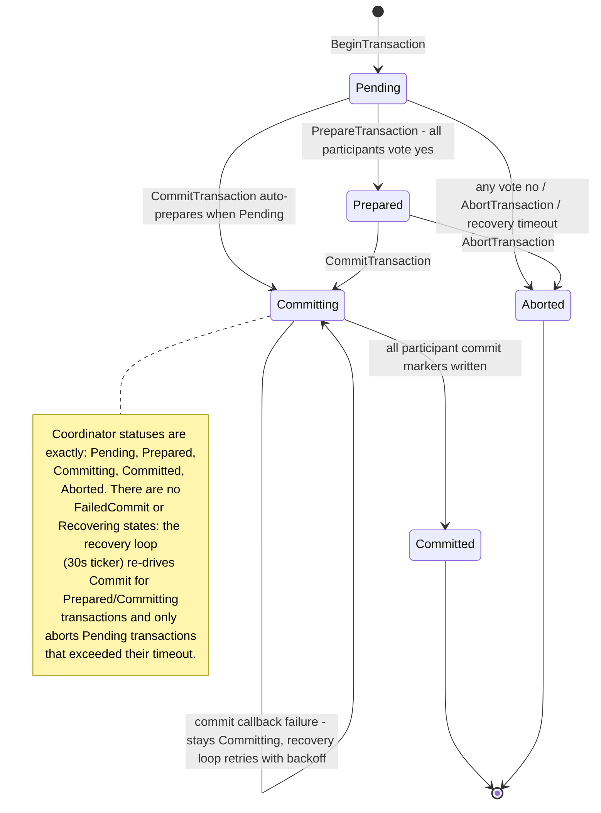

# Transactions (2PC) Architecture

> **Experimental. Not supported in production.** Transactions are disabled by
> default. The `TransactionService` is registered only when the server runs
> with `--dev --experimental-features`; without `--dev`,
> `--experimental-features` is refused at start ("transactions, online
> splitting and cross-region replication are not supported in production",
> `internal/config/config.go`). Nothing on this page is a supported guarantee.

## Purpose

The transaction module is an experimental two-phase commit coordinator: it
runs prepare and commit phases across partition participants.

## Key Files

- [internal/tx/coordinator.go](../../../internal/tx/coordinator.go)
- [internal/tx/transaction_handler.go](../../../internal/tx/transaction_handler.go)
- [proto/events.proto](../../../proto/events.proto)

## Main Flow

1. Transaction request enters transaction service handler.
2. Coordinator Prepare path executes phase-1 state transition and participant checks.
3. Commit path applies phase-2 commit operations from prepared state.
4. Recovery path replays durable transaction log on restart.

## Design of the Experimental Implementation

These describe what the code does. They are not tested or supported as
guarantees.

- Prepare and commit are separate phases.
- State transitions are written to `tx_log.json` in the data directory, so the
  coordinator can find in-flight transactions after a restart.
- `tx.NewHandler(pm)` gives the coordinator the **PartitionManager**, so
  Begin/Prepare/Commit write to real partitions. `cmd/api/main.go` creates it
  only with `--experimental-features`.
- A recovery loop (every 30 s) re-drives Commit for Prepared and Committing
  transactions and aborts Pending ones past their timeout. Whether this holds
  up across crashes, failovers and replicated partitions has not been
  verified.

## Debug Pointers

- State transition bugs: [internal/tx/coordinator.go](../../../internal/tx/coordinator.go)
- RPC mapping and validation: [internal/tx/transaction_handler.go](../../../internal/tx/transaction_handler.go)

## Diagrams

### Transaction state machine

### Related diagrams

- [System overview](../README.md#system-overview)
